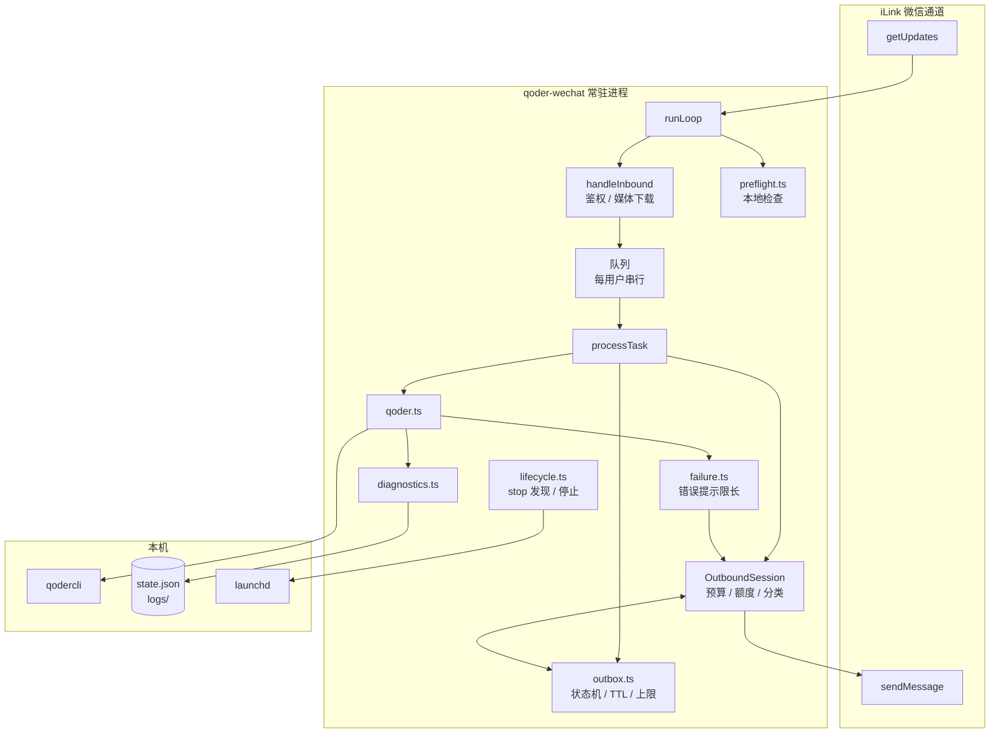
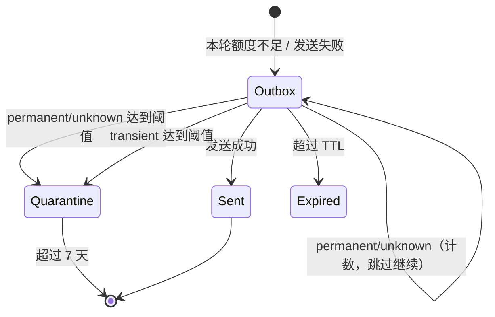
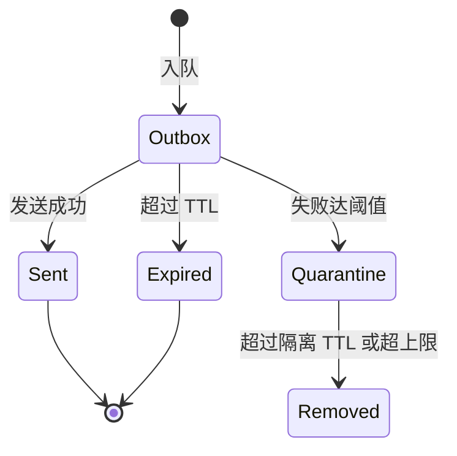

# 【后端技术文档】桥接稳定性优化

> 状态：已实现并验收 ｜ 更新：2026-11-03
> 需求基线：[requirements.md](./requirements.md)（2026-11-03 已确认）
> 规范目录：`.specs/20261103_桥接稳定性优化/`
> 开发分支：`feat/20261103-bridge-stability`
> 关联事故：2026-11-03 补发队列堵塞

## 生成 AI 概要

- 生成模型：Qoder Desktop Agent 当前会话模型（会话未暴露底层型号，不作推测）
- 生成方式：由 `jojo-specs` 技能按“需求 → 设计”阶段生成
- 设计输入：`requirements.md` + 现有代码（`src/bridge/service.ts`、`src/bridge/qoder.ts`、`src/bridge/lifecycle.ts`、`src/weixin/client.ts`、`src/config.ts`）

---

## 1. 需求背景

### 1.1 为什么要做

2026-11-03 的事故不是一个孤立的 bug，而是三个缺陷叠加：

1. `qodercli` 崩溃后，`runQoder` 把 261KB stderr 原样放进 `result.error`，`service.ts` 又把它当回复切了 122 条；
2. 补发循环遇到第一条发送失败就 `break`，后面的正常消息永远轮不到；
3. `ret=-2` 被当成普通发送失败，既没有停止本轮，也没有和“内容失败”区分。

结果是：一条坏消息 + 一次额度耗尽 = 整个队列永久堵塞，用户一条正常消息都收不到。

本期聚焦事故直接根因和低成本运维加固。

### 1.2 高层方案与理由

| 设计决策 | 做法 | 理由 / 权衡 |
| --- | --- | --- |
| 出站统一入口 | 新增 `OutboundSession`，所有出站（补发、通知、命令回复、任务结果、错误提示）走同一套预算 / 额度 / 失败分类逻辑 | 现在发送点分散在 `processTask`、`deliver`、`notify`，每处对 `ret=-2` 的理解都不同。统一入口后，“额度耗尽停本轮、永久失败跳过、瞬时失败停本轮”只实现一次 |
| 发送错误类型化 | `weixin/client.ts` 不再抛裸 `Error`，改为抛 `BridgeSendError`，携带 `kind / ret / errcode / httpStatus` | 字符串匹配（现在的 `msg.includes('-14')`）既脆弱又会误判。类型化后状态机可以直接 switch |
| 队列状态机独立 | 新增 `bridge/outbox.ts`，把“发送结果 → 队列动作”做成纯函数，持久化仍由 service 负责 | 毒丸隔离、TTL、上限这些规则最容易写错，独立成纯模块才能用单测穷举状态迁移 |
| 异常输出双层限长 | `runQoder` 内部把完整诊断落盘（≤64KB），只返回 ≤300 字的用户提示；service 对错误提示强制单条发送、不再分片 | 从源头切断“stderr 变成回复”的路径，而不是在分片层打补丁 |
| 补发队列有界 | outbox 上限 200 条 + TTL 24 小时 + 隔离区上限/TTL；清理时优先丢最旧 | 事故中 108 条垃圾在 40 分钟内堆满；上限/TTL 是便宜的保险，避免状态文件无限增长 |
| 预检只告警 | 启动检查 Node ≥20、qodercli 可执行与版本；失败写结构化日志 + 最多一条短告警，不阻止任务处理 | 事故发生在服务运行中，启动检查拦不住；任务失败由需求 2 的短错误兜底 |
| stop 保持打印命令 | launchd 托管时打印精确的 `launchctl bootout` 命令、恢复命令和手动兜底命令，退出码 2；手动实例发信号并验证 | 保留 0.1.1 已文档化的契约，避免 `bootout` 卸载 KeepAlive 任务后用户不知如何恢复；退出码 2 让脚本能识别“没停成” |
| 多实例只报告 | 发现多个桥接进程/多个 launchd label 时列出全部并报告冲突，不自动全部停止 | 多实例互斥属 v2；自动停全部有误杀风险。本期满足需求 6.5 的“明确报告冲突”分支 |

### 1.3 技术栈

- Node.js ≥ 20（`engines` 已有约束），TypeScript 5.6，ESM，现有 `cross-spawn` 保持。
- 不新增运行时依赖。
- 新增开发依赖：`vitest`（单测）、`@vitest/coverage-v8`（覆盖率）、`fast-check`（outbox 状态机属性测试）。
- 集成测试使用本地 HTTP 假 iLink 服务 + 假 qodercli 脚本，不触碰真实微信通道。

---

## 2. 相关文档 & 资源

| **资源** | **描述** |
| --- | --- |
| 需求文档 | [.specs/20261103_桥接稳定性优化/requirements.md](./requirements.md) |
| 设计稿地址 | 无 |
| 页面地址 | 无 |
| 接口文档地址 | 无（iLink 无官方文档，契约以现有 `src/weixin/types.ts` 与实测为准） |
| 第三方服务/SDK 文档 | Qoder CLI headless（本机 `qodercli --help`）；iLink 通道（社区实测） |
| 测试冒烟用例地址 | 无（本次在 `test/` 内新增，见第 8 节） |
| Redmine 任务管理 | 无（个人项目） |
| UI | 无（CLI 文本输出 + 微信文本消息） |
| 前端 | 无 |
| 后端 | joke_yao |
| 测试 | joke_yao |
| 产品 | joke_yao |

---

## 3. UI

无图形界面。用户可见交互只有两类，规范见 5.1 与第 7 节：

1. 微信内的回复文本（正常结果、命令回复、错误提示）；
2. `qoder-wechat status` / `stop` 的终端输出。

---

## 4. 架构

### 4.1 组件关系



### 4.2 数据流

**入站**

1. `getUpdates` 拿到消息；
2. `handleInbound` 按 `message_id` 去重、鉴权；
3. 下载媒体、拼接 prompt、挂到该用户的串行队列；
4. `processTask` 先吸收 `pending-notifications.jsonl`，再按时间顺序补发 outbox，最后执行命令或任务。

**出站**

1. 所有出站文本进入 `OutboundSession`；
2. 正常回复沿用现有 `chunkText` 按字符数分片；错误提示强制单条；
3. 每次发送结果由 `classifySendError` 归类；
4. 额度 → 保留并停止本轮；瞬时 → 保留并停止本轮；永久 / 未知 → 计数，跳过继续，达到阈值移入隔离区；成功 → 删除并记账；
5. 需要延迟的消息写入 outbox，并在每次入站、启动时执行 TTL / 上限清理。

### 4.3 外部集成与部署

- **qodercli**：通过 `cross-spawn` 以 `-p -o json` 调用；本次新增诊断落盘和错误分类，不改变参数契约。
- **iLink**：只发文本；错误码语义以现有实测为准（`-2` 额度 / 上下文失效，`-14` 会话过期）。
- **launchd**：只读 `launchctl list` / `launchctl print` 做发现；不自动 `bootout`。
- **部署拓扑**：单机单进程；`state.json` 是唯一写者（service），CLI 命令只读；`pending-notifications.jsonl` 由 CLI 追加、service 重命名消费。

---

## 5. 方案设计

### 5.0 关键默认值与决策

| 配置项 | 默认值 | 说明 |
| --- | --- | --- |
| `maxReplyChars` | `2000` | 保持现状 |
| `poisonMaxAttempts` | `3` | 连续非额度、非瞬时失败达到 3 次移入隔离区 |
| `transientMaxAttempts` | `10` | 瞬时失败跨窗口累计 10 次才隔离，避免网络抖动误杀 |
| `outboxMaxItems` | `200` | 超出后丢弃最旧消息 |
| `outboxTtlMs` | `24h` | 与 `context_token` 时效对齐 |
| `quarantineMaxItems` | `500` | 隔离区上限，避免无限增长 |
| `quarantineTtlMs` | `7d` | 隔离区过期删除 |
| `userErrorMaxChars` | `300` | 单条错误提示上限 |
| `diagnosticMaxBytes` | `65536` | 单次失败诊断落盘上限 |
| `diagnosticRetentionDays` | `7` | 诊断文件保留天数 |
| `preflightVersionTimeoutMs` | `5000` | `qodercli --version` 超时 |

> 所有配置都支持 `QWB_*` 环境变量覆盖，与现有配置体系一致。

### 5.1 组件与接口

#### 5.1.1 `src/weixin/errors.ts`（新增）

**目的**：把 HTTP / 业务错误码转成桥接层可判定的错误类型。

**职责**：只做分类，不决定队列动作。

**接口契约**

```ts
/** 发送失败的语义分类 */
export type SendFailureKind = 'quota' | 'session_expired' | 'transient' | 'permanent' | 'unknown';

/** 发送失败错误，携带原始错误码 */
export class BridgeSendError extends Error {
  readonly kind: SendFailureKind;
  readonly ret?: number;
  readonly errcode?: number;
  readonly httpStatus?: number;
}

/**
 * 把未知异常归类为发送失败
 * @param err - 原始异常
 * @returns 带分类的错误
 */
export function classifySendError(err: unknown): BridgeSendError;
```

**分类规则**

| 来源 | kind |
| --- | --- |
| `ret === -2`（`CONTEXT_INVALID_RET`） | `quota` |
| `ret === -14` 或 `errcode === -14` | `session_expired` |
| HTTP 401 / 403 | `session_expired` |
| HTTP 429 | `quota` |
| HTTP 408 / 5xx / `TimeoutError` / `AbortError` / `TypeError`（fetch 网络错误） | `transient` |
| HTTP 400 / 413 / 422 | `permanent` |
| 其它非零 `ret` / `errcode` | `unknown` |
| 无法识别 | `unknown` |

**依赖**：`weixin/client.ts` 在 HTTP 层抛出带 `status` 的 `HttpError`，`sendItem` 负责转换。

**设计理由**：`ret=-2` 必须和内容错误彻底分开；`unknown` 单独保留，便于日志观察未知错误码，而不是被误当成 `permanent` 静默隔离。

#### 5.1.2 `src/weixin/client.ts`（修改）

**变更点**

- `postJson` / `getJson` 的 HTTP 失败改为抛 `HttpError(status, body)`（内部类型，不导出）。
- `sendItem` 把回执映射为 `BridgeSendError`：

```ts
if (resp.ret === CONTEXT_INVALID_RET) throw new BridgeSendError('下行额度耗尽', 'quota', { ret: resp.ret });
if (resp.ret === SESSION_EXPIRED_ERRCODE) throw new BridgeSendError('微信会话过期', 'session_expired', { ret: resp.ret });
if (resp.ret && resp.ret !== 0) throw new BridgeSendError('未知业务错误', 'unknown', { ret: resp.ret });
if (resp.errcode && resp.errcode !== 0) { /* 同上按 errcode 映射 */ }
```

- 现有 `SESSION_EXPIRED_ERRCODE` / `CONTEXT_INVALID_RET` 常量保留导出。
- `sendText` 签名不变，返回 `SendMessageResp`（含 `message_id`）。

**职责边界**：不重试、不写 outbox、不决定是否隔离。

#### 5.1.3 `src/bridge/outbox.ts`（新增）

**目的**：把补发队列的状态迁移做成可穷举测试的纯逻辑。

**职责**

- 决定每条消息发送后：删除 / 保留 / 隔离；
- 执行 TTL、条数上限、隔离区上限清理；
- 维护“下一轮从哪里继续”的预算与停止原因；
- 不直接读文件、不发网络请求。

**接口契约**

```ts
/** 单条消息的发送结果 */
export type DeliveryOutcome =
  | { kind: 'sent'; messageId?: string }
  | { kind: 'quota' }
  | { kind: 'session_expired' }
  | { kind: 'transient'; reason: string }
  | { kind: 'permanent'; reason: string }
  | { kind: 'unknown'; reason: string };

/** 队列策略，全部来自 Config */
export interface OutboxPolicy {
  maxItems: number;
  ttlMs: number;
  poisonMaxAttempts: number;
  transientMaxAttempts: number;
  quarantineMaxItems: number;
  quarantineTtlMs: number;
  now: () => number;
}

/** 一轮补发的结果 */
export interface FlushResult {
  /** 未发送 / 未处理的消息，保持原顺序 */
  remaining: OutboxItem[];
  /** 本轮新隔离的消息 */
  quarantined: QuarantineItem[];
  sent: number;
  budgetLeft: number;
  stopReason: 'done' | 'budget' | 'quota' | 'session_expired' | 'transient';
}

/**
 * 按顺序补发某个用户的消息
 * @param items - 该用户的消息快照（按 createdAt 升序）
 * @param budget - 本轮剩余额度
 * @param send - 实际发送函数
 */
export async function flushOutbox(input: {
  items: OutboxItem[];
  budget: number;
  policy: OutboxPolicy;
  send: (item: OutboxItem) => Promise<DeliveryOutcome>;
}): Promise<FlushResult>;

/** 入队并在超限时丢弃最旧消息 */
export function pushOutbox(state: State, item: OutboxItem, policy: OutboxPolicy): { dropped: OutboxItem[] };

/** 过期 + 超限清理，返回被删除的消息用于日志 */
export function pruneOutbox(state: State, policy: OutboxPolicy): {
  expired: OutboxItem[];
  dropped: OutboxItem[];
  quarantineExpired: QuarantineItem[];
  quarantineDropped: QuarantineItem[];
};

/** 把消息移入隔离区（调用方负责持久化） */
export function quarantineItem(state: State, item: OutboxItem, reason: string, policy: OutboxPolicy): QuarantineItem;
```

**状态机**



**关键规则**

1. `quota`：不增加任何失败计数，立即停止本轮，保留当前及后续消息；
2. `session_expired`：不计数，停止本轮并触发服务停止；
3. `transient`：`transientFailures += 1`，停止本轮（网络大概率不可用）；达到 `transientMaxAttempts` 则隔离并继续；
4. `permanent` / `unknown`：`failures += 1`，**不停止本轮**，继续尝试下一条；达到 `poisonMaxAttempts` 后隔离；
5. `sent`：从队列删除，失败计数随消息一起丢弃；
6. 任何清理都返回被删除项，由 service 写日志。

**设计理由**：永久失败在达到阈值前也跳过，能避免“阈值 3 次 × 每次入站间隔”造成的分钟级堵塞；代价是该条消息可能被后面的消息“超车”，这是“先保证送达”的显式取舍。**瞬时失败不超车**，保持严格顺序。

#### 5.1.4 `src/bridge/failure.ts`（新增）

**目的**：把 qodercli 的失败类别转成一条 ≤300 字的用户提示。

**接口契约**

```ts
/** qodercli 失败类别 */
export type QoderErrorKind = 'timeout' | 'spawn' | 'empty' | 'parse' | 'exit' | 'is_error';

/**
 * 生成单条用户可读错误提示
 * @param input - 失败类别、退出码、可选原始错误文本
 * @returns 不超过 userErrorMaxChars 的单行提示
 */
export function buildUserErrorReply(input: {
  kind: QoderErrorKind;
  exitCode?: number | null;
  detail?: string;
  timeoutMs?: number;
  maxChars: number;
}): string;
```

**提示模板**

| kind | 模板 |
| --- | --- |
| `timeout` | `执行失败：任务超过 {N} 秒被终止。详见本机日志。` |
| `spawn` | `执行失败：无法启动 qodercli（{短原因}）。请检查 QWB_QODER_BIN，详见本机日志。` |
| `empty` | `执行失败：qodercli 没有任何输出（退出码 {code}）。详见本机日志。` |
| `parse` | `执行失败：qodercli 输出无法解析（退出码 {code}）。详见本机日志。` |
| `exit` | `执行失败：qodercli 异常退出（退出码 {code}）。详见本机日志。` |
| `is_error` | `执行失败：{错误首行，最多 200 字}（退出码 {code}）` |

**规则**

- 所有模板结果统一走 `truncateGraphemes(text, maxChars)`，并为“…详见本机日志。”预留长度；
- 错误提示永远是单条，不参与 `chunkText`；
- 错误提示不写入 outbox 的正文来源，只作为一条 `kind='error'` 的消息入队（如果当前窗口发不出去）；
- 不包含 stdout/stderr 原文。

> 说明：`truncateGraphemes` 只用于错误提示的安全截断。

#### 5.1.5 `src/diagnostics.ts`（新增）

**目的**：保存单次失败的完整诊断，供本机排查。

**接口契约**

```ts
export interface DiagnosticInput {
  taskId: string;
  sessionId?: string;
  kind: QoderErrorKind | 'send';
  exitCode?: number | null;
  durationMs?: number;
  stdout: string;
  stderr: string;
}

/**
 * 写一份诊断文件
 * @returns 文件路径与写入字节数；写失败时 path 为空
 */
export function writeDiagnostic(input: DiagnosticInput): { path: string; bytes: number };

/** 按保留天数清理诊断目录 */
export function pruneDiagnostics(retentionDays: number, now?: number): number;

/** 脱敏：token、Bearer、cookie、secret、sk-* */
export function redactSensitive(text: string): string;
```

**存储规则**

- 路径：`$STATE_DIR/logs/diagnostics/YYYY-MM-DD/{ts}-{taskId}.log`；
- 目录 `0700`，文件 `0600`；
- 总大小 ≤64KB：先写元信息头，剩余空间按 stdout / stderr 动态分配（一方为空时另一方拿满）；
- 截断处写入 `…[truncated N bytes]`；
- 写入前执行 `redactSensitive`；
- 写失败只记 warn，不影响主流程。

**选择独立文件而非 JSONL 的理由**：单条诊断可能到 64KB，混进按行读取的 `bridge-*.jsonl` 会破坏日志工具的行解析；独立文件也便于按 taskId 定位和过期清理。

#### 5.1.6 `src/bridge/qoder.ts`（修改）

**变更点**

```ts
export interface QoderRunInput {
  // 现有字段保持不变
  taskId: string;          // 新增：用于诊断文件关联
  diagnosticDir?: string;  // 新增：测试可注入
}

export interface QoderRunResult {
  ok: boolean;
  text: string;
  sessionId?: string;
  modelUsed?: string;
  errorKind?: QoderErrorKind;   // 新增
  error?: string;               // 改为 <=300 字的短提示
  exitCode?: number | null;     // 新增
  diagnosticPath?: string;      // 新增
  durationMs: number;
}
```

**失败处理顺序（`finalize`）**

1. `killedByTimeout` → `timeout`，不读取子进程输出作为回复；
2. `child.on('error')` → `spawn`；
3. `stdout` 与 `stderr` 都为空 → `empty`；
4. 无法解析 `result` → `parse`；
5. 退出码非 0 → `exit`（即使解析出了 result 也按失败处理）；
6. `is_error=true` → `is_error`；
7. 以上失败都先调用 `writeDiagnostic`，再返回短错误。

**输出缓冲**

- stdout/stderr 各按 **字节** 累计，上限 5MB（现有 5MB 上限保留，但改为字节判定）；
- 解析时先尝试整段（仅当 ≤1MB），否则只尝试最后 200 行，避免对 5MB 源码逐行 `JSON.parse`。

**不修改的部分**：`parseResult` 的匹配规则保持不变。

#### 5.1.7 `src/bridge/preflight.ts`（新增，仅本地检查）

**目的**：启动时尽早发现 Node / qodercli 环境异常。

**接口契约**

```ts
export interface PreflightResult {
  ok: boolean;
  node: { version: string; major: number; execPath: string; ino: number; mtimeMs: number };
  qodercli: { path: string; version: string } | null;
  failures: Array<{ kind: 'node_version' | 'qoder_missing' | 'qoder_version'; detail: string }>;
}

export async function runPreflight(input: {
  qoderBin: string;
  versionTimeoutMs: number;
  now?: () => number;
}): Promise<PreflightResult>;

/** 记录 Node 二进制指纹，用于运行期变化检测 */
export function nodeFingerprint(): { path: string; ino: number; mtimeMs: number; version: string };

/** 检测到 Node 指纹变化时返回原因 */
export function detectNodeChange(
  prev: ReturnType<typeof nodeFingerprint>,
  next: ReturnType<typeof nodeFingerprint>,
): string | null;
```

**检查项**

1. Node 主版本 ≥ 20（不满足记 `node_version`）；
2. `process.execPath` 可 stat，记录 `ino / mtimeMs / realpath`；
3. qodercli 解析：绝对路径做 `X_OK` 检查，否则用 `which`（Windows `where`）；
4. `qodercli --version`，超时 `preflightVersionTimeoutMs`；
5. 启动日志记录 Node 路径 / 版本、qodercli 路径 / 版本。

**失败行为（告警式）**

- 所有失败都写结构化 error 日志；
- 若存在有效 `contextTokens[ownerUserId]`，最多发送一条短告警（单条、≤300 字）；没有则只写日志；
- **不阻止服务启动、不阻止任务处理**；任务失败由需求 2 的短错误兜底。

**运行期 Node 变化检测**

- 启动时保存一次 `nodeFingerprint()`；
- 每条任务执行前重新 stat 一次（成本极低）；路径 / inode / 版本变化时写 warn，更新快照，不自动重启。

#### 5.1.8 `src/bridge/lifecycle.ts`（修改）

**目的**：让 `stop` 不依赖可能失效的 `run.json`。

**接口契约**

```ts
export interface BridgeProcess {
  pid: number;
  command: string;
}

export type StopDecision =
  | { kind: 'idle'; message: string }
  | { kind: 'signal'; pids: number[]; extra: BridgeProcess[]; staleRunInfo?: number }
  | { kind: 'supervised'; supervised: Array<{ pid: number; label: string; domain: string; command: string }>; extra: BridgeProcess[] }
  | { kind: 'conflict'; processes: BridgeProcess[]; detail: string };

/** 纯决策函数，便于单测 */
export function planStop(input: {
  runInfo: RunInfo | null;
  runInfoAlive: boolean;
  runInfoIsBridge: boolean;
  processes: BridgeProcess[];
  launchd: Array<{ pid: number; label: string; domain: string }>;
}): StopDecision;

/** 列出命令行匹配桥接 run 的进程 */
export function listBridgeProcesses(): BridgeProcess[];

/** 校验 pid 是否真的是桥接 run 进程 */
export function isBridgeProcess(pid: number): boolean;

/** 查找 launchd 中的桥接服务（不依赖 run.json） */
export function findLaunchdServices(): Array<{ pid: number; label: string; domain: string }>;

export async function stopService(waitMs?: number): Promise<StopOutcome>;
```

**进程匹配规则**

按命令行首段（真正的 argv）匹配，而不是在整串里搜子串；同时排除 shell 包装命令：

```ts
function isBridgeCommand(command: string): boolean {
  const tokens = command.trim().split(/\s+/);
  const executable = basename(tokens[0] ?? '');
  if (SHELL_NAMES.has(executable)) return false;          // zsh/bash -c "... node dist/cli.js run ..."
  if (executable === 'qoder-wechat') return tokens[1] === 'run';
  if (executable === 'node') {
    const script = basename(tokens[1] ?? '');
    return (script === 'qoder-wechat' || script === 'cli.js') && tokens[2] === 'run';
  }
  return false;
}
```

同时排除 `stop` / `status` 自身，避免 `qoder-wechat stop` 把当前 CLI 进程匹配进来。0.2.0 真机验收发现：如果直接在整串里搜 `node dist/cli.js run`，执行 `stop` 的 shell 包装命令行会被误判成第二个实例；因此改为按 argv 首段匹配并加回归用例。

**执行流程**

1. 读 `run.json`，验证 pid 存活且命令行匹配；
2. `listBridgeProcesses()` 扫描补充（macOS/Linux `ps -axo pid=,command=`；Windows 跳过，仅用 run.json）；
3. 若 run.json 失效：清理记录，继续扫描；
4. `findLaunchdServices()`：
   - 先按 pid 匹配 `launchctl list`；
   - run.json 缺失时，按标签关键词（`qoder` + `wechat|bridge`）列出候选，再用 `launchctl print gui/<uid>/<label>` 确认；
5. 决策：
   - 无进程、无 launchd → `idle`，不删除任何无关状态；
   - 只有一个手动实例 → 发 `SIGTERM`，轮询等待；
   - launchd 实例 → **不自动 bootout**，打印 `launchctl bootout gui/<uid>/<label>`、验证命令、恢复命令和手动兜底命令，退出码 `2`；
   - 多个手动实例 / 多个 label / 混合场景 → 停止 run.json 验证过的主实例（若有），其余全部列为 `extra` 并打印精确 `kill -TERM` 命令，退出码 `2`，明确报告冲突；
6. 若发信号后仍有存活进程 → 退出码 `1`，说明 pid 与原因；
7. `EPERM` → 打印精确 `kill -TERM <pid>` 命令与失败原因，退出码 `2`。

**手动停止提示（你在评审中要求补充）**

launchd 场景输出：

```text
桥接服务由 launchd 托管（pid 12345，标签 com.example.qoder-wechat）

它会被 KeepAlive 重新拉起，请手动执行：
  launchctl bootout gui/501/com.example.qoder-wechat

验证是否已停止：
  launchctl print gui/501/com.example.qoder-wechat
  pgrep -fl "qoder-wechat run"

恢复自启：
  launchctl bootstrap gui/501 ~/Library/LaunchAgents/com.example.qoder-wechat.plist

兜底（bootout 不可用时，KeepAlive 可能重新拉起）：
  pkill -TERM -f "qoder-wechat run"
```

**stop 输出与退出码**

| 结果 | 输出 | 退出码 |
| --- | --- | --- |
| `idle` | 未运行 | 0 |
| `stopped` | 已停止 + 等待时长 | 0 |
| `timeout` | 仍在运行 + 再次 stop 提示 | 1 |
| `supervised` | bootout + 验证 + 恢复 + 兜底命令 | 2 |
| `conflict` | 冲突明细 + 每个 pid 的 `kill -TERM` 命令 | 2 |
| `EPERM` | 精确命令 + 原因 | 2 |

**设计理由**：保留“只打印命令”的契约；退出码非零让脚本和用户都能明确知道“服务没停”，同时给出可复制的手动操作。

#### 5.1.9 `src/bridge/service.ts`（重构）

**新增内部组件 `OutboundSession`**

```ts
class OutboundSession {
  budget: number;
  quotaExhausted: boolean;
  sessionExpired: boolean;
  sentCount: number;

  /** 发送一条原文（错误提示 / 命令回复），不经过分片 */
  sendSingle(text: string, opts: { kind: OutboxItem['kind']; queueOnFailure: boolean }): Promise<'sent' | 'queued' | 'skipped'>;

  /** 按现有字符分片发送正常回复 */
  sendChunked(text: string, opts: { kind: OutboxItem['kind']; taskId?: string }): Promise<{ sent: number; queued: number }>;

  /** 直接入队（预算不足或已判定额度耗尽） */
  enqueue(text: string, opts: { kind: OutboxItem['kind']; taskId?: string; failures?: number }): void;
}
```

**统一规则**

- 每次发送前检查 `budget` 与 `quotaExhausted`；任一不满足 → 入队，不发请求；
- 发送结果按 `classifySendError` 处理：
  - `quota` → `quotaExhausted = true`，当前消息入队，停止本轮；
  - `session_expired` → `sessionExpired = true`，当前消息入队，停服务；
  - `transient` → 当前消息入队，停止本轮；
  - `permanent` / `unknown` → 当前消息入队（`failures = 1`），停止本轮；
  - 成功 → `budget -= 1`，记录 `messageId / chars / bytes`；
- `sendChunked` 采用“当前分片失败 → 当前及后续全部分片按顺序入队”的策略，避免缺片乱序；
- 错误提示使用 `sendSingle`，永远单条。

**`processTask` 新流程**

```
processTask(userId, text, contextToken, attachments, taskId)
  1. TypingKeeper.start()
  2. ingestPendingNotices()：把 pending-notifications 全部入 outbox（按 createdAt 排序）
  3. pruneOutbox()：TTL / 上限清理，写日志
  4. flushOutboxForUser()：余额内按顺序补发；命中 quota / transient 则停止
  5. 内置命令 / 模型切换：走 OutboundSession.sendSingle()
  6. runQoder()：失败 → buildUserErrorReply() + sendSingle()
  7. 成功 → sendChunked(result.text)
  8. finally：runningTasks.delete / typing.stop()
```

**顺序保证**

- `ingestPendingNotices` 后对 `state.outbox` 按 `createdAt` 稳定排序；
- 补发严格按排序后的顺序处理；
- 新任务结果的片段在补发之后入队，保证“旧消息优先”。

**额度告警**

- `state.quota.streak`：本轮命中 `ret=-2` 则 +1；本轮有成功发送则归零；
- `streak >= 2` 时每次入站写 warn，并在 `/status` 与 `status` 中展示；
- 不因额度问题删除、隔离或增加失败计数。

**启动流程**

```
ensureDirs()
pruneDiagnostics(diagnosticRetentionDays)
loadConfig / loadState / normalizeState
pruneOutbox()
runPreflight() → 失败时写 error 日志 + 最多一条短告警，继续启动
若未登录 → login()
writeRunInfo()
notifyClient(start)
runLoop()
```

**预检告警**

- 只发送一次，使用 `state.contextTokens[ownerUserId]`；
- 发送失败只记 warn，不重试、不入 outbox；
- 不改变服务运行状态。

#### 5.1.10 `src/config.ts`（修改）

**新增配置字段**

| 字段 | 类型 | 默认值 | 环境变量 |
| --- | --- | --- | --- |
| `outboxMaxItems` | `number` | `200` | `QWB_OUTBOX_MAX` |
| `outboxTtlMs` | `number` | `86_400_000` | `QWB_OUTBOX_TTL_MS` |
| `poisonMaxAttempts` | `number` | `3` | `QWB_POISON_ATTEMPTS` |
| `transientMaxAttempts` | `number` | `10` | `QWB_TRANSIENT_ATTEMPTS` |
| `quarantineMaxItems` | `number` | `500` | `QWB_QUARANTINE_MAX` |
| `quarantineTtlMs` | `number` | `604_800_000` | `QWB_QUARANTINE_TTL_MS` |
| `userErrorMaxChars` | `number` | `300` | `QWB_USER_ERROR_CHARS` |
| `diagnosticMaxBytes` | `number` | `65_536` | `QWB_DIAG_MAX_BYTES` |
| `diagnosticRetentionDays` | `number` | `7` | `QWB_DIAG_RETENTION_DAYS` |
| `preflightVersionTimeoutMs` | `number` | `5_000` | `QWB_PREFLIGHT_VERSION_TIMEOUT_MS` |

**新增状态字段**

见 5.2。`loadState` 增加 `normalizeState`，兼容旧 `attempts` 字段。

#### 5.1.11 `src/cli.ts`（修改）

- `printStatus()` 增加：outbox 总数、最旧年龄、总字节、隔离区数量、额度连续告警。
- `stop` 按 5.1.8 的退出码与手动提示输出。
- `--help` 中补充 outbox / 诊断相关 `QWB_*` 配置说明。
- 不新增 `queue` 命令（隔离区手动恢复见第 13 节）。

#### 5.1.12 `src/notify.ts`（修改）

- 保持现有 `chunkText` 字符分片；
- `takePending` 消费时丢弃超过 `outboxTtlMs` 的提醒，并写日志；
- 送入 outbox 的提醒统一走 `pushOutbox`，受条数上限约束。

---

### 5.2 数据模型

#### 5.2.1 配置

见 5.1.10。配置优先级保持：命令行参数 > 环境变量 `QWB_*` > 配置文件 > 默认值。

#### 5.2.2 状态 `state.json`（version 2）

```json
{
  "version": 2,
  "getUpdatesBuf": "...",
  "sessions": {
    "user-id": { "sessionId": "...", "updatedAt": 1793700000000, "turns": 3 }
  },
  "outbox": [
    {
      "id": "1793700000000-ab12cd",
      "toUserId": "user-id",
      "text": "片段正文",
      "kind": "reply",
      "createdAt": 1793700000000,
      "bytes": 1830,
      "failures": 0,
      "transientFailures": 0,
      "taskId": "m3k2-9f1a"
    }
  ],
  "quarantine": [
    {
      "id": "1793600000000-zz99yy",
      "toUserId": "user-id",
      "text": "坏消息正文",
      "kind": "reply",
      "createdAt": 1793600000000,
      "bytes": 2100,
      "failures": 3,
      "transientFailures": 0,
      "taskId": "m3k1-11ab",
      "quarantinedAt": 1793600180000,
      "reason": "permanent",
      "preview": "坏消息正文前 120 字…"
    }
  ],
  "quota": { "streak": 2, "lastAt": 1793700000000 },
  "seenMessageIds": ["..."],
  "models": {},
  "contextTokens": { "user-id": "..." }
}
```

#### 5.2.3 实体说明

**OutboxItem**

| 字段 | 类型 | 说明 |
| --- | --- | --- |
| `id` | `string` | `${Date.now()}-${random}` |
| `toUserId` | `string` | 目标微信用户 |
| `text` | `string` | 已分片后的单条正文 |
| `kind` | `'reply' \| 'notice' \| 'error'` | 正常结果 / 主动提醒 / 错误提示 |
| `createdAt` | `number` | 创建时间（毫秒） |
| `bytes` | `number` | UTF-8 字节数，入队时计算（用于日志与 status） |
| `failures` | `number` | 永久 / 未知失败次数 |
| `transientFailures` | `number` | 瞬时失败次数 |
| `lastErrorKind` | `SendFailureKind?` | 最近一次失败类别 |
| `lastErrorAt` | `number?` | 最近一次失败时间 |
| `taskId` | `string?` | 关联任务，便于日志串联 |

**QuarantineItem**：`OutboxItem` + `quarantinedAt` / `reason` / `preview`（120 字内，脱敏）。

**State 新字段**

| 字段 | 说明 |
| --- | --- |
| `version` | 状态版本，本次为 `2` |
| `quarantine` | 隔离区，持久化，重启后不回到 outbox |
| `quota` | `{ streak, lastAt }`，用于连续额度告警 |

#### 5.2.4 状态迁移与生命周期



- **Outbox → Sent**：删除，失败计数一并丢弃；
- **Outbox → Quarantine**：保留原 id、正文、失败次数、错误类别，追加隔离时间、原因、预览；
- **Outbox → Expired**：超过 `outboxTtlMs`，删除并记录 id + 年龄；
- **Quarantine → Removed**：超过 `quarantineTtlMs` 或 `quarantineMaxItems`，删除并记录；
- **重启**：`loadState` 后 `normalizeState`，隔离区保持在隔离区，不参与补发。

#### 5.2.5 校验与持久化

- `state.json` 仍用 `writeAtomic`（临时文件 + rename），权限 `0600`，目录 `0700`；
- 每次队列变更后持久化；条数上限 200 时单次写入 <1MB，满足有界内存；
- 旧状态迁移：`attempts` → `failures`，缺失的 `bytes` / `kind` / `taskId` 补默认值；
- `loadState` 解析失败：保留原文件不覆盖，记录 warn，使用默认状态启动（下次保存前用户仍可从原文件恢复）。

---

## 6. 正确性属性

### 正确性属性 1：坏消息不阻塞队列

_For any_ outbox 与任意发送结果序列，若某条消息发生永久 / 未知失败，系统 SHALL 在当前轮继续尝试其后的消息，并在非额度失败达到 `poisonMaxAttempts` 时将其移入隔离区。

**验证需求：需求 1.1、1.3**

### 正确性属性 2：隔离区持久且不自动回流

_For any_ 重启次数与启动时的 outbox 内容，已隔离消息 SHALL 始终保留在隔离区，SHALL NOT 出现在 outbox 或自动重试。

**验证需求：需求 1.2、1.4**

### 正确性属性 3：成功即清账

_For any_ 消息，若其发送成功，系统 SHALL 从 outbox 删除该消息，并 SHALL 丢弃其失败计数。

**验证需求：需求 1.5**

### 正确性属性 4：空队列静默

_If_ outbox 为空，补发流程 SHALL 产生 0 次发送调用，且 SHALL NOT 写 warn / error 日志。

**验证需求：需求 1.6**

### 正确性属性 5：异常输出永不直达用户

_For any_ qodercli 的 stdout / stderr（任意大小与内容），失败时系统 SHALL 最多发送一条不超过 `userErrorMaxChars` 的用户提示，且 SHALL NOT 把原始输出写入 outbox 或作为微信回复。

**验证需求：需求 2.1、2.3、2.4**

### 正确性属性 6：诊断有界且可关联

_For any_ 失败，诊断文件 SHALL 不超过 `diagnosticMaxBytes`，权限 SHALL 为 `0600`，且 SHALL 包含 `taskId` / `sessionId`（若存在）。

**验证需求：需求 2.2、N4**

### 正确性属性 7：空输出与超时只发一条

_If_ qodercli 无输出或超时，系统 SHALL 发送恰好一条短提示，SHALL NOT 发送空消息或子进程原始输出。

**验证需求：需求 2.6、2.7**

### 正确性属性 8：额度错误不计数、不删消息

_When_ 发送返回 `ret=-2`，系统 SHALL 将其归类为额度耗尽，SHALL NOT 增加失败计数、删除或隔离消息，并 SHALL 停止本轮且保留剩余消息顺序。

**验证需求：需求 3.1、3.2、3.4、3.6**

### 正确性属性 9：下一窗口优先补发

_For any_ 因额度保留的消息集合，下一次授权入站时系统 SHALL 在预算内按原顺序优先补发这些消息，再发送本轮新结果。

**验证需求：需求 3.3**

### 正确性属性 10：额度告警不丢消息

_For any_ 连续多个入站窗口出现 `ret=-2`，系统 SHALL 在日志与 `status` 中告警，且 SHALL NOT 丢弃任何消息。

**验证需求：需求 3.5**

### 正确性属性 11：队列有界

_After any_ 入队、清理、补发操作，outbox 条数 SHALL ≤ `outboxMaxItems`，且 SHALL NOT 存在年龄超过 `outboxTtlMs` 的消息。

**验证需求：需求 5.1、5.2**

### 正确性属性 12：清理优先保留新消息

_When_ 因超限需要丢弃，系统 SHALL 优先丢弃最旧的消息，保留最近创建的消息。

**验证需求：需求 5.3**

### 正确性属性 13：清理可追溯

_For any_ 过期、超限或隔离清理，系统 SHALL 记录被删除消息的数量、原因与摘要，SHALL NOT 静默丢弃。

**验证需求：需求 5.6、5.7**

### 正确性属性 14：stop 不依赖 run.json

_For any_ 缺失或失效的 `run.json`，只要存在 launchd 托管的桥接服务或匹配的桥接进程，`stop` SHALL 发现并处理；_If_ 两者都不存在，SHALL 报告“未运行”且不删除无关状态。

**验证需求：需求 6.1、6.4**

### 正确性属性 15：stop 结果可验证

_After_ 对非 launchd 实例发出停止信号，若仍有桥接进程存活，`stop` SHALL 返回非零退出码并说明原因；launchd 实例 SHALL 打印精确 bootout / 验证 / 恢复 / 兜底命令，并以非零码说明“未停止”。

**验证需求：需求 6.2、6.3、6.6**

### 正确性属性 16：多实例不静默处理

_When_ 存在多个桥接进程或多个 launchd label，`stop` SHALL 明确报告冲突并列出全部实例及其精确停止命令，SHALL NOT 静默只处理一个。

**验证需求：需求 6.5**

### 正确性属性 17：预检失败不产生垃圾

_If_ 启动预检失败，系统 SHALL 记录结构化错误，SHALL 最多发送一条短告警，且 SHALL NOT 因预检本身向 outbox 写入任何消息。

**验证需求：需求 8.2、8.5**

### 正确性属性 18：Node 变化可观测

_When_ 运行期间 Node 二进制的路径、inode 或版本发生变化，系统 SHALL 记录 warning，且 SHALL NOT 自动重启。

**验证需求：需求 8.4**

---

## 7. 错误处理

### 7.1 发送错误

| 触发 | 分类 | 失败计数 | 本轮动作 | 下一轮 |
| --- | --- | --- | --- | --- |
| `ret=-2` | `quota` | 不增加 | 当前及剩余消息入队，停止 | 新窗口优先补发 |
| `ret=-14` / `errcode=-14` | `session_expired` | 不增加 | 入队，停止服务 | 重新 `login` 后恢复 |
| HTTP 401 / 403 | `session_expired` | 不增加 | 同上 | 同上 |
| HTTP 429 | `quota` | 不增加 | 同额度 | 新窗口重试 |
| HTTP 408 / 5xx / 网络 / 超时 | `transient` | `transientFailures += 1` | 入队，停止本轮 | 达 10 次隔离 |
| HTTP 400 / 413 / 422 | `permanent` | `failures += 1` | 入队 / 跳过继续 | 达 3 次隔离 |
| 其它非零 `ret` / `errcode` | `unknown` | `failures += 1` | 跳过继续 | 达 3 次隔离，日志保留原始码 |

**部分失败**：分片发送时若第 N 片失败，当前及后续片段整体按顺序入队，不发送“缺片”的结果；下一窗口从第 N 片继续。

### 7.2 qodercli 错误

| 触发 | 诊断 | 用户可见 | 是否进入 outbox |
| --- | --- | --- | --- |
| 超时被杀 | 已捕获的 stdout/stderr | 单条超时提示 | 是（单条，失败时） |
| 子进程无法启动 | 启动错误信息 | 单条“无法启动”提示 | 是 |
| stdout 与 stderr 都为空 | 元信息 | 单条“无输出”提示 | 是 |
| 输出无法解析 | 原始输出（≤64KB） | 单条“输出无法解析”提示 | 是 |
| 退出码非 0 | 原始输出（≤64KB） | 单条“异常退出（退出码 N）” | 是 |
| `is_error=true` | result + 原始输出 | 单条“错误首行 + 退出码” | 是 |
| 用户 `/stop` | 无 | “任务已停止。” | 否 |

> “进入 outbox”指当前窗口发不出去时才入队；错误提示本身仍是一条，不会分片。

### 7.3 状态与磁盘

| 场景 | 处理 |
| --- | --- |
| `state.json` 解析失败 | 记录 warn，保留原文件，使用默认状态启动；下次保存前原文件仍可人工恢复 |
| `saveState` 失败（磁盘满 / 权限） | 记录 error，内存状态继续运行；重启后可能丢失最近变更，日志中明确提示 |
| 诊断文件写入失败 | 记录 warn，仍发送短错误提示 |
| 队列清理失败 | 记录 error，不阻塞入站处理 |
| 并发写 | 单进程写 `state.json`；CLI 只读；`pending-notifications.jsonl` 用 rename 消费，保持现状 |

### 7.4 启动预检

| 场景 | 处理 |
| --- | --- |
| Node < 20 | 记 `node_version`，写 error 日志；有 token 时发一条短告警；继续启动 |
| qodercli 不存在 / 不可执行 | 记 `qoder_missing`，写 error 日志；提示检查 `QWB_QODER_BIN`；继续启动 |
| `qodercli --version` 超时 / 失败 | 记 `qoder_version`，写 error 日志；继续启动 |
| 无有效 `context_token` | 只写日志，不阻塞启动 |
| Node 指纹变化 | 写 warn（路径 / inode / 版本），更新快照，不重启 |

**说明**：预检失败不阻止任务处理；此时任务会在 `runQoder` 阶段失败，并按需求 2 的规则只回一条短提示，不产生垃圾队列。

### 7.5 stop

| 场景 | 处理 |
| --- | --- |
| 无 run.json，无进程，无 launchd | 报告未运行，退出码 0 |
| run.json pid 不存在 / 不是桥接进程 | 清理该记录，继续扫描 |
| 单个手动实例 | 发 SIGTERM；退出则成功，否则退出码 1 |
| 多个手动实例 | 停止 run.json 验证过的主实例（若有），其余列出并打印 `kill -TERM` 命令，退出码 2，报告冲突 |
| launchd 托管 | 打印 bootout + 验证 + 恢复 + 兜底命令，退出码 2 |
| 混合托管 + 手动 | 停止手动主实例，打印托管命令与其余实例命令，退出码 2 |
| 权限不足（EPERM） | 打印精确 `kill -TERM <pid>` / bootout 命令与原因，退出码 2 |
| Windows | 仅按 run.json 处理；无 launchd 分支 |

### 7.6 其他

- **时钟回拨**：TTL 判定使用 `now - createdAt > ttlMs`；回拨时最多延迟清理，不会误删未来消息；负年龄在日志中按 0 处理。
- **outbox 排序**：按 `createdAt` 稳定排序；同毫秒消息保持入队顺序。

---

## 8. 测试策略

### 8.1 基础设施

- 新增 `vitest` + `@vitest/coverage-v8` + `fast-check` 开发依赖；
- `package.json` 增加 `"test": "vitest run"`、`"test:watch": "vitest"`、`"test:coverage": "vitest run --coverage"`；
- 测试目录：`test/unit/`、`test/integration/`；
- 单测编写统一委托 `unit-test` skill，覆盖本次新增或触达的 `.ts` 文件，Lines 覆盖率 ≥ 95%；
- CI / 本地均不调用真实微信通道。

### 8.2 单元测试矩阵

| 模块 | 用例重点 |
| --- | --- |
| `bridge/outbox.ts` | quota 不计数且停本轮、permanent 跳过继续、阈值隔离、transient 停本轮 / 高阈值隔离、成功删除、TTL、条数上限、隔离区上限、顺序保持、空队列静默 |
| `bridge/failure.ts` | 每个 kind 的模板、300 字截断、保留“详见本机日志”、不包含原始输出 |
| `diagnostics.ts` | 64KB 上限、stdout / stderr 动态分配、脱敏、0600 权限、过期清理 |
| `weixin/errors.ts` | `-2` / `-14` / 401 / 403 / 408 / 429 / 400 / 413 / 5xx / 网络错误 / 未知 ret |
| `weixin/client.ts` | 回执映射、HTTP 错误映射、`sendText` 返回值 |
| `bridge/qoder.ts` | 输出缓冲字节上限、`parseResult`、失败分类、诊断调用 |
| `bridge/lifecycle.ts` | `planStop` 全矩阵：无记录、失效 pid、非桥接 pid、单实例、多实例、launchd、混合、冲突 |
| `bridge/preflight.ts` | Node 版本、qodercli 缺失、版本超时、Node 指纹变化 |
| `config.ts` | 新字段默认值、环境变量覆盖、旧状态 `attempts` 迁移、损坏状态回退 |

### 8.3 属性测试

使用 `fast-check` 覆盖 outbox 状态机：

| 属性 | 生成器 |
| --- | --- |
| 1、2、3、8、9、11、12 | 随机消息序列 + 随机发送结果序列（含 quota / permanent / transient / 成功） |

断言：隔离后不回流、额度不计数、队列有界、最旧优先丢弃、顺序保持。

### 8.4 集成测试

使用本地 HTTP 假 iLink 服务（`baseUrl` 已可配置）和假 qodercli 脚本：

| 场景 | 断言 |
| --- | --- |
| 261KB stderr + 退出码 1 | 用户只收到 1 条 ≤300 字提示；outbox 为空；诊断文件 ≤64KB 且含 taskId |
| 第一条永久失败、后两条正常 | 后两条在本轮送达；第一条在 3 轮后进入隔离区 |
| 连续 `ret=-2` | 消息全部保留、顺序不变；下一窗口全部补发；`status` 显示连续告警 |
| `ret=-14` | 服务停止循环，消息保留 |
| 过期 / 超限 | outbox 条数 ≤ 上限；最旧被删；日志含摘要 |
| 重启 | 隔离区仍在隔离区；outbox 顺序不变 |
| 预检失败 | 只写日志 + 最多一条短告警；任务仍可执行并按需求 2 返回短错误 |

### 8.5 手工验收（真实通道，仅本机）

1. launchd 托管下执行 `qoder-wechat stop`，确认打印 bootout / 验证 / 恢复 / 兜底命令，退出码 2，进程仍在；
2. 手工执行打印的 bootout 命令，确认服务停止；
3. 制造一次 qodercli 失败（临时把 `QWB_QODER_BIN` 指向不存在路径），确认只收到一条短提示；
4. 查看 `status` 的 outbox / 隔离区 / 额度告警字段；
5. 重启服务，确认隔离区数量不变、隔离消息不再补发。

### 8.6 性能

- outbox 200 条、单条 4KB 时，`saveState` 单次 <50ms（本机 SSD 实测）；
- 补发 / 清理均为 O(n)，n ≤ 200；
- 诊断文件按天分目录，启动时按 mtime 清理；
- 预检只做一次 stat + 一次 `--version`，不影响启动时间（`--version` 超时 5 秒）。

---

## 9. 埋点逻辑

无外部埋点。使用现有 `log` 结构化日志，新增字段：

| 事件 | 字段 |
| --- | --- |
| 出站成功 | `messageId, taskId, category=sent, chars, bytes, attempts` |
| 额度耗尽 | `category=quota, ret, streak, remaining` |
| 瞬时失败 | `category=transient, reason, transientFailures` |
| 永久 / 未知失败 | `category=permanent\|unknown, reason, failures` |
| 隔离 | `messageId, reason, failures, preview(≤120 字)` |
| 清理 | `count, reason, ids, ages` |
| 预检 | `nodeVersion, nodePath, qoderPath, qoderVersion, failureKind, durationMs` |
| Node 变化 | `path, ino, mtimeMs, version` |

**禁止记录**：token、cookie、完整消息正文、用户隐私、环境变量值。错误日志中的预览截断到 120 字并脱敏。

---

## 10. 权限变更

- 不新增系统权限；
- 新增文件沿用 `0700` 目录 / `0600` 文件；
- `stop` 不自动执行 `launchctl bootout`，避免需要额外授权；
- 预检只做本地检查，不调用模型，不新增权限；
- Windows 不涉及权限模型变更。

---

## 11. 影响范围

### 11.1 文件清单

| 文件 | 类型 | 变更 |
| --- | --- | --- |
| `src/weixin/errors.ts` | 新增 | 发送错误类型与分类 |
| `src/weixin/client.ts` | 修改 | HTTP / 回执错误类型化 |
| `src/bridge/outbox.ts` | 新增 | 队列状态机、TTL、上限、隔离 |
| `src/bridge/failure.ts` | 新增 | qoder 失败 → 用户提示 |
| `src/bridge/qoder.ts` | 修改 | 诊断落盘、错误分类、输出缓冲字节上限 |
| `src/bridge/preflight.ts` | 新增 | 启动本地检查、Node 指纹 |
| `src/bridge/lifecycle.ts` | 修改 | stop 发现 / 决策 / 退出码 / 手动提示 |
| `src/bridge/service.ts` | 修改 | 出站统一入口、补发重构、预检告警、状态清理 |
| `src/diagnostics.ts` | 新增 | 诊断文件、脱敏、清理 |
| `src/config.ts` | 修改 | 新配置、状态 v2、迁移与归一化 |
| `src/cli.ts` | 修改 | status 字段、stop 退出码与提示 |
| `src/notify.ts` | 修改 | 过期提醒丢弃、入队走上限 |
| `src/index.ts` | 修改 | 导出新增公共 API / 类型 |
| `test/**` | 新增 | 单测、属性测试、集成测试、假服务 |
| `vitest.config.ts` | 新增 | 测试配置与覆盖率阈值 |
| `package.json` / `package-lock.json` | 修改 | 测试依赖与脚本、版本号 `0.2.0` |
| `README.md` / `RUNBOOK.md` | 修改 | 限制、配置、stop 行为、诊断路径、故障排查 |

### 11.2 功能影响

| 功能 | 影响 |
| --- | --- |
| 正常文本对话 | 行为不变 |
| 图片 / 文件 / 视频 | 行为不变 |
| `/help` `/status` `/reset` `/model` `/stop` | 行为不变；回复统一走预算与额度处理 |
| `notify` | 过期提醒在消费时丢弃；入队受 outbox 上限约束 |
| `status` | 新增队列 / 隔离 / 额度字段 |
| `stop` | 新增进程扫描与 launchd 发现；launchd 场景退出码改为 2；多实例报告冲突 |
| `run` | 启动预检（告警式）、诊断清理 |
| 状态文件 | v1 → v2 自动迁移；`attempts` 保留为兼容读取 |
| 库 API | `QoderRunInput` 新增必填 `taskId`（破坏性）；`OutboxItem` 字段扩展 |

### 11.3 文档同步

- README：已知限制（outbox 上限 / TTL、隔离区）、配置表、stop 退出码与手动命令、故障排查；
- RUNBOOK：`ret=-2` 分类、诊断目录、stop 矩阵、`status` 字段、隔离区手动恢复；
- `qoder-wechat-plugin` 的 skill 文档是否需要同步 stop 契约：待确认（见第 13 节）。

---

## 12. 项目发布说明

### 12.1 相关记录

| **事项** | **内容** | **备注** |
| --- | --- | --- |
| package.json 是否变更 | 是 | 新增 devDependencies：`vitest`、`@vitest/coverage-v8`、`fast-check`；新增 `test` 脚本；版本预设 `0.2.0` |
| 是否需要上传权限 | 否 | 无 |
| 涉及的前端服务 | 无 | CLI / 常驻进程 |
| 涉及后端服务 | 无 | 单机进程 |
| 运维配置 | 发布后配置 | launchd plist 不变；如需调整队列阈值，使用 `QWB_OUTBOX_*` / `QWB_POISON_ATTEMPTS` 等 |
| 其它第三方依赖说明 | 无新增运行时依赖 | 无 |
| 审核 | joke_yao | 个人项目 |

> 版本说明：`0.1.1` 尚未发布；本改动包含状态 schema 与 `stop` 退出码变化，预设为 `0.2.0`。

### 12.2 上线步骤执行流程

> 本表按项目实际情况调整：原模板中的 jojo 发布计划 / sentry 观察不适用，替换为本机日志观察。

| **步骤** | **内容** | **负责人** |
| --- | --- | --- |
| 确认（研发） | 1. 基于 `feat/20261103-bridge-stability` 合入最新 `main`<br>2. 确认变更点：出站状态机、错误限长、队列上限、stop、预检<br>3. 确认版本号与 tag | joke_yao |
| 复核 | 1. `npm run typecheck`<br>2. `npm test`（含覆盖率 ≥95%）<br>3. `npm run build`<br>4. `node scripts/check-publish.mjs` | joke_yao |
| 本机验证 & 观察 | 1. 用 launchd 重启服务，确认预检日志<br>2. 制造 qodercli 失败，确认只收到一条短提示<br>3. 观察 `logs/bridge-*.jsonl` 与 `logs/diagnostics/`<br>4. 确认 `status` 字段正确 | joke_yao |
| 收尾（研发） | 1. 合并至 `main`<br>2. `npm publish`（如需）<br>3. 更新 README / RUNBOOK 的已知限制 | joke_yao |

---

## 13. 待确认的开放问题

1. **默认阈值**：毒丸 3 次、outbox 200 条 / 24 小时、隔离区 500 条 / 7 天。如果你希望更激进（例如 1 次即隔离）或更宽松，设计评审时调整。
2. **隔离区运维命令**：本期只在 `status` 展示数量；手动恢复为停服后编辑 `state.json`。是否需要在下一迭代加 `qoder-wechat queue`？
3. **`stop` 的退出码**：launchd 托管时采用“打印命令 + 退出码 2（未停止）”，并补充 bootout / 验证 / 恢复 / 兜底命令。已按你的意见确认。
4. **多实例**：本期只报告冲突，不自动停止全部；自动停止/互斥留到 v2。
5. **`ret=0` 投递确认**：继续留在 v2。
6. **`stop` 契约同步**：是否需要同步修改 `qoder-wechat-plugin` 的 skill 文档与命令契约？

---

## 14. 验收记录（2026-11-03）

| 用例 | 结果 |
| --- | --- |
| 正常收发 | 1 条 18 字回复，outbox / 隔离区均为 0 |
| qodercli 不可执行 | `errorKind=spawn`，单条 80 字错误，诊断文件 150B |
| outbox 持久化与优先补发 | 606 字回复只发 1 段，10 条入队；重启后仍为 10 条；下一轮补 9 条剩 2 条；再发一条后归零 |
| stop | launchd 下打印 bootout 并返回 2；手动实例 603ms / 604ms 退出并返回 0 |
| 验收中修复 | `stop` 误把包含 `node dist/cli.js run` 的 shell 包装命令当成第二实例；改为按 argv 首段匹配并补回归用例 |

真实微信通道验收已通过；`npm run typecheck`、`npm run test:coverage`（214 tests，Lines 97.44%）、`npm run build`、`check-publish` 均通过。
