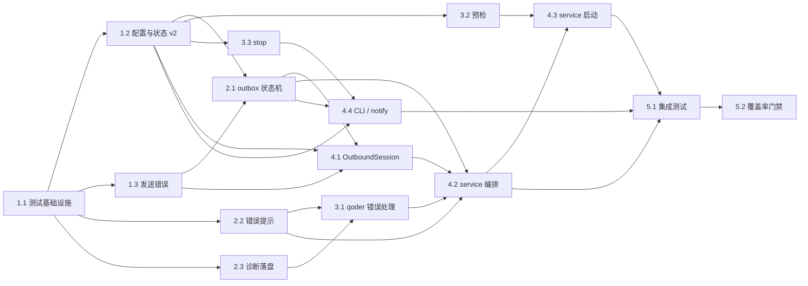

# 实现计划

> 执行约束（来自 jojo-specs workflow）：
>
> - 一次只实现一个任务；子任务存在时优先做子任务
> - 完成后立即更新本文档对应任务状态再停止，等待评审
> - 仅在用户明确要求时运行测试
> - 任务编号即为推荐执行顺序，按依赖关系自上而下递进
>
> **测试覆盖率约束：**
>
> - 本 feature 新增或被任务触达的 `src/` 中的 **.js**、**.ts** 源文件，单元测试 **Lines 覆盖率必须 ≥ 95%**
> - Statements / Functions / Branches 作为辅助指标，以 `unit-test` skill 的最新要求为准；未达辅助指标时需在风险点中说明原因与影响
> - **单测编写统一委托给 `unit-test` skill**：遵循其项目配置优先原则、命名规范（BDD 三层 `describe` + "应该 + 结果 + 当 + 条件" 句式）、Mock 复用规则、覆盖率红线、低价值测试禁令与最终交付格式；本 workflow 不重复定义用例规范
> - **前端**：覆盖全部 `.ts` / `.js` 业务文件
> - **后端（NestJS）**：仅强制覆盖 `repository` 与 `service`；`controller` / `module` / `entity` / `dto` 等默认走 E2E / 集成测试，不作为本 feature 覆盖率门禁范围
> - 验证口径：在 PR 说明里附上覆盖率验证命令与输出；Lines 未达 95% 须在对应单测任务里补齐用例后再关闭
>
> **提交约束：**
>
> - 每完成一个子任务（对应一个 [x] 的子任务条目）后，不自动执行 git commit；如需提交，必须由用户后续明确触发，并按 /Users/joke/.agents/skills/jojo-specs/references/phase-5-commit.md 执行
> - Commit 流程严格遵守 workflow 的所有步骤：收集改动 → 识别 type / scope → 生成 `type(scope): summary refs #issue-id` → 执行 `git commit`
> - `scope` 优先取本任务主要改动目录的模块名；如跨多个模块，取变动最大者
> - `issue-id` 取规范目录前缀 `20261103`；当前分支 `feat/20261103-bridge-stability` 不符合 `feature/<user>/<issue-id>` 约定，提交前需向用户确认最终 issue-id
> - 本规则**从第一个待执行任务起生效**
>
> **任务详情拆分约定：**
>
> - 本文档只保留任务状态、进度与索引；每个子任务的完整内容（目标 / 实现要点 / 引用 / 验证命令 / 验收 / 将写入）下钻到 `task-list/` 目录对应文件
> - 勾选 `[x]` / `[ ]` 状态仅在本文档维护；`task-list/` 文件内不再重复状态字段

---

## 概览

共 **5 个任务组 / 15 个子任务**。

执行顺序按“先纯逻辑、后编排、最后集成”组织：

1. **T1 测试与模型基础**：先搭 vitest / coverage / fast-check，再落配置与状态 v2、发送错误类型。后续所有任务都依赖这三块。
2. **T2 纯逻辑核心**：outbox 状态机、错误提示生成、诊断落盘。这三块不依赖网络和子进程，最容易用单测穷举，先做能最早锁定事故修复的正确性。
3. **T3 qodercli 与运维**：qoder 调用层错误分类、启动本地预检、stop 发现与决策。它们依赖 T2 的纯函数，但彼此文件独立。
4. **T4 服务编排**：OutboundSession、service 出站编排、启动流程、CLI / notify。4.2 与 4.3 都改 `service.ts`，必须严格串行。
5. **T5 集成与门禁**：假 iLink 服务 + 假 qodercli 跑事故回归，最后统一跑覆盖率与构建门禁。

关键拆分原则：

- 每个代码子任务都自带单测，单测统一委托 `unit-test` skill；不把测试集中到最后补。
- `service.ts` 的改造拆成“出站编排”和“启动流程”两个串行子任务，避免同一文件并行冲突。
- 文档同步（README / RUNBOOK）不在本任务清单内（按 jojo-specs 阶段约束排除），实现完成后由用户决定是否补。
- 手工真机验收不在本任务清单内；自动化集成测试覆盖事故场景。

## 执行顺序总览

任务采用**严格线性顺序**，编号即执行顺序。下表列出全部 15 个子任务与关键依赖、预期产出（点击“任务”列链接查看完整任务内容）：

| 顺序 | 任务 | 摘要 | 硬前置 | 产出类型 |
| ---: | --- | --- | --- | --- |
| 1 | [**1.1**](./task-list/1.1-test-infra.md) | 搭建 vitest / coverage / fast-check 与测试目录 | — | 测试基础设施 |
| 2 | [**1.2**](./task-list/1.2-config-state-v2.md) | 新增队列配置、OutboxItem / QuarantineItem / State v2 与迁移 | 1.1 | 配置与模型 |
| 3 | [**1.3**](./task-list/1.3-send-errors.md) | 发送错误类型化与 client 回执映射 | 1.1 | 错误类型 |
| 4 | [**2.1**](./task-list/2.1-outbox-state-machine.md) | outbox 补发状态机、TTL、上限、隔离 | 1.2、1.3 | 状态机 |
| 5 | [**2.2**](./task-list/2.2-user-error-reply.md) | qoder 失败 → ≤300 字单条用户提示 | 1.1 | 纯函数 |
| 6 | [**2.3**](./task-list/2.3-diagnostics.md) | 诊断落盘、脱敏、64KB 上限与过期清理 | 1.1 | 诊断模块 |
| 7 | [**3.1**](./task-list/3.1-qoder-error-handling.md) | runQoder 错误分类、短错误、诊断接入、字节缓冲 | 2.2、2.3 | 调用层 |
| 8 | [**3.2**](./task-list/3.2-preflight-local-checks.md) | 启动本地预检与 Node 指纹变化检测 | 1.2 | 预检模块 |
| 9 | [**3.3**](./task-list/3.3-stop-discovery.md) | stop 发现、冲突报告、手动提示、退出码 | 1.2 | 生命周期 |
| 10 | [**4.1**](./task-list/4.1-outbound-session.md) | OutboundSession：预算 / 额度 / 失败分类 / 分片入队 | 1.2、1.3、2.1 | 编排组件 |
| 11 | [**4.2**](./task-list/4.2-service-orchestration.md) | service 接入 outbox / OutboundSession / pending 提醒 | 2.1、2.2、3.1、4.1 | 服务编排 |
| 12 | [**4.3**](./task-list/4.3-service-startup.md) | 启动流程：清理、预检告警、Node 指纹、运行记录 | 3.2、4.2 | 服务编排 |
| 13 | [**4.4**](./task-list/4.4-cli-status-stop-notify.md) | status 字段、stop 输出、notify 过期与上限 | 1.2、2.1、3.3 | CLI / 通知 |
| 14 | [**5.1**](./task-list/5.1-fake-ilink-integration.md) | 假 iLink + 假 qodercli 事故回归集成测试 | 4.2、4.3、4.4 | 集成测试 |
| 15 | [**5.2**](./task-list/5.2-coverage-gate.md) | 覆盖率门禁、全量回归、构建校验 | 5.1 | 验证门禁 |

### 关键依赖链

- `T1.2 + T1.3 → T2.1`：状态机依赖队列模型与发送失败分类。
- `T2.2 + T2.3 → T3.1`：qoder 调用层依赖错误类型与诊断写入。
- `T4.2 → T4.3`：两者都改 `service.ts`，启动流程必须在出站编排完成后接入。
- `T4.2 + T4.3 + T4.4 → T5.1`：集成测试需要完整服务链路与 CLI / notify 行为。

### 并行化提示（仅供加速参考，默认仍单任务串行）

- **2.2 与 2.3** 文件独立，可合并为一次编辑。
- **3.2 与 3.3** 文件独立，可合并为一次编辑。
- **4.2 与 4.3** 都写 `src/bridge/service.ts`，必须严格串行，不得并行。
- **1.2 与 1.3** 都改 `src/index.ts`，建议按编号串行。
- **4.1 与 4.4** 文件不冲突，可在 4.2 之后并行；但默认仍按编号串行。

---

## 任务清单（状态 · 进度）

> 勾选 `[x]` 表示已完成，`[ ]` 表示未完成。点击任务编号进入 `task-list/` 中的完整任务说明。

## T1. 测试与模型基础

- [x] **1.1** [搭建 vitest / coverage / fast-check 测试基础设施](./task-list/1.1-test-infra.md)
- [x] **1.2** [新增队列配置与状态 v2 模型](./task-list/1.2-config-state-v2.md)
- [x] **1.3** [发送错误类型化与 client 回执映射](./task-list/1.3-send-errors.md)

## T2. 纯逻辑核心

- [x] **2.1** [outbox 补发状态机、TTL、上限与隔离区](./task-list/2.1-outbox-state-machine.md)
- [x] **2.2** [qoder 失败提示生成与 300 字限长](./task-list/2.2-user-error-reply.md)
- [x] **2.3** [诊断落盘、脱敏与过期清理](./task-list/2.3-diagnostics.md)

## T3. qodercli 与运维

- [x] **3.1** [runQoder 错误分类、短错误与诊断接入](./task-list/3.1-qoder-error-handling.md)
- [x] **3.2** [启动本地预检与 Node 指纹变化检测](./task-list/3.2-preflight-local-checks.md)
- [x] **3.3** [stop 发现、冲突报告与手动提示](./task-list/3.3-stop-discovery.md)

## T4. 服务编排与命令

- [x] **4.1** [OutboundSession 预算 / 额度 / 失败分类](./task-list/4.1-outbound-session.md)
- [x] **4.2** [service 接入 outbox 与 OutboundSession](./task-list/4.2-service-orchestration.md)
- [x] **4.3** [service 启动流程：清理、预检告警与 Node 指纹](./task-list/4.3-service-startup.md)
- [x] **4.4** [status 字段、stop 输出与 notify 队列治理](./task-list/4.4-cli-status-stop-notify.md)

## T5. 集成与门禁

- [x] **5.1** [假 iLink + 假 qodercli 事故回归集成测试](./task-list/5.1-fake-ilink-integration.md)
- [x] **5.2** [覆盖率门禁、全量回归与构建校验](./task-list/5.2-coverage-gate.md)

---

全部 15 个子任务已执行完成，并通过真机验收（2026-11-03）。
