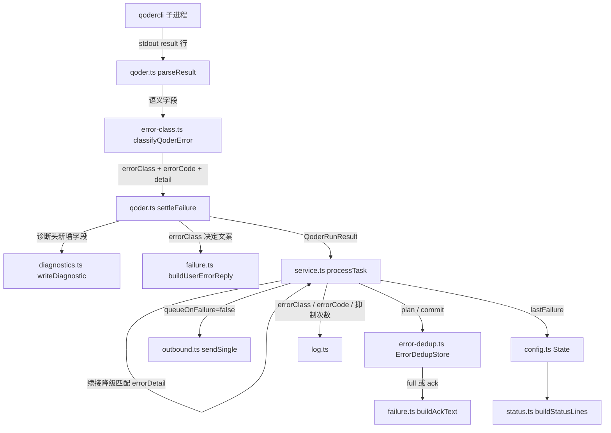

# 【后端技术文档】桥接错误可读性

> 状态：设计待评审 ｜ 更新：2026-11-06
> 需求基线：[requirements.md](./requirements.md)（2026-11-06 已确认）
> 规范目录：`.specs/20261106_错误可读性/`
> 开发分支：`feat/20261106-error-readability`
> 关联事故：2026-11-05 额度耗尽刷屏 5 次、2026-11-06 输出截断被报成"异常退出"

## 生成 AI 概要

- 生成模型：Qoder Desktop Agent 当前会话模型（会话未暴露底层型号，不作推测）
- 生成方式：由 `jojo-specs` 技能按"需求 → 设计"阶段生成
- 设计输入：`requirements.md` + 6 份本机真实诊断文件 + `bridge-2026-11-05.jsonl` / `bridge-2026-11-06.jsonl` + 现有代码（`src/bridge/qoder.ts`、`src/bridge/failure.ts`、`src/bridge/service.ts`、`src/bridge/outbound.ts`、`src/config.ts`、`src/status.ts`、`src/diagnostics.ts`）

---

## 1. 需求背景

### 1.1 为什么要做

两次事故是**同一个缺陷**的两种表现：qodercli 在业务语义失败时带退出码 1 返回，而 `runQoder` 的 `finalize` 把 `code !== 0` 判断排在 `parsed.is_error` 之前，于是全部落到 `exit` 分支——该分支只带 `exitCode`，不读 stdout `result` 行里已经存在的 `error_code` / `errors` / `error_message` / `stop_reason`。

实测证据（详见需求文档背景节）：

| 事故 | qodercli 实际返回 | 用户实际收到 |
| --- | --- | --- |
| 11-05 额度耗尽 ×5 | `exit=1`、`error_code=110`、`error_message="Billing daily count exceeded"` | `执行失败：qodercli 异常退出（退出码 1）。详见本机日志。`（33 字符）×5 条 |
| 11-06 输出截断 ×1 | `exit=1`、`error_code="max_output_tokens"`、`stop_reason="max_tokens"` | 同上，1 条 |

语义信息一直都在，只是被丢掉了。叠加"同类错误不去重"和"错误提示 `queueOnFailure: true`"，形成刷屏 + 队列风险。

### 1.2 高层方案与理由

| 设计决策 | 做法 | 理由 / 权衡 |
| --- | --- | --- |
| 语义分类独立成纯模块 | 新增 `src/bridge/error-class.ts`，只做「语义字段 → 类别」的纯函数映射 | 分类规则最容易写错、且必须穷举测试。与一期把队列状态机独立成 `outbox.ts` 是同一思路 |
| 传输层 kind 与语义 class 正交，不改判定顺序 | `QoderErrorKind` 保持 6 个值不变；新增 `QoderErrorClass` 4 个值。`code !== 0` 仍先于 `is_error` | 一期的诊断文件头 `kind`、日志 `errorKind`、既有单测全部依赖传输层 kind。改顺序或改名会破坏一期已验收行为（N1）。语义 class 只决定**用户文案**，两者互不覆盖 |
| 分类只认实测过的特征 | `error_code=110` / `"max_output_tokens"` / `"authentication_failed"` 三条硬规则，其余一律 `unknown` | 上游枚举里的 `billing_error` / `rate_limit` / `invalid_request` / `server_error` 零实测样本，猜特征会给出错误的行动建议。`unknown` 走需求 1.7 的日志记录，攒够样本再收敛 |
| 原文降级为内部信号 | 新增 `QoderRunResult.errorDetail`，承载 `errors[0]` / `error_message` / `result` 原文；`result.error` 只放中文模板 | `service.ts:591` 的续接降级正则依赖原文。若直接把原文从 `error` 里拿掉，该重试会静默失效。分成"对外文案"与"对内信号"两个字段，才能让需求 1.5（原文不下行）与 N1（会话续接不变）同时成立 |
| 去重状态放内存，不放 state.json | 新增 `src/bridge/error-dedup.ts`，`ErrorDedupStore` 持有 `Map<userId:class, entry>`，注入时钟 | 窗口只有 10 分钟、失败全部由用户入站触发。持久化会带来 schema 迁移与状态膨胀，收益极低。重启后窗口重置的最坏结果是**多发一条完整提示**——失败方向是安全的（宁可多提示，不可静默吞掉） |
| 只有真正 sent 才推进窗口 | `plan()` 只读决策，`commit()` 仅在 `sendSingle` 返回 `'sent'` 后调用 | 若发送失败也计数，用户会在整个窗口内什么都收不到。这与需求 3.5「发送失败只写日志」一致 |
| 抑制时回 ack 而非静默 | ack 带类别短语、首次提示时间（`HH:mm`）与含本次的累计抑制次数 | 11-05 的 5 次失败全是用户主动发消息触发的。静默会让用户以为桥接挂了；ack 既有反馈又不刷屏 |
| `lastFailure` 进 state.json | 新增可空字段，`status` 增一行「最近失败」 | status 是独立进程读 state.json，必须持久化。字段可空且不改 `version`（仍为 2），旧状态文件天然兼容 |
| 命名与既有 `quota` 彻底隔离 | 语义类别叫 `model_quota`；`status` 新行叫「最近失败」，既有「下行额度」行原样保留 | `SendFailureKind='quota'` 与 `state.quota` 指微信下行 `ret=-2`，与模型额度毫无关系。共用名字会让 status 与日志出现两种 quota |

### 1.3 技术栈

- Node.js ≥ 20、TypeScript 5.6、ESM，沿用现有 `cross-spawn`。
- **不新增任何运行时依赖。**
- **不新增开发依赖**：`vitest` / `@vitest/coverage-v8` / `fast-check` 一期已就位。
- 新增两个源文件均为纯逻辑，无 I/O、无副作用，时钟通过参数注入。

---

## 2. 相关文档 & 资源

| **资源** | **描述** |
| --- | --- |
| 需求文档 | [.specs/20261106_错误可读性/requirements.md](./requirements.md) |
| 一期需求 / 设计 | [.specs/20261103_桥接稳定性优化/](../20261103_桥接稳定性优化/design.md)（0.2.0 已验收，本期的兼容性基线） |
| 设计稿地址 | 无 |
| 页面地址 | 无 |
| 接口文档地址 | 无（qodercli `-o json` 的 `result` 行契约以本机诊断文件实测为准） |
| 实测样本 | `~/.local/state/qoder-wechat-bridge/logs/diagnostics/2026-11-05/`、`.../2026-11-06/`；`logs/bridge-2026-11-05.jsonl`、`logs/bridge-2026-11-06.jsonl` |
| 第三方服务/SDK 文档 | Qoder CLI headless（本机 `qodercli --help`）；qodercli 打包产物内的错误枚举 `["authentication_failed","billing_error","rate_limit","invalid_request","server_error","unknown","max_output_tokens"]` |
| 测试冒烟用例地址 | 无（本次在 `test/` 内新增，见第 8 节） |
| Redmine 任务管理 | 无（个人项目） |
| UI | 无（CLI 文本输出 + 微信文本消息） |
| 前端 | 无 |
| 后端 | joke_yao |
| 测试 | joke_yao |
| 产品 | joke_yao |

---

## 3. UI

无图形界面。用户可见变化只有两类：

**3.1 微信下行文案（4 种新文案 + 1 种 ack）**

| 场景 | 文案 | 字符数 |
| --- | --- | --- |
| `model_quota` | `模型额度已用尽：今日调用次数达到上限。可稍后重试，或发 /model 切换模型。（退出码 1）` | 47 |
| `output_limit` | `回答被截断：模型输出达到上限，本次没有完整结果。可发 /model 换输出上限更大的模型，或把任务拆小。（退出码 1）` | 59 |
| `auth` | `Qoder 凭据已失效：需在本机重新登录 qodercli 后重试。（退出码 1）` | 41 |
| `unknown` | 沿用一期传输层文案，不改 | — |
| ack（窗口内第 n 次抑制） | `（模型额度已用尽同 23:13 那条，本次为第 4 次，已略）` | 31 |

文案设计约束：

- 建议动作必须是用户在微信里**真能执行**的。`/model` 是既有命令，所以 `model_quota` / `output_limit` 直接引用它。
- `auth` 的建议**不能**写成"点击重新登录"——qodercli 的凭据只能在本机刷新，微信侧无入口，所以文案明说"需在本机"。
- 不写死具体模型名（需求 2.2），避免模型列表变化后文案过期。
- 全部经 `fit(text, maxChars)` 限长，沿用一期"…详见本机日志。"的收尾规则。

**3.2 `status` 终端输出新增一行**

```
最近失败：模型额度已用尽（model_quota｜error_code=110｜退出码 1）于 2026/11/5 23:27:51｜任务 mw3p970m-bt2wwl
```

无失败记录时为 `最近失败：无`。既有 `下行额度：…` 行原样保留，两行相邻但语义不混。时间格式沿用既有 `quotaLine` 的 `toLocaleString('zh-CN', { hour12: false })`，不引入第二种时间格式。

---

## 4. 架构

### 4.1 组件关系



新增文件 2 个（`error-class.ts`、`error-dedup.ts`），修改文件 7 个。

### 4.2 数据流：一次语义失败的完整路径

```
1. qodercli 退出，code=1，stdout 含 result 行
2. parseResult 读出 is_error / result / session_id / model
   + 新增 stop_reason / error_code / error_message / errors
3. finalize：killedByTimeout? → 否
             stdout/stderr 全空? → 否
             parsed 为 null? → 否
             code !== 0? → 是 → settleFailure('exit', { 语义字段透传 })
   （判定顺序完全不变，一期行为保持）
4. settleFailure 内：
   a. classifyQoderError(语义字段) → { errorClass:'model_quota', errorCode:'110', detail:"You've reached…" }
   b. writeDiagnostic({ kind:'exit', errorClass, errorCode, … })
   c. buildUserErrorReply({ kind:'exit', errorClass:'model_quota', exitCode:1, maxChars:300 })
      → 中文模板，detail 不参与文案
   d. resolve({ ok:false, errorKind:'exit', errorClass, errorCode, error:中文模板, errorDetail:原文, … })
5. service.processTask：
   a. 续接降级判断改用 errorDetail（行为等价于改造前）
   b. 写 state.lastFailure + persistState
   c. log.info('任务结束', { …, errorClass, errorCode })
   d. errorDedup.plan(userId, 'model_quota') → { full:true|false, firstAt, suppressed }
   e. body = full ? result.error : buildAckText(decision)
   f. session.sendSingle(body, { kind:'error', queueOnFailure:false, taskId })
   g. outcome === 'sent' → errorDedup.commit(userId, class, full)
      否则 → log.warn('错误提示未送达，不推进去重窗口', { … })
```

### 4.3 外部集成与部署

- 无新增外部依赖，无网络调用变化。
- launchd plist 不变；重启服务即生效。
- state.json 新增可空字段 `lastFailure`，旧文件读取时归一化为 `null`，`version` 保持 2，无需迁移脚本。

---

## 5. 方案设计

### 5.0 关键默认值与决策

| 配置项 | 默认值 | 环境变量 | 说明 |
| --- | --- | --- | --- |
| `errorDedupWindowMs` | `600000`（10 分钟） | `QWB_ERROR_DEDUP_WINDOW_MS` | **本期唯一新增配置项**（N3）。非法值（非数字 / ≤0 / 无穷）由 `loadConfig` 在合并配置文件与环境变量**两条路径之后**统一校验并回落默认值；`ErrorDedupStore` 构造器再兜一层退化为不去重，保护直接构造它的库调用方（审查 I-3 / W4） |
| `userErrorMaxChars` | `300` | `QWB_USER_ERROR_CHARS` | 一期已有，本期复用，不新增 |
| `ACK_MAX_CHARS` | `60` | 不可配 | 模块常量。需求 3.4 只要求"不超过 60"，实测最长 ack 为 34 字符（`model_quota` + `suppressed=9999`），不做成配置项 |

**分类特征白名单（只这三条，其余 unknown）**

| `error_code` / 字段 | 类别 | 证据 |
| --- | --- | --- |
| `110`（number 或 `"110"`），或 `error_message` 含 `Billing daily count exceeded` | `model_quota` | 5 份 11-05 诊断文件 |
| `"max_output_tokens"`，或 `stop_reason === "max_tokens"` 且 `is_error === true` | `output_limit` | 1 份 11-06 诊断文件 |
| `"authentication_failed"` | `auth` | qodercli 产物内枚举，无失败样本（需求评审已确认保留） |

**判定优先级**：`model_quota` → `output_limit` → `auth` → `unknown`，短路返回。理由：`error_code` 是单值字段，三条规则实测不会同时命中；固定优先级是为了让 `error_code=110` 且 `stop_reason=max_tokens` 这类理论组合有确定结果——额度是因、截断是果，判 `model_quota`。

**明确不做**：上游枚举中的 `billing_error` / `rate_limit` / `invalid_request` / `server_error` 本期不归入任何已知类别，落 `unknown` 并按需求 1.7 记录 `error_code` 与摘要，等实测样本出现再收敛。

### 5.1 组件与接口

#### 5.1.1 `src/bridge/error-class.ts`（新增）

**目的**：把 qodercli `result` 行里的语义字段映射到四类之一，并提供类别的中文短语。

**职责**：只做纯映射。**不**生成用户文案（那是 `failure.ts`）、**不**读文件、**不**决定发送策略。

**接口契约**

```ts
/** qodercli 业务语义失败类别 */
export type QoderErrorClass = 'model_quota' | 'output_limit' | 'auth' | 'unknown';

/** 类别的中文短语，供文案模板与 status 复用 */
export const ERROR_CLASS_LABEL: Record<QoderErrorClass, string>;
// model_quota  -> '模型额度已用尽'
// output_limit -> '回答被截断'
// auth         -> '凭据已失效'
// unknown      -> '未归类'

/** 从 result 行提取的语义字段（全部可选，缺失即视为无该信号） */
export interface QoderSemanticFields {
  errorCode?: unknown;      // 上游类型为 number | string，这里收 unknown 做防御性归一
  errorMessage?: unknown;
  errors?: unknown;         // 上游为 string[]
  stopReason?: unknown;
  isError?: unknown;        // 上游为 boolean；收 unknown 后以 === true 严格判定
  result?: string;
}

/** 分类结果 */
export interface QoderErrorClassification {
  errorClass: QoderErrorClass;
  /** 归一化为字符串的 error_code，用于日志 / 诊断 / status；缺失时为 undefined */
  errorCode?: string;
  /** 内部匹配用原文，永不直达用户；取 errors[0] → error_message → result 中首个非空 */
  detail?: string;
}

/**
 * 把不可信文本压成安全的单行，供会写进纯文本载体的字段共用
 * @param value - 原始值；有限数字会先转成字符串
 * @param maxChars - 长度上限
 */
export function sanitizeSingleLine(value: unknown, maxChars: number): string | undefined;

/** error_code 归一化后的长度上限 */
export const ERROR_CODE_MAX_CHARS = 64;

/**
 * 把 qodercli 语义字段归类
 * @param fields - result 行提取的语义字段
 * @returns 类别、归一化 error_code 与内部原文
 */
export function classifyQoderError(fields: QoderSemanticFields): QoderErrorClassification;
```

`sanitizeSingleLine` 由 `normalizeErrorCode` 与 `config.ts` 的 `normalizeLastFailure` 共用：前者清洗 qodercli 活路径的值，后者清洗可能被手改的 `state.json`。两者最终都会拼进诊断文件 header 或 `status` 行这类纯文本载体（审查 I-5a / N-1）。

**归一化规则**

- `errorCode`：`typeof === 'number'` 且有限 → `String(n)`；`typeof === 'string'` → 把 `[\r\n\u0000-\u001f]` 替换为空格、折叠连续空白、trim、截断到 64 字符，非空则采用；其它（`null` / `undefined` / 对象 / `NaN`）→ `undefined`。数字 `110` 与字符串 `"110"` 归一后同为 `"110"`，规则 1 只需比较一次。
  - **为什么要剥控制字符与限长（审查 I-5a）**：`errorCode` 会原样写进诊断文件的纯文本 header（`# errorCode: …`）与 `status` 的单行输出。实测 `errorCode = "110\n# exitCode: 0\n# forged: yes"` 能伪造出两行 header，破坏诊断文件自身结构。源是本机 qodercli 而非攻击者，严重度低，但修复只需一行且保护的是本工具的排查能力。注意 `log.ts` 走 `JSON.stringify`，**日志侧不存在该注入面**，故只需在归一化处修一次。
  - 副作用：含杂质的 `error_code` 归一后不再等于 `"110"`，会落 `unknown` 而非 `model_quota`。这是期望行为——畸形错误码不该命中精确规则。
- `errors`：`Array.isArray` 时取第一个 `typeof === 'string'` 且非空的元素；否则忽略。
- `errorMessage` / `stopReason`：仅 `typeof === 'string'` 时采用，trim 后非空才生效。
- `detail`：按 `errors[0]` → `errorMessage` → `result` 顺序取首个非空字符串，**会 trim 并折叠首尾空白**（勘误：初版写"原样返回，不截断不脱敏"，实际经 `normalizeText` 处理），但**不截断长度、不脱敏**——脱敏由落盘与日志处各自负责（`redactSensitive` + `slice(0,160)`）。

**设计理由**：入参全部声明为 `unknown` 并在函数内归一，是因为 `result` 行来自外部进程，字段类型不受本项目控制（已实测到 `error_code` 同时存在 number 与 string 两种形态）。归一化集中在一处，`failure.ts` / `service.ts` / `status.ts` 都不必再判类型。

#### 5.1.2 `src/bridge/qoder.ts`（修改）

**变更点 1：`ParsedResult` 扩展语义字段**

```ts
interface ParsedResult {
  result: string;
  is_error: boolean;
  session_id?: string;
  model?: string;
  // 新增（原样透传，不做类型断言，交给 classifyQoderError 归一）
  stop_reason?: unknown;
  error_code?: unknown;
  error_message?: unknown;
  errors?: unknown;
}
```

`parseResult` 的解析策略（整段 + 尾部 200 行、`type === 'result'` 判定、5MB 缓冲上限）**完全不变**，只在返回对象里多带 4 个字段。上游还有 `subtype` 字段，但没有任何消费方（原始 stdout 本就整段落进诊断文件），故不透传。

**变更点 2：`QoderRunResult` 新增三个字段**

```ts
export interface QoderRunResult {
  // …一期字段全部保留…
  /** 业务语义类别；失败时必有值，成功时为 undefined */
  errorClass?: QoderErrorClass;
  /** 归一化后的 error_code，用于日志 / 诊断 / status */
  errorCode?: string;
  /** 内部信号原文（errors[0] / error_message / result），仅用于续接降级匹配，永不直达用户 */
  errorDetail?: string;
}
```

**变更点 3：`settleFailure` 的 opts 增加语义字段**

```ts
const settleFailure = (
  kind: QoderErrorKind,
  opts: {
    exitCode?: number | null;
    detail?: string;
    sessionId?: string;
    modelUsed?: string;
    semantic?: QoderSemanticFields;   // 新增
  } = {},
): void => {
  // …
  const classification = classifyQoderError(opts.semantic ?? {});
  const diagnostic = writeDiagnostic({
    taskId: input.taskId,
    sessionId: opts.sessionId ?? input.sessionId,
    kind,
    errorClass: classification.errorClass,   // 新增
    errorCode: classification.errorCode,     // 新增
    exitCode,
    durationMs,
    stdout,
    stderr,
  }, { dir: input.diagnosticDir });
  const error = buildUserErrorReply({
    kind,
    errorClass: classification.errorClass,   // 新增
    exitCode,
    detail: opts.detail,
    timeoutMs: input.timeoutMs,
    maxChars: input.errorMaxChars ?? DEFAULT_ERROR_MAX_CHARS,
  });
  resolve({
    ok: false,
    text: '',
    sessionId: opts.sessionId ?? input.sessionId,
    modelUsed: opts.modelUsed,
    errorKind: kind,
    errorClass: classification.errorClass,   // 新增
    errorCode: classification.errorCode,     // 新增
    error,
    errorDetail: classification.detail,      // 新增
    exitCode,
    diagnosticPath: diagnostic.path || undefined,
    durationMs,
  });
};
```

**变更点 4：`finalize` 的 `exit` 与 `is_error` 两个分支透传语义字段**

```ts
if (code !== 0) {
  settleFailure('exit', {
    exitCode: code,
    sessionId: parsed.session_id,
    modelUsed: parsed.model,
    semantic: {                       // 新增
      errorCode: parsed.error_code,
      errorMessage: parsed.error_message,
      errors: parsed.errors,
      stopReason: parsed.stop_reason,
      isError: parsed.is_error,
      result: parsed.result,
    },
  });
  return;
}
if (parsed.is_error) {
  settleFailure('is_error', { /* 同上，semantic 一致 */ });
  return;
}
```

`timeout` / `spawn` / `empty` / `parse` 四个分支**不传 semantic**：它们要么没有 `parsed`（`spawn` / `empty` / `parse`），要么进程被 SIGKILL（`timeout`），语义字段不可信。这四类的 `errorClass` 由 `classifyQoderError({})` 得到 `'unknown'`，文案沿用一期，行为不变。

**变更点 5：成功分支前补一道截断判定（审查 D3，实测支撑）**

```ts
const semantic = semanticFields(parsed);
if (code !== 0) { settleFailure('exit', { …, semantic }); return; }
if (parsed.is_error) { settleFailure('is_error', { …, semantic }); return; }
// 进程正常退出且 is_error 为假，但 error_code 表明输出被截断：
// 半截答案一旦按成功下发，用户会当成完整回答，因此仍判失败（需求 2.1）
if (classifyQoderError(semantic).errorClass === 'output_limit') {
  settleFailure('is_error', { exitCode: code, detail: parsed.result, …, semantic });
  return;
}
// 成功
```

实测探针证实了这道判定必要：构造 `exit=0` + `is_error:false` + `error_code:"max_output_tokens"` + `result:"half answer"` 的输出，改造前 `runQoder` 返回 `ok: true`、`text: "half answer"`——用户会把半截答案当完整回答收下，正是需求 2.1 明令禁止的。传输层 `kind` 记为 `is_error`（术语表定义为"进程正常退出但任务实际失败"），语义 `class` 为 `output_limit`，文案走截断模板、不含 `result`。

**判定顺序**：`killedByTimeout` → 空输出 → `!parsed` → `code !== 0` → `is_error` → **`output_limit` 截断判定** → 成功。前五项与一期完全一致（一期正确性属性 5 / 7 与既有单测继续成立），新增的第六项插在成功之前，只会把"本会误判为成功"的情况改成失败，不会让任何一期判为失败的情况变成成功。

**职责边界**：不做去重、不决定发送、不写 state。

#### 5.1.3 `src/bridge/failure.ts`（修改）

**变更点 1：入参新增 `errorClass`**

```ts
export function buildUserErrorReply(input: {
  kind: QoderErrorKind;
  errorClass?: QoderErrorClass;   // 新增
  exitCode?: number | null;
  detail?: string;
  timeoutMs?: number;
  maxChars: number;
}): string;
```

**变更点 2：语义类别优先短路**

在现有 `switch (input.kind)` **之前**插入：

```ts
const code = /* 现有逻辑：undefined|null → '未知'，否则 String(exitCode) */;
switch (input.errorClass) {
  case 'model_quota':
    return fit(`模型额度已用尽：今日调用次数达到上限。可稍后重试，或发 /model 切换模型。（退出码 ${code}）`, input.maxChars);
  case 'output_limit':
    return fit(`回答被截断：模型输出达到上限，本次没有完整结果。可发 /model 换输出上限更大的模型，或把任务拆小。（退出码 ${code}）`, input.maxChars);
  case 'auth':
    return fit(`Qoder 凭据已失效：需在本机重新登录 qodercli 后重试。（退出码 ${code}）`, input.maxChars);
  // 'unknown' 与 undefined 落入下方既有 switch，行为完全不变
}
```

**关键点**：语义分支**不使用 `input.detail`**，从代码层面保证需求 1.5（英文原文不作为回复正文）。`detail` 仍只被 `spawn` 分支使用（取 ENOENT 等首行原因），该行为一期已验收，保留。

**变更点 3：新增 ack 文案函数**

```ts
/** ack 字符上限（需求 3.4） */
export const ACK_MAX_CHARS = 60;

/**
 * 生成去重窗口内的极简 ack
 * @param input - 类别、首次提示时间、含本次的累计抑制次数
 * @returns 不超过 ACK_MAX_CHARS 的单行提示
 */
export function buildAckText(input: {
  errorClass: QoderErrorClass;
  firstAt: number;
  suppressed: number;
}): string;
```

实现：

```ts
const label = ERROR_CLASS_LABEL[input.errorClass];
const hhmm = new Date(input.firstAt).toTimeString().slice(0, 5);   // 本地时区 "23:13"
return `（${label}同 ${hhmm} 那条，本次为第 ${input.suppressed} 次，已略）`;
```

长度上界：`（` 1 字 + `label` ≤ 7 字 + `同 ` 2 字 + `hhmm` 5 字 + ` 那条，本次为第 ` 9 字 + `suppressed` ≤ 4 位 + ` 次，已略）` 6 字 = 最长 34 字符，恒小于 60。**因此不做运行时截断**——由单测穷举四个 label × `suppressed ∈ {1, 99, 9999}` 断言长度 ≤ 60（见 8.2）。

`toTimeString().slice(0, 5)` 而非 `toLocaleTimeString`：后者输出含秒且受 ICU locale 影响，前者格式固定为 `HH:MM:SS GMT+xxxx`，切片结果稳定。

**设计理由**：文案与限长规则集中在 `failure.ts`（一期已确立的职责），`error-class.ts` 只提供 label，避免 `status.ts` 反向依赖 `failure.ts`。

#### 5.1.4 `src/bridge/error-dedup.ts`（新增）

**目的**：实现"窗口内同类只发一条完整提示，其余发 ack"的决策与计数。

**职责**：只做决策与计数。**不**发消息、**不**写日志、**不**持久化。

**接口契约**

```ts
/** 单次决策结果 */
export interface ErrorDedupDecision {
  /** true = 发完整提示；false = 发 ack */
  full: boolean;
  /** 窗口内首次完整提示的时间；full=true 时等于本次时间 */
  firstAt: number;
  /** 含本次在内的累计抑制次数；full=true 时为 0 */
  suppressed: number;
}

/** 去重存储选项 */
export interface ErrorDedupOptions {
  /** 去重窗口时长（毫秒） */
  windowMs: number;
  /** 时钟，测试可注入 */
  now?: () => number;
}

/**
 * 错误提示去重存储（内存态，进程重启即重置）
 */
export class ErrorDedupStore {
  constructor(opts: ErrorDedupOptions);

  /**
   * 只读决策：判断本次该发完整提示还是 ack，不修改状态
   * @param userId - 微信用户 id（去重维度）
   * @param errorClass - 语义类别
   */
  plan(userId: string, errorClass: QoderErrorClass): ErrorDedupDecision;

  /**
   * 提交决策：仅在消息真正 sent 后调用
   * @param userId - 微信用户 id
   * @param errorClass - 语义类别
   * @param full - 本次发的是完整提示还是 ack
   */
  commit(userId: string, errorClass: QoderErrorClass, full: boolean): void;

  /** 当前未过期条目数，用于测试与诊断 */
  get size(): number;
}
```

**内部状态**

```ts
interface Entry { firstAt: number; suppressed: number }
// key = `${userId}\u0000${errorClass}`，用 NUL 分隔避免 userId 含冒号时歧义
private readonly entries = new Map<string, Entry>();
```

**`plan` 算法**

```
1. pruneExpired()：遍历 Map，删除 now - firstAt >= windowMs 的条目
2. key = userId + NUL + errorClass；entry = entries.get(key)
3. entry 不存在（含刚被 prune 掉）→ 返回 { full: true, firstAt: now, suppressed: 0 }
4. entry 存在 → 返回 { full: false, firstAt: entry.firstAt, suppressed: entry.suppressed + 1 }
```

**`commit` 算法**

```
full === true  → entries.set(key, { firstAt: now, suppressed: 0 })
full === false → entry = entries.get(key)；存在则 suppressed += 1，不存在则什么都不做
```

> 勘误（审查 I-1）：初版断言"`commit(full=false)` 时 entry 必然存在，因为同 userId 串行、期间不会被并发改写"，该论证是**错的**。`pruneExpired()` 是**全表遍历**：另一个用户的 `plan()` 会在本用户 `await sendSingle` 期间执行清理，若窗口边界恰好落在这段 await 内，本用户的 key 会被删掉，此时 `entries.get(key)!` 的非空断言抛 TypeError（被上层 `.catch` 记成`任务执行异常`）。串行队列只约束同一 `userId`，管不住别人触发的全局清理。当前单账号部署下不可达，属潜伏缺陷。

**兜底选择"什么都不做"而非重建条目**：用户已收到的 ack 引用的是**旧的**首次提示时间，若按 `now` 重建 `{firstAt: now, suppressed: 1}`，后续 ack 会指向一次从未发生过的完整提示。留空则下一次 `plan` 重新发完整提示——方向安全。审查建议的重建方案在这一点上不成立，已按留空实现并补交错用例锁定。

**`windowMs` 归一化（审查 I-3）**：构造器内 `Number.isFinite(windowMs) && windowMs > 0 ? windowMs : 0`。非法值退化为 `0` 即**不去重**，而不是让 `now - firstAt >= NaN` 恒为 false 导致条目永不过期——后者会让用户首次失败后**永久只收到 ack**，是唯一一条把失败方向反转的路径。`Number.POSITIVE_INFINITY` 同样归零：永久去重与永久抑制在用户侧不可区分。`src/config.ts` 的环境变量解析处另有一层回落默认值的校验，两层各自独立生效（前者保证配置正确，后者保护直接构造 store 的库调用方）。

**`size` getter 有副作用（审查 I-5e）**：读取时先 `pruneExpired()`，以保证返回"未过期条目数"，已在 JSDoc 注明。

**`pruneExpired` 与 Map 有界性**：条目数上界 = 授权用户数 × 4。当前部署为单一授权账号 + 白名单，量级为个位数；每次 `plan` 都 prune，Map 不会无界增长。

**去重维度说明**：需求术语表写的是"同一会话"。本项目的会话状态 `state.sessions` 以 `userId` 为键，一个微信用户对应一个 qodercli 会话，故 `userId` 即会话维度。`/reset` 只删 `state.sessions[userId]`，**不清去重条目**——`/reset` 的语义是重置 qodercli 上下文，与"错误提示是否刷屏"无关；若用户 `/reset` 后立刻又撞上同类错误，仍应走 ack 而不是再刷一条完整提示。

**时钟回拨**：窗口判定为 `now - firstAt >= windowMs`。回拨时差值变小或为负，结果是**窗口被延长**，最坏情况是同类错误多发几条 ack，不会误判过期而重复发完整提示，也不会抛异常。与一期 outbox TTL 的处理方向一致。

**设计理由**：`plan` / `commit` 分离而非合成一个 `take()`，是为了让"发送失败不推进窗口"（需求 3.5 + 安全方向）在调用点显式可见，而不是隐藏在存储内部。

#### 5.1.5 `src/bridge/service.ts`（修改）

**变更点 1：持有 store 实例**

在 `runService` 内、与 `state` 同级创建：

```ts
const errorDedup = new ErrorDedupStore({ windowMs: config.errorDedupWindowMs, now });
```

`now` 复用 service 已有的注入时钟（一期为测试注入而设），保证去重与 outbox TTL 用同一时间源。

`processTask` 内创建的 `OutboundSession` 是**每轮新建**的，无法承载跨轮状态，所以 store 必须放在 `runService` 作用域。

**并发说明**：同一 `userId` 的任务由 `runningTasks` 与入站串行化处理保证不并发；不同 `userId` 并发时 key 不同，互不干扰。因此 `plan` → `await sendSingle` → `commit` 之间不存在同 key 竞态。

**变更点 2：续接降级改用 `errorDetail`（关键耦合修复）**

```ts
// 改造前
if (!result.ok && record?.sessionId && /session|resume|not found/i.test(result.error ?? '')) {
// 改造后
if (!result.ok && record?.sessionId && /session|resume|not found/i.test(result.errorDetail ?? '')) {
```

同时把该分支的 `log.warn` 补上语义字段，并对内部原文脱敏（与变更点 5 的 `errorSummary` 同一口径，满足 N2 与第 9 节）：

```ts
log.warn('续接会话失败，改为新建会话重试', {
  errorDetail: redactSensitive(result.errorDetail ?? '').slice(0, 160),
  errorClass: result.errorClass ?? '',
  errorCode: result.errorCode ?? '',
  taskId: id,
});
```

**为什么必须改**：改造前 `exit` 分支的 `result.error` 是中文模板 `执行失败：qodercli 异常退出（退出码 1）。详见本机日志。`，正则本就不命中；只有 `is_error` 分支会把英文原文放进 `error`，正则才可能命中。本期把 `is_error` 的原文也移出 `error`，若不同步迁移，该降级路径将**永久静默失效**。

**命中面变化（勘误）**：初版曾称"命中面比改造前更宽"，该说法只在 `exit` 分支成立。`errorDetail` 是 `errors[0]` → `error_message` → `result` 的**三选一**回退，不是三者并集：

| 分支 | 改造前匹配源 | 改造后匹配源 | 变化 |
| --- | --- | --- | --- |
| `exit` | 中文模板（恒不命中） | `errors[0]` / `error_message` / `result` 之一 | **纯增强** |
| `is_error` | `result` 首行 | 同上三选一 | 多数情况等价；当 `errors[0]` 存在但与 session 无关、而 `result` 才含 `No such session` 时**会变窄** |

变窄的组合零实测样本，本期按审查意见 I-4 的方案③处理：修正措辞 + 补一条用例锁定实际行为，不改回退顺序（改成拼接会同时影响 `errorSummary` 的语义与 N2 评估）。若将来出现该样本，再改为并集匹配。

**变更点 3：写 `lastFailure`（需求 4.1 / 4.2）**

在续接降级重试之后、`log.info('任务结束')` 之前插入（确保记录的是**最终**结果，重试成功则不记失败）：

```ts
if (!result.ok) {
  state.lastFailure = {
    kind: result.errorKind ?? 'exit',
    errorClass: result.errorClass ?? 'unknown',
    errorCode: result.errorCode,
    exitCode: result.exitCode ?? null,
    at: now(),
    taskId: id,
  };
  persistState();
}
```

**变更点 4：`任务结束` 日志补字段（需求 4.2）**

```ts
log.info('任务结束', {
  // …一期字段全部保留…
  errorClass: result.errorClass ?? '',
  errorCode: result.errorCode ?? '',
  diagnosticPath: result.diagnosticPath ?? '',
});
```

`sessionId` / `taskId` / `exitCode` 一期已有，`diagnosticPath` 为本期补齐（需求 4.2 要求记录诊断文件路径）。

**变更点 5：未识别语义错误单独告警（需求 1.7）**

```ts
if (!result.ok && result.errorClass === 'unknown' && (result.errorCode || result.errorDetail)) {
  log.warn('未识别的 qodercli 语义错误', {
    errorCode: result.errorCode ?? '',
    errorSummary: redactSensitive(result.errorDetail ?? '').slice(0, 160),
    taskId: id,
  });
}
```

`redactSensitive` 从 `src/diagnostics.ts` 导入（一期已导出），满足 N2。

**变更点 6：错误提示发送改为去重 + 不入队（需求 3.1 / 3.2 / 3.3 / 3.5）**

```ts
// 改造前
await session.sendSingle(reply, { kind: 'error', queueOnFailure: true, taskId: id });

// 改造后
const errorClass = result.errorClass ?? 'unknown';
// unknown 覆盖 timeout/spawn/empty/parse 与未收录错误码，不参与去重（见下方说明）
const deduped = errorClass !== 'unknown';
const decision = deduped ? errorDedup.plan(userId, errorClass) : { full: true, firstAt: now(), suppressed: 0 };
const body = decision.full
  ? result.error ?? buildUserErrorReply({
      kind: result.errorKind ?? 'exit',
      errorClass,
      exitCode: result.exitCode,
      maxChars: config.userErrorMaxChars,
    })
  : buildAckText({
      errorClass,
      firstAt: decision.firstAt,
      suppressed: decision.suppressed,
    });
const outcome = await session.sendSingle(body, { kind: 'error', queueOnFailure: false, taskId: id });
if (outcome === 'sent') {
  if (deduped) errorDedup.commit(userId, errorClass, decision.full);
} else {
  log.warn('错误提示未送达，不推进去重窗口', {
    userId, taskId: id, errorClass, outcome, suppressed: decision.suppressed,
  });
}
if (!decision.full) {
  log.info('错误提示被去重窗口抑制', {
    category: 'suppressed', userId, taskId: id, errorClass,
    suppressed: decision.suppressed, firstAt: decision.firstAt,
  });
}
```

**为什么 `unknown` 不参与去重（审查 D1，实测支撑）**：`unknown` 是四种传输层失败与全部未收录错误码的公共兜底桶。实测把 `timeout` 纳入去重后，第二次超时用户只收到 `（未归类同 08:00 那条，本次为第 1 次，已略）`——"任务超过 600 秒被终止"这个关键信息完全丢失，退出码与失败种类也不在 ack 里；更糟的是 `spawn` 失败（qodercli 没装）会抑制掉后续的 `rate_limit` 失败，两个无关根因共用一个桶。2026-11-05 的 5 条刷屏全是 `model_quota`，`unknown` 本不成灾，因此只对三个已知类别去重。

**副作用（正向）**：`unknown` 不去重意味着四种传输层失败的文案**每次都逐字不变**，正确性属性 16 与 §11.2 的"文案逐字不变"因此完全成立，不需要弱化为"首次不变"。

`queueOnFailure: false` 覆盖两条路径：`OutboundSession.sendSingle` 在下行额度耗尽 / 会话过期 / 预算为 0 时直接返回 `'skipped'`，在发送异常时也返回 `'skipped'`，两者都不入队（需求 3.1 / 3.5）。

抑制日志与 `outcome` 无关：即使 ack 未送达，也如实记录"本次被抑制"，满足需求 4.3。

**变更点 7：微信内 `/status` 命令不改**

需求 4.1 的 `status` 指本机 CLI 的 `qoder-wechat status`（走 `buildStatusLines`，见 5.1.7）。微信内的 `/status` 是 `processTask` 里一段手写的 7 行数组，与 `src/status.ts` **无关**，本期保持原样不动。

> 勘误：本节初版曾写"`/status` 分支拼接的行来自 `buildStatusLines`，无需额外改动"——该描述是错的，两处实现互相独立。已按审查意见（D4）修正，口径确认为"仅 CLI status"。

#### 5.1.6 `src/diagnostics.ts`（修改）

```ts
export interface DiagnosticInput {
  // …一期字段保留…
  /** 业务语义类别 */
  errorClass?: string;
  /** 归一化后的 error_code */
  errorCode?: string;
}
```

header 在 `# kind:` 之后插入两行：

```
# errorClass: model_quota
# errorCode: 110
```

缺失时写空值（与既有 `# sessionId:` / `# exitCode:` 的处理一致）。字节预算计算沿用现有 `header` 长度扣减逻辑，无需改动。

**设计理由**：`kind` 保留传输层语义（`exit` / `is_error` / `timeout` …），新增两行承载业务语义。排查时两者都需要：`kind` 说明进程怎么失败的，`errorClass` 说明 qodercli 报的是什么。

#### 5.1.7 `src/status.ts`（修改）

在 `quotaLine` 之后新增 `lastFailureLine`：

```ts
const lastFailureLine = state.lastFailure
  ? `最近失败：${ERROR_CLASS_LABEL[state.lastFailure.errorClass]}（${state.lastFailure.errorClass}${
      state.lastFailure.errorCode ? `｜error_code=${state.lastFailure.errorCode}` : ''
    }｜退出码 ${state.lastFailure.exitCode ?? '未知'}）于 ${new Date(state.lastFailure.at).toLocaleString('zh-CN', { hour12: false })}｜任务 ${state.lastFailure.taskId}`
  : '最近失败：无';
```

返回数组在 `quotaLine` 后追加 `lastFailureLine`。

**需求 4.4 的落地**：`下行额度：…`（既有，微信 `ret=-2`）与 `最近失败：…`（本期，含 `model_quota`）两行文案与字段名均不重叠；`ERROR_CLASS_LABEL.model_quota` 是"模型额度已用尽"，与 `quotaLine` 的"下行额度"字面可区分。

`errorClass` 为 `'unknown'` 时显示"未归类"，并同时显示传输层信息？——**不显示**。`kind` 已在日志与诊断文件里，status 只回答需求 4.1 问的"类别与时间"。保持单行简短。

#### 5.1.8 `src/config.ts`（修改）

```ts
/** 最近一次任务失败记录，用于 status */
export interface LastFailureRecord {
  /** 传输层类别 */
  kind: string;
  /** 业务语义类别 */
  errorClass: QoderErrorClass;
  /** 归一化后的 error_code */
  errorCode?: string;
  /** 退出码 */
  exitCode: number | null;
  /** 发生时间（毫秒） */
  at: number;
  /** 任务 id */
  taskId: string;
}
```

- `Config` 新增 `errorDedupWindowMs: number`；`DEFAULT_CONFIG` 为 `10 * 60_000`；`ENV_OVERRIDES` 追加 `['errorDedupWindowMs', 'QWB_ERROR_DEDUP_WINDOW_MS', (v) => Number(v)]`。
- `State` 新增 `lastFailure: LastFailureRecord | null`；`DEFAULT_STATE` 为 `null`。
- `normalizeState` 追加字段级归一化：

```ts
lastFailure: isRecord(raw.lastFailure)
  ? {
      kind: typeof raw.lastFailure.kind === 'string' ? raw.lastFailure.kind : 'exit',
      errorClass: isErrorClass(raw.lastFailure.errorClass) ? raw.lastFailure.errorClass : 'unknown',
      errorCode: typeof raw.lastFailure.errorCode === 'string' ? raw.lastFailure.errorCode : undefined,
      exitCode: typeof raw.lastFailure.exitCode === 'number' ? raw.lastFailure.exitCode : null,
      at: asNumber(raw.lastFailure.at, 0),
      taskId: typeof raw.lastFailure.taskId === 'string' ? raw.lastFailure.taskId : '',
    }
  : null,
```

`isErrorClass` 为本文件内的私有守卫（检查是否属于四个合法值），防止手改 state.json 后 `ERROR_CLASS_LABEL[...]` 取到 `undefined`。

- `version` **保持 2**：新增字段可空且 `normalizeState` 已做兜底，旧状态文件读取即为 `null`，无需迁移。

**类型导入方向**：`config.ts` 需要 `QoderErrorClass`，而 `error-class.ts` 不依赖 `config.ts`，故 `import type { QoderErrorClass } from './bridge/error-class.js'` 无循环依赖。

#### 5.1.9 `src/index.ts`（修改）

追加库导出，与一期风格一致：

```ts
export { classifyQoderError, ERROR_CLASS_LABEL } from './bridge/error-class.js';
export type { QoderErrorClass, QoderErrorClassification, QoderSemanticFields } from './bridge/error-class.js';
export { ErrorDedupStore } from './bridge/error-dedup.js';
export type { ErrorDedupDecision, ErrorDedupOptions } from './bridge/error-dedup.js';
export { buildAckText, ACK_MAX_CHARS } from './bridge/failure.js';
export type { LastFailureRecord } from './config.js';
```

`buildUserErrorReply` 已导出，签名扩展为向后兼容（`errorClass` 可选）。

### 5.2 数据模型

#### 5.2.1 实体

**`QoderErrorClass`（值类型，不落盘）**

| 值 | 含义 | 用户文案 | status label |
| --- | --- | --- | --- |
| `model_quota` | 模型侧调用额度耗尽（实测 `error_code=110`） | 见 3.1 | 模型额度已用尽 |
| `output_limit` | 模型输出达到上限，回答被截断 | 见 3.1 | 回答被截断 |
| `auth` | qodercli 凭据失效 | 见 3.1 | 凭据已失效 |
| `unknown` | 未命中任何已知特征 | 沿用一期传输层文案 | 未归类 |

**`LastFailureRecord`（持久化，`state.lastFailure`）**

| 属性 | 类型 | 约束 |
| --- | --- | --- |
| `kind` | `string` | 传输层类别，取自 `QoderErrorKind` |
| `errorClass` | `QoderErrorClass` | 归一化时非法值降级为 `'unknown'` |
| `errorCode` | `string \| undefined` | 归一化后的 error_code |
| `exitCode` | `number \| null` | `null` 表示未知（超时 / spawn 失败） |
| `at` | `number` | 毫秒时间戳，缺失归一为 `0` |
| `taskId` | `string` | 缺失归一为 `''` |

**`Entry`（内存态，不落盘）**

| 属性 | 类型 | 约束 |
| --- | --- | --- |
| `firstAt` | `number` | 窗口内首次完整提示时间 |
| `suppressed` | `number` | 单调递增，窗口过期后随条目删除归零 |

#### 5.2.2 关系

```
State 1 ── 0..1 LastFailureRecord        （只保留最近一次，覆盖写）
ErrorDedupStore 1 ── 0..N Entry          （N ≤ 授权用户数 × 4）
QoderRunResult 1 ── 0..1 QoderErrorClassification
```

`state.quota`（下行额度）与 `state.lastFailure`（模型侧失败）**无关联**，各自独立更新。

#### 5.2.3 状态迁移

**去重条目生命周期（单个 `userId:class`）**

| 当前状态 | 事件 | 迁移到 | 下发动作 |
| --- | --- | --- | --- |
| 无条目 | 失败 + sent | `{firstAt: now, suppressed: 0}` | 完整提示 |
| 无条目 | 失败 + 未送达 | 无条目（不 commit） | 无（只写日志） |
| 有条目且未过期 | 失败 + sent | `suppressed += 1` | ack（带 `suppressed` 新值） |
| 有条目且未过期 | 失败 + 未送达 | 条目不变 | 无（只写日志） |
| 有条目且已过期 | `plan` 触发 prune | 无条目 → 同"无条目 + 失败" | 完整提示，计数归零 |
| 任意 | 进程重启 | 全部丢失 | 下次失败发完整提示 |
| 任意 | `/reset` | **不变** | 与 qodercli 上下文重置无关 |

**`lastFailure` 生命周期**

| 事件 | 动作 |
| --- | --- |
| 任务最终失败（含续接降级重试后仍失败） | 覆盖写入 + `persistState()` |
| 续接降级重试后成功 | 不写入（记录最终结果） |
| 任务成功 | 不变（保留上一次失败记录，供 status 追溯） |
| 读取到非法 / 缺失字段 | `normalizeState` 降级为合法值或 `null` |

#### 5.2.4 校验约束

- `errorClass` 只允许四个合法值，`normalizeState` 与 `classifyQoderError` 双侧保证。
- `errorCode` 统一为 `string`，数字与字符串形态在 `classifyQoderError` 内归一，下游不再判类型。
- `errorDetail` **禁止**出现在任何用户可见文案中；只允许出现在日志（经 `redactSensitive` + 截断 160 字）与诊断文件（经 `redactSensitive` + 64KB 预算）中。
- ack 长度 ≤ 60（由单测穷举保证，不做运行时截断）。
- 完整提示长度 ≤ `userErrorMaxChars`（由 `fit()` 保证）。

#### 5.2.5 持久化策略

| 数据 | 位置 | 生命周期 |
| --- | --- | --- |
| `lastFailure` | `~/.local/state/qoder-wechat-bridge/state.json`（`0600`） | 覆盖写，保留至下次失败 |
| 去重条目 | 进程内存 | 进程生命周期；重启即重置 |
| 诊断文件 | `.../logs/diagnostics/{YYYY-MM-DD}/{ts}-{taskId}.log`（`0600`） | 一期规则，保留 7 天 |
| 结构化日志 | `.../logs/bridge-{YYYY-MM-DD}.jsonl` | 一期规则不变 |

---

## 6. 正确性属性

### 正确性属性 1：分类全覆盖且确定

_For any_ qodercli 失败结果，无论 `result` 行的语义字段是缺失、类型异常还是取值未知，`classifyQoderError` SHALL 返回 `model_quota` / `output_limit` / `auth` / `unknown` 之一，且对相同输入 SHALL 返回相同结果。

**验证需求：需求 1.1、1.6**

### 正确性属性 2：实测特征必被识别

_For any_ `result` 行，若 `error_code` 归一后为 `"110"`、或 `error_message` 含 `Billing daily count exceeded`、或 `error_code` 为 `"max_output_tokens"`、或 `stop_reason` 为 `"max_tokens"` 且 `is_error` 为真、或 `error_code` 为 `"authentication_failed"`，则 `classifyQoderError` SHALL 返回对应的已知类别而非 `unknown`。

**验证需求：需求 1.2、1.3、1.4、2.1**

### 正确性属性 3：英文原文永不直达用户

_For any_ 失败结果与任意 `maxChars`，`buildUserErrorReply` 在 `errorClass` 为 `model_quota` / `output_limit` / `auth` 时返回的文本 SHALL NOT 包含 `errors[0]` 或 `error_message` 的任何片段，且 SHALL 为固定中文模板。

**验证需求：需求 1.5、2.2、N2**

### 正确性属性 4：截断永不算成功

_For any_ qodercli 输出，若 `error_code` 归一后为 `"max_output_tokens"`，或 `stop_reason` 为 `"max_tokens"` 且 `is_error` 为真，则 `runQoder` SHALL 返回 `ok: false` 且 `errorClass: 'output_limit'`，SHALL NOT 返回 `ok: true`。

**验证需求：需求 2.1**

### 正确性属性 5：截断提示不虚假承诺

_For any_ `output_limit` 失败，返回给用户的文本 SHALL NOT 声称已附上部分生成内容，且 SHALL 包含换模型或拆小任务的建议。

**验证需求：需求 2.2、2.3**

### 正确性属性 6：提示限长且非空

_For any_ 失败结果与任意 `maxChars > 0`，`buildUserErrorReply` 与 `buildAckText` 返回的文本长度 SHALL 不超过各自上限（`maxChars` / 60），且在文本非空输入下 SHALL NOT 返回空串。

**验证需求：需求 2.4、3.1、3.4**

### 正确性属性 7：错误消息永不入队

_For any_ 错误提示或 ack，无论发送成功、发送异常、下行额度耗尽还是会话过期，`sendSingle` SHALL 以 `queueOnFailure: false` 调用，`state.outbox` 与 `state.quarantine` SHALL NOT 因该消息而增长。

**验证需求：需求 3.1、3.5**

### 正确性属性 8：窗口内同类最多一条完整提示

_For any_ 用户与任意失败序列，若错误类别属于 `model_quota` / `output_limit` / `auth`，则在任一长度为 `windowMs` 的时间窗口内，该类别的完整提示下发次数 SHALL ≤ 1，其余同类失败 SHALL 下发 ack。类别为 `unknown` 时 SHALL NOT 去重，每次都下发完整提示（见需求 3.3）。

**验证需求：需求 3.2、3.3、3.4**

### 正确性属性 9：类别间互不抑制

_For any_ 用户与任意失败序列，不同 `errorClass` 的去重条目 SHALL 独立计数；一个类别处于抑制状态 SHALL NOT 影响另一类别下发完整提示。

**验证需求：需求 3.6**

### 正确性属性 10：窗口过期后重新完整提示并归零

_For any_ 用户与类别，若距 `firstAt` 已过 `windowMs`，则下一次同类失败 SHALL 下发完整提示，且新的 `suppressed` SHALL 从 0 重新计数。

**验证需求：需求 3.7**

### 正确性属性 11：发送失败不推进窗口

_For any_ 失败结果，若错误提示或 ack 的 `sendSingle` 返回值不是 `'sent'`，则去重状态 SHALL 保持不变，`commit` SHALL NOT 被调用；下一次同类失败 SHALL 仍尝试下发完整提示。

**验证需求：需求 3.5**

### 正确性属性 12：每次失败都可追溯

_For any_ 最终失败的任务，`state.lastFailure` SHALL 被覆盖为该次失败的类别、`error_code`、退出码、时间与任务 id，且日志 SHALL 含 `errorClass`、`errorCode`、`exitCode`、`taskId`、`sessionId`、`diagnosticPath`。

**验证需求：需求 4.1、4.2**

### 正确性属性 13：抑制必留痕

_For any_ 被去重窗口抑制的错误，无论 ack 是否送达，日志 SHALL 记录该类别在窗口内的累计抑制次数。

**验证需求：需求 4.3**

### 正确性属性 14：两种额度命名不混淆

_For any_ `status` 输出与日志记录，模型额度失败 SHALL 只以 `model_quota` / "模型额度" 表述，微信下行额度 SHALL 只以既有 `quota` / "下行额度" 表述，两者 SHALL NOT 共用同一标识符或同一行输出。

**验证需求：需求 4.4**

### 正确性属性 15：续接降级不因文案改造而失效

_For any_ 失败结果，若 `errorDetail` 匹配 `/session|resume|not found/i` 且存在既有会话 id，则 `processTask` SHALL 触发新建会话重试；该判定 SHALL 只依赖 `errorDetail`，SHALL NOT 依赖面向用户的 `error` 文案。

**验证需求：N1（会话续接能力不变）**

### 正确性属性 16：一期传输层行为不退化

_For any_ `timeout` / `spawn` / `empty` / `parse` 失败，用户提示文本、诊断文件内容与 `errorKind` SHALL 与一期完全一致（`errorClass` 为 `unknown` 且不改变文案）。

**注**：本属性成立的前提是 `unknown` 不参与去重（审查 D1 方案 A）。若让 `unknown` 去重，第二次传输层失败就会被替换成 `（未归类同 HH:MM 那条…）`，本属性只能弱化为"首次提示一致"。

**验证需求：N1**

### 正确性属性 17：非法窗口配置不导致永久抑制

_For any_ `windowMs` 取值（含 `NaN` / `≤0` / `Infinity`），`ErrorDedupStore` SHALL 退化为不去重（每次都允许完整提示），SHALL NOT 出现"条目永不过期、用户首次失败后永久只收到 ack"。`loadConfig` 对非法的 `QWB_ERROR_DEDUP_WINDOW_MS` SHALL 回落默认值。

**验证需求：需求 3.8**

### 正确性属性 18：全局清理不使提交抛异常

_For any_ 用户 A 与 B 的交错调用序列，若 B 的 `plan` 在 A 的 `plan` 与 `commit` 之间触发了全局过期清理并删除了 A 的条目，则 A 的 `commit` SHALL NOT 抛异常，且 SHALL NOT 重建一个指向未发生过完整提示的条目。

**验证需求：需求 3.5、3.7**

---

## 7. 错误处理

### 7.1 语义字段异常

| 场景 | 处理 |
| --- | --- |
| `error_code` 为 `null` / 对象 / 数组 / `NaN` | 归一为 `undefined`，不参与匹配 |
| `error_code` 为未收录的字符串（如 `"rate_limit"`） | 归 `unknown`，按需求 1.7 写 `未识别的 qodercli 语义错误` 告警 |
| `errors` 不是数组，或元素全非字符串 | 忽略该字段，`detail` 退到 `error_message` → `result` |
| `error_message` / `stop_reason` 非字符串 | 忽略该字段 |
| `result` 行为空 / 解析失败 | 走一期 `empty` / `parse` 分支，`semantic` 不传，`errorClass='unknown'`，文案不变 |
| 语义字段与退出码同时异常 | 传输层 `kind` 如实记录，语义 `class` 独立归类，两者不互相覆盖 |

### 7.2 分类误判的兜底

| 场景 | 处理 |
| --- | --- |
| 上游改了 `error_code` 取值 | 落 `unknown` → 一期传输层文案（仍可用，只是不够具体）+ 需求 1.7 告警日志，攒样本后补规则 |
| `auth` 规则从未被真实触发 | 无副作用：规则不命中即走 `unknown`，不影响其它类别 |
| `model_quota` 建议"稍后重试"无效 | 实测 11-05 23:21 失败、23:22 同模型成功，建议有效；若后续变为硬封锁，文案需改为"明日恢复"，属文案调整而非结构改动 |

### 7.3 去重与发送

| 场景 | 处理 |
| --- | --- |
| 完整提示发送失败（下行额度耗尽 / 会话过期 / 预算为 0 / 网络异常） | `sendSingle` 返回 `'skipped'`，不 commit、不入队，写 `错误提示未送达，不推进去重窗口` 告警；下次同类失败仍尝试完整提示 |
| ack 发送失败 | 同上；抑制日志仍如实记录本次被抑制 |
| 时钟回拨 | 窗口判定 `now - firstAt >= windowMs` 差值变小或为负 → 窗口被延长，最坏多发几条 ack，不会误判过期、不抛异常 |
| 时钟大幅前跳 | 条目立即过期被 prune → 下次发完整提示。方向安全（宁可多提示） |
| 进程重启 | 去重条目全丢 → 下次同类失败发完整提示。可接受：窗口仅 10 分钟，且失败方向安全 |
| Map 无界增长 | 每次 `plan` 前 `pruneExpired`；条目上界 = 授权用户数 × 4 |
| 不同用户并发失败 | key 含 `userId`，互不干扰；同用户由入站串行化保证 `plan`/`commit` 之间无同 key 竞态 |

### 7.4 状态与磁盘

| 场景 | 处理 |
| --- | --- |
| `state.json` 缺 `lastFailure` | `normalizeState` 补 `null`，status 显示"最近失败：无" |
| `state.json` 的 `lastFailure` 被手改坏（非法 `errorClass` / `at` 非数字） | 字段级降级：`errorClass` → `'unknown'`，`at` → `0`，`taskId` → `''`；不让 `status` 抛异常 |
| `persistState()` 写盘失败 | 沿用一期 `log.error('保存状态失败')`，不影响错误提示下发 |
| 诊断文件写入失败 | 一期行为不变：`writeDiagnostic` 返回空路径，`diagnosticPath` 为 `undefined`，日志字段留空 |
| 旧版 state（`version: 2` 无新字段） | 无需迁移，读取即兼容；`version` 不 bump |

### 7.5 用户体验 during error

| 场景 | 用户看到 |
| --- | --- |
| 首次额度耗尽 | 一条中文提示 + 可执行建议（`/model`） |
| 10 分钟内第 2..n 次 | 一条 ≤30 字符 ack，含首次时间与累计次数——用户知道自己没被无视，也知道不必再试 |
| 窗口过期后再次失败 | 重新收到完整提示 |
| 下行额度同时耗尽 | 错误提示被丢弃（只写日志）；用户的**正常回复**仍在 outbox 中等待下个窗口补发，一期行为不变 |
| 截断 | 明确的"回答被截断"说明；不会看到半截正文冒充完整回答（`result` 本就为空） |
| 未归类错误 | 一期传输层文案（如"异常退出（退出码 1）"），不比现状差 |

**质量检查**

- [x] 每个外部调用都有失败处理（qodercli 输出、微信发送、状态写盘、诊断写盘）
- [x] 每个外部输入都有校验（语义字段全部 `unknown` 入参 + 归一化）
- [x] 已覆盖部分失败场景（提示发送失败、ack 发送失败、重试后成功）
- [x] 已记录恢复路径（窗口过期、进程重启、时钟异常）
- [x] 已考虑错误期间的用户体验（ack 机制即为该项的专门设计）

---

## 8. 测试策略

### 8.1 基础设施

- 沿用一期 `vitest` + `@vitest/coverage-v8` + `fast-check`，**不新增依赖**。
- `vitest.config.ts` 的 `coverage.include` 追加 `src/bridge/error-class.ts` 与 `src/bridge/error-dedup.ts`，`thresholds.lines` 保持 `95`。
- 单测编写统一委托 `unit-test` skill；新增或被触达的 `.ts` 文件 Lines 覆盖率 ≥ 95%。
- 不调用真实微信通道、不调用真实 qodercli。

### 8.2 单元测试矩阵

| 模块 | 用例重点 |
| --- | --- |
| `bridge/error-class.ts`（新增） | 三条硬规则各自命中；`error_code` 数字 `110` 与字符串 `"110"` 等价；优先级（`110` + `max_tokens` → `model_quota`）；`error_code` 为 `null` / 对象 / `NaN` / 未收录字符串 → `unknown`；`errors` 非数组 / 元素非字符串 / 空数组；`detail` 三级回退顺序；`errorCode` 归一化；空输入 → `unknown` |
| `bridge/error-dedup.ts`（新增） | 首次 `full=true`；窗口内第二次 `full=false` 且 `suppressed=1`；连续 n 次计数递增；`commit` 后状态才变化（`plan` 只读）；窗口过期后重新 `full=true` 且计数归零；不同 class 互不抑制；不同 userId 互不抑制；`pruneExpired` 使 `size` 收敛；时钟回拨不抛异常且不误判过期；注入时钟驱动全部用例 |
| `bridge/failure.ts` | 三个新模板各自的关键短语；语义分支**不含** `errors[0]` / `error_message` 原文；`errorClass='unknown'` 与 `undefined` 时六个传输层 kind 文案逐字不变（一期回归）；`maxChars` 限长与"…详见本机日志。"收尾；`buildAckText` 四个 label × `suppressed ∈ {1, 99, 9999}` 长度 ≤ 60；`HH:mm` 切片格式 |
| `bridge/qoder.ts` | 新增 fixture 模式复现真实样本（见 8.4）；`exit` 分支带语义字段时 `errorClass` / `errorCode` / `errorDetail` 正确；`is_error` 分支同上；`timeout` / `spawn` / `empty` / `parse` 四类 `errorClass='unknown'` 且文案与一期一致；诊断头部含 `# errorClass:` / `# errorCode:`；解析策略未变（一期用例全绿） |
| `config.ts` | `errorDedupWindowMs` 默认值与 `QWB_ERROR_DEDUP_WINDOW_MS` 覆盖；`lastFailure` 缺失 → `null`；非法 `errorClass` → `'unknown'`；`at` 非数字 → `0`；`version` 仍为 2；旧 state 文件读取兼容 |
| `status.ts` | 有 `lastFailure` 时的行格式（含 label、class、error_code、退出码、时间、taskId）；无 `lastFailure` 时显示"最近失败：无"；`errorCode` 缺失时不显示该段；与既有"下行额度"行同时存在且不重名 |
| `diagnostics.ts` | header 新增两行的位置与缺失时留空；字节预算仍不超 `maxBytes`；脱敏与 `0600` 权限不变（一期回归） |
| `bridge/service.ts` | 错误提示以 `queueOnFailure: false` 发送；`sent` 后才 `commit`；`skipped` 时不 commit 且写告警；抑制时写 `category=suppressed` 日志；`lastFailure` 在最终失败时写入、重试成功时不写；续接降级改用 `errorDetail` 后仍触发重试；`unknown` + 有语义字段时写未识别告警且经脱敏 |

### 8.3 属性测试

沿用 `fast-check`，覆盖去重状态机：

| 属性 | 生成器 | 断言 |
| --- | --- | --- |
| 8、9、10、11 | 随机 `(userId, errorClass, timestamp, sendOutcome)` 序列，时间戳单调递增 | 任一 `windowMs` 长度窗口内每 `(userId, class)` 完整提示 ≤ 1 条；未送达不推进状态；过期后重新完整提示 |
| 1、6 | 随机语义字段组合（含类型异常值） | 分类结果必属四类；ack 与完整提示长度恒在上限内 |

### 8.4 集成测试

扩展 `test/fixtures/fake-qodercli.mjs`，**直接使用真实诊断文件里的 JSON 结构**：

| 新增 mode | 输出 | 退出码 |
| --- | --- | --- |
| `quota-110` | 11-05 真实样本：`is_error:true`、`stop_reason:"stop_sequence"`、`error_code:110`、`error_message:"Billing daily count exceeded"`、`errors:["You've reached your daily usage limit…"]`、`result:""` | 1 |
| `max-output-tokens` | 11-06 真实样本：`is_error:true`、`stop_reason:"max_tokens"`、`error_code:"max_output_tokens"`、`errors:["The model reached its output token limit…"]`、`result:""` | 1 |
| `auth-failed` | `is_error:true`、`error_code:"authentication_failed"`、`result:""` | 1 |
| `semantic-unknown` | `is_error:true`、`error_code:"rate_limit"`、`errors:["…"]`、`result:""` | 1 |
| `resume-failed` | `is_error:true`、`error_code:"invalid_request"`、`errors:["No such session: resume not found"]`、`result:""` | 1 |
| `quota-110-exit0` | 与 `quota-110` 同一份 payload，用于覆盖 `is_error` 分支（退出码 0）的语义透传 | **0** |
| `max-output-tokens-exit0` | `is_error:false`、`stop_reason:"max_tokens"`、`error_code:"max_output_tokens"`、`result:"half answer"`、无 `errors` | **0** |

后两个 mode 不对应任何实测样本，是为覆盖两条边界路径而构造的：`quota-110-exit0` 验证 `is_error` 分支同样透传语义字段；`max-output-tokens-exit0` 验证审查 D3 指出的"进程正常退出但截断"组合不会被判成功。

端到端场景（假 iLink + 假 qodercli）：

| 场景 | 断言 |
| --- | --- |
| 复现 11-05：连续 5 次 `quota-110` | 用户收到 1 条完整提示 + 4 条 ack；ack 含递增次数；outbox 与隔离区均为 0；日志含 4 条 `category=suppressed`；`lastFailure.errorClass='model_quota'`、`errorCode='110'` |
| 复现 11-06：`max-output-tokens` | 用户收到 1 条含"回答被截断"的提示；不含英文原文；`ok=false`；诊断头部含 `# errorClass: output_limit` |
| `auth-failed` | 提示含"凭据已失效"与"在本机"；不含 `authentication_failed` 字样 |
| `semantic-unknown` | 提示为一期传输层文案；日志含 `未识别的 qodercli 语义错误` 且 `errorCode='rate_limit'` |
| 跨类别不抑制 | 先 `quota-110` 再 `max-output-tokens`，两条都是完整提示 |
| 窗口过期 | 注入时钟推进 11 分钟后再 `quota-110`，重新收到完整提示且 ack 计数从 1 重新开始 |
| 提示发送失败 | 假 iLink 对错误提示返回 `ret=-2`：不 commit、不入队、写告警；下一次同类失败仍发完整提示 |
| 续接降级 | `resume-failed` + 既有 sessionId：触发新建会话重试；重试成功则 `lastFailure` 不写入 |
| `status` | 上述任一失败后执行 status，输出含"最近失败：…"与既有"下行额度：…"两行 |
| 一期回归 | 一期全部集成用例（261KB stderr、毒丸隔离、`ret=-2` 补发、重启、预检）全绿 |

### 8.5 手工验收（真实通道，仅本机）

1. 用 `/model` 切到 `Qwen3.8-27B`，发一个长任务复现截断，确认收到"回答被截断"提示而非"异常退出"；
2. 额度耗尽时段连发 3 条消息，确认第 1 条收到完整提示、第 2/3 条收到 ack 且次数递增；
3. 执行 `qoder-wechat status`，确认"最近失败"行的类别、`error_code`、时间与任务 id 与日志一致，且与"下行额度"行不混；
4. 打开当日诊断文件，确认 `# errorClass:` / `# errorCode:` 两行存在且 `stdout` 未被新增字段挤掉；
5. 重启服务后再触发一次同类失败，确认收到完整提示（窗口重置符合预期）；
6. 确认 outbox 与隔离区计数全程为 0。

### 8.6 性能

- `classifyQoderError` 为 O(1) 字段读取，每次失败调用一次，可忽略。
- `ErrorDedupStore.plan` 含一次 `pruneExpired`，O(条目数) ≤ O(用户数 × 4)，个位数。
- `state.json` 新增 `lastFailure` 约 150 字节，对一期实测的 `saveState` <50ms 无影响。
- 不新增子进程调用、不新增网络请求。

---

## 9. 埋点逻辑

无外部埋点。沿用现有 `log` 结构化日志，本期新增 / 扩展字段：

| 事件 | 字段 | 变更 |
| --- | --- | --- |
| `任务结束` | `errorClass`、`errorCode`、`diagnosticPath` | 新增（`errorKind` / `exitCode` / `taskId` / `sessionId` 一期已有） |
| `未识别的 qodercli 语义错误` | `errorCode`、`errorSummary`（脱敏 + 截断 160 字）、`taskId` | 新增事件（需求 1.7） |
| `错误提示被去重窗口抑制` | `category=suppressed`、`userId`、`taskId`、`errorClass`、`suppressed`、`firstAt` | 新增事件（需求 4.3） |
| `错误提示未送达，不推进去重窗口` | `userId`、`taskId`、`errorClass`、`outcome`、`suppressed` | 新增事件（需求 3.5） |
| `续接会话失败，改为新建会话重试` | `errorDetail`（截断 160 字）、`errorClass`、`errorCode` | 扩展（原字段名 `error` 改为 `errorDetail`） |
| `出站消息` | 无变化 | `kind='error'` 已能区分错误提示；ack 同用 `kind='error'`，由 `chars` 可辨 |

**禁止记录**：token、cookie、完整任务正文、用户隐私、环境变量值。`errorSummary` / `errorDetail` 必须经 `redactSensitive` 并截断到 160 字。完整英文原文只落诊断文件（一期脱敏 + 64KB 预算规则不变）。

---

## 10. 权限变更

- 不新增系统权限。
- 不新增文件；`state.json` 与诊断文件沿用 `0700` 目录 / `0600` 文件。
- 不新增网络出口、不新增子进程调用。
- 去重状态在内存，不落盘，无新增隐私面。
- Windows 不涉及权限模型变更。

---

## 11. 影响范围

### 11.1 文件清单

| 文件 | 类型 | 变更 |
| --- | --- | --- |
| `src/bridge/error-class.ts` | 新增 | 语义字段归一化 + 四类分类 + 中文 label |
| `src/bridge/error-dedup.ts` | 新增 | 去重窗口决策与计数（内存态） |
| `src/bridge/failure.ts` | 修改 | 入参增 `errorClass`；三个语义模板短路；新增 `buildAckText` / `ACK_MAX_CHARS` |
| `src/bridge/qoder.ts` | 修改 | `ParsedResult` 增 4 字段；`QoderRunResult` 增 3 字段；`settleFailure` 接语义字段；`exit` / `is_error` 分支透传；成功分支前补 `output_limit` 判定 |
| `src/bridge/service.ts` | 修改 | 持有 `ErrorDedupStore`；续接降级改 `errorDetail`；写 `lastFailure`；日志补字段；错误提示去重 + `queueOnFailure:false` |
| `src/config.ts` | 修改 | `errorDedupWindowMs` 配置；`LastFailureRecord` 类型；`State.lastFailure`；`normalizeState` 归一化 |
| `src/status.ts` | 修改 | 新增"最近失败"行 |
| `src/diagnostics.ts` | 修改 | `DiagnosticInput` 增 `errorClass` / `errorCode`；header 增两行 |
| `src/index.ts` | 修改 | 导出新增类型与函数 |
| `test/fixtures/fake-qodercli.mjs` | 修改 | 新增 7 个 mode（取真实样本结构 + 两个边界组合） |
| `test/unit/error-class.test.ts` | 新增 | 分类全矩阵 |
| `test/unit/error-dedup.test.ts` | 新增 | 窗口 / 计数 / 多类别 / 过期 / 时钟 |
| `test/unit/failure.test.ts` | 修改 | 新模板、原文不下行、ack 长度、一期文案回归 |
| `test/unit/qoder.test.ts` | 修改 | 语义字段透传、四类传输层不退化 |
| `test/unit/config.test.ts` | 修改 | 新配置项、`lastFailure` 归一化 |
| `test/unit/status.test.ts` | 修改 | 新行格式与两种额度不混淆 |
| `test/unit/diagnostics.test.ts` | 修改 | header 新字段 |
| `test/unit/service.test.ts` | 修改 | 去重 / 不入队 / `lastFailure` / 续接降级 |
| `test/unit/error-dedup.property.test.ts` | 新增 | `fast-check` 去重状态机属性 |
| `test/integration/fake-ilink.test.ts` | 修改 | 8.4 的端到端场景 |
| `vitest.config.ts` | 修改 | `coverage.include` 追加两个新文件 |
| `package.json` | 修改 | 版本号（见 12.1） |
| `README.md` / `RUNBOOK.md` | 修改 | 见 11.3 |

### 11.2 功能影响

| 功能 | 影响 |
| --- | --- |
| 正常文本对话 / 图片 / 文件 / 视频 | 行为不变 |
| `/help` `/status` `/reset` `/model` `/stop` | 命令行为与输出**全部不变**。微信内 `/status` 是 `service.ts:480-492` 的手写 7 行数组，与 CLI 的 `buildStatusLines` 无关，**不**新增"最近失败"行（D4：需求 4.1 仅指本机 CLI） |
| `notify` | 行为不变（不走错误提示路径） |
| 传输层失败提示（`timeout` / `spawn` / `empty` / `parse`） | **文案逐字不变** |
| `exit` / `is_error` 失败提示 | 命中已知语义特征时改为中文模板；未命中时保持一期文案 |
| 续接会话降级重试 | 匹配源从 `error` 改为 `errorDetail`。`exit` 分支为纯增强（改造前是中文模板，恒不命中）；`is_error` 分支多数情况等价，仅在「`errors[0]` 存在但与 session 无关、而 `result` 才含 session 字样」时**会变窄**——该组合零实测样本，详见 §5.1.5 变更点 2 勘误 |
| outbox / 隔离区 / 毒丸 / `ret=-2` | 行为不变；错误提示不再进入 outbox（收紧） |
| `status` 命令 | 新增"最近失败"行；既有行全部保留 |
| 诊断文件 | header 新增两行；`stdout` / `stderr` 预算规则不变 |
| state.json | 新增可空字段 `lastFailure`；`version` 仍为 2，旧文件直接兼容 |
| 库 API | `QoderRunResult` 新增 3 个可选字段（向后兼容）；`buildUserErrorReply` 入参新增可选 `errorClass`（向后兼容）；`DiagnosticInput` 新增 2 个可选字段（向后兼容）。**无破坏性变更** |

### 11.3 文档同步

- **README**：配置表新增 `QWB_ERROR_DEDUP_WINDOW_MS`；"已知限制"补充"错误提示不补发、去重窗口重启即重置"；故障排查表新增四类错误的含义与用户侧应对。
- **RUNBOOK**：新增"错误类别速查"节（`error_code` → 类别 → 处置动作 → 实测样本出处）；`status` 字段说明补"最近失败"行；明确"模型额度"与"下行额度"的区分与各自排查路径；诊断文件 header 字段说明补 `errorClass` / `errorCode`。

---

## 12. 项目发布说明

### 12.1 相关记录

| **事项** | **内容** | **备注** |
| --- | --- | --- |
| package.json 是否变更 | 是 | 仅版本号；**无新增依赖**。版本预设 `0.3.0`（新增用户可见行为与库 API 字段，非补丁级） |
| 是否需要上传权限 | 否 | 无 |
| 涉及的前端服务 | 无 | CLI / 常驻进程 |
| 涉及后端服务 | 无 | 单机进程 |
| 运维配置 | 发布后配置 | launchd plist 不变；如需调整去重窗口，设 `QWB_ERROR_DEDUP_WINDOW_MS` 后重启服务 |
| 其它第三方依赖说明 | 无新增运行时依赖 | 无 |
| 审核 | joke_yao | 个人项目 |

> 版本说明：`0.2.0` 已发布。本期无破坏性变更（新增字段全部可选），但改变了用户可见的错误文案与下行条数，按语义化版本属 minor，预设 `0.3.0`。

### 12.2 上线步骤执行流程

> 本表按项目实际情况调整：原模板中的 jojo 发布计划 / sentry 观察不适用，替换为本机日志观察。

| **步骤** | **内容** | **负责人** |
| --- | --- | --- |
| 确认（研发） | 1. 基于 `feat/20261106-error-readability` 合入最新 `main`<br>2. 确认变更点：语义分类、截断检测、去重与 ack、`lastFailure`、续接降级迁移<br>3. 确认版本号与 tag | joke_yao |
| 复核 | 1. `npm run typecheck`<br>2. `npm test`（含覆盖率 Lines ≥ 95%）<br>3. `npm run build`<br>4. `node scripts/check-publish.mjs` | joke_yao |
| 本机验证 & 观察 | 1. launchd 重启服务<br>2. 执行 8.5 的 6 项手工验收<br>3. 观察 `logs/bridge-*.jsonl` 的 `errorClass` / `suppressed` 字段与 `logs/diagnostics/` 的新 header<br>4. 确认 outbox 与隔离区全程为 0 | joke_yao |
| 收尾（研发） | 1. 合并至 `main`<br>2. `npm publish`（如需）<br>3. 更新 README / RUNBOOK | joke_yao |

---

## 13. 开放问题（全部已关闭）

1. **`is_error` + `unknown` 时仍会下行 `result` 首行原文** —— **已关闭：保留一期行为（书面豁免）**。`result` 是**模型输出**而非 `errors` / `error_message` 的错误原文，N2 的禁令不覆盖它；一期已验收，收紧会丢掉一条排障线索。实测 6 份样本的 `result` 全为空，当前不触发。口径已写进需求 1.6。若将来出现 `is_error` + 非空英文 `result` + 未收录 `error_code`，英文原文仍会下行，届时按新样本重新评估。
2. **`billing_error` / `rate_limit` 是否直接归入 `model_quota`** —— **已关闭：不归入**。零实测样本，猜特征会给出错误的行动建议；一律落 `unknown` + 需求 1.7 的告警日志，攒够样本再收敛。
3. **`context_limit` 是否记入 `.specs/v2-backlog.md`** —— **已关闭：不记录**。按"砍掉的需求彻底删除"处理，需求与设计均不留占位段；`.specs/v2-backlog.md`（原 `docs/v2-backlog.md`，2026-11-06 随 docs/ 迁入 `.specs/`）未被改动。等出现上下文超限的实测样本时再按新需求走流程。
4. **ack 是否也计入 `maxRepliesPerTurn` 预算** —— **已关闭：计入，不免预算**。免预算等于给错误消息开一个绕过额度控制的口子，与一期"所有出站走同一预算"的决策冲突。极端情况下预算被 outbox 补发耗尽时 ack 会 `skipped`，此时按需求 3.5 只写日志且不推进窗口。

### 13.1 代码审查（2026-11-06）新增的三项决策

审查报告见 [review.md](./review.md)。其中三条属需求/设计层面的口径问题，已拍板并回写文档与代码：

| 编号 | 问题 | 决策 | 落地位置 |
| --- | --- | --- | --- |
| D1 | `unknown` 是否参与去重 | **不参与**。`unknown` 是四种传输层失败与全部未收录错误码的公共兜底桶，实测纳入去重后第二次超时只剩"（未归类同 HH:MM 那条）"，且 `spawn` 失败会抑制 `rate_limit` 失败 | 需求 3.3；设计 5.1.5 变更点 6；`service.ts` 的 `deduped` 判定；属性 8 / 16 |
| D3 | `exit=0` + `is_error:false` + `error_code:"max_output_tokens"` 被判成功 | **补判定**。实测探针证实该组合下 `runQoder` 返回 `ok:true` 且把 `"half answer"` 当完整答案下发 | 设计 5.1.2 变更点 5；`qoder.ts` 成功分支前的 `output_limit` 判定；fixture `max-output-tokens-exit0`；成功标准 4 |
| D4 | 需求 4.1 的 `status` 指哪个 | **仅本机 CLI `qoder-wechat status`**。微信内 `/status` 是 `service.ts` 里手写的 7 行数组，与 `buildStatusLines` 无关，本期不动 | 需求 4.1；设计 5.1.5 变更点 7（含勘误） |

审查提出的实现缺陷 I-1（`commit` 非空断言在全局清理下可抛异常）、I-2（续接降级日志未脱敏）、I-3（非法窗口值导致永久抑制）、I-5a（`errorCode` 换行可伪造诊断头）、I-5d（变量遮蔽）、I-5e（getter 副作用）均已修复；测试缺陷 T1（属性测试同义反复）、T2（三个未覆盖路径）、T3（集成测试依赖真实 sleep）均已修复。

**未采纳改码的三条**（均属实，但按理由不改实现）：

- **I-5c**（`QWB_USER_ERROR_CHARS` 设得很小时动作建议被 `fit()` 截掉）：属实但**不改代码**。该配置的含义就是"限制到 N 字"，一期所有模板同样行为；把建议前置会重排全部文案并砸掉 2.1 的逐字回归护栏。这是需求 1.2 与 3.1 在极端配置下的规范层冲突，记录于本节即可。
- **I-5b**（`lastFailure.at` 被手改为 0 时 `status` 显示 1970/1/1）：属实，实测确认，但只在手改 `state.json` 时出现，纯外观，留待下一迭代。
- **I-4**（续接降级正则命中面）：设计措辞已勘误（"更宽"只在 `exit` 分支成立），但**不改回退顺序**——变窄的组合零实测样本，改成并集匹配会同时影响 `errorSummary` 语义与 N2 评估。已补用例锁定实际行为。

### 13.2 第二轮复审（2026-11-06）

第二轮结论为「可合并，Block 级 0」，并核定开发方对第一轮的两处反驳成立（I-1 的重建建议会让 ack 指向从未发生的完整提示；§6.3 的"并发进程"是误判）。剩余 4 处文档一致性与 3 条 Info 的处置：

| 编号 | 处置 |
| --- | --- |
| W1 §11.2 仍写"`/status` 回复多一行" | 已改为"微信内 `/status` 不新增该行"，与 D4 一致 |
| W2 §11.2 仍写"命中面变宽（增强，非退化）" | 已改为分 `exit` / `is_error` 说明，与 §5.1.5 勘误一致 |
| W3 需求 3 编号后移造成死引用（含指向不存在的「需求 3.9」） | 已按行号定点同步 **14 处**（审查列 12 处，另查出变更点 6 标题与属性 6 两处）；现全部引用落在 3.1–3.8 |
| W4 `loadConfig` 只校验环境变量路径 | **改代码而非弱化文档**。实测配置文件写 `"abc"` 时 `loadConfig()` 返回字符串，与 `Config.errorDedupWindowMs: number` 的声明矛盾；已在合并两条路径之后统一校验，需求 3.8 现字面成立 |
| N-1 `normalizeLastFailure` 未剥控制字符 | 已修，抽出 `sanitizeSingleLine` 与活路径共用。该函数本就在防手改 `state.json`，漏掉控制字符与 I-5a 是同一类缺陷 |
| N-2 同一 `semantic` 二次分类 | 不改。纯函数结果一致，抽掉要把分类结果穿透 `settleFailure` 签名，得不偿失 |
| N-3 `at=0` 显示 1970 | 按第一轮商定顺延 |

**连带行为变更**：`normalizeLastFailure` 对数字形态的 `errorCode`（如 `110`）由"丢弃"改为归一化成 `'110'`，与活路径 `classifyQoderError` 一致。

第二轮修复后门禁：`npm test` **322 tests 全绿**（+4）；`typecheck` 通过；All files Lines **97.72%**，两个新文件四项指标仍各 100%。
