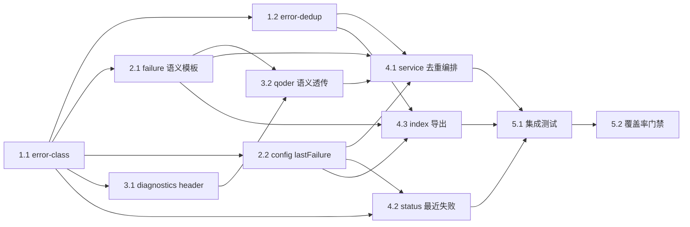

# 实现计划

> 执行约束（来自 jojo-specs workflow）：
>
> - 一次只实现一个任务；子任务存在时优先做子任务
> - 完成后立即更新本文档对应任务状态再停止，等待评审
> - 仅在用户明确要求时运行测试
> - 任务编号即为推荐执行顺序，按依赖关系自上而下递进
>
> **测试覆盖率约束：**
>
> - 本 feature 新增或被任务触达的 `src/` 中的 **.js**、**.ts** 源文件，单元测试 **Lines 覆盖率必须 ≥ 95%**
> - Statements / Functions / Branches 作为辅助指标，以 `unit-test` skill 的最新要求为准；未达辅助指标时需在风险点中说明原因与影响
> - **单测编写统一委托给 `unit-test` skill**：遵循其项目配置优先原则、命名规范（BDD 三层 `describe` + "应该 + 结果 + 当 + 条件" 句式）、Mock 复用规则、覆盖率红线、低价值测试禁令与最终交付格式；本 workflow 不重复定义用例规范
> - **前端**：覆盖全部 `.ts` / `.js` 业务文件
> - **后端（NestJS）**：仅强制覆盖 `repository` 与 `service`；`controller` / `module` / `entity` / `dto` 等默认走 E2E / 集成测试，不作为本 feature 覆盖率门禁范围
> - 验证口径：在 PR 说明里附上覆盖率验证命令与输出；Lines 未达 95% 须在对应单测任务里补齐用例后再关闭
>
> **提交约束：**
>
> - 每完成一个子任务（对应一个 [x] 的子任务条目）后，不自动执行 git commit；如需提交，必须由用户后续明确触发，并按 /Users/joke/.agents/skills/jojo-specs/references/phase-5-commit.md 执行
> - Commit 流程严格遵守 workflow 的所有步骤：收集改动 → 识别 type / scope → 生成 `type(scope): summary refs #issue-id` → 执行 `git commit`
> - `scope` 优先取本任务主要改动目录的模块名；如跨多个模块，取变动最大者
> - `issue-id` 取规范目录前缀 `20261106`；当前分支 `feat/20261106-error-readability` 不符合 `feature/<user>/<issue-id>` 约定，但末段日期与 issue-id 一致，提交时直接用 `refs #20261106`
> - 本规则**从第一个待执行任务起生效**
>
> **任务详情拆分约定：**
>
> - 本文档只保留任务状态、进度与索引；每个子任务的完整内容（目标 / 实现要点 / 引用 / 验证命令 / 验收 / 将写入）下钻到 `task-list/` 目录对应文件
> - 勾选 `[x]` / `[ ]` 状态仅在本文档维护；`task-list/` 文件内不再重复状态字段

---

## 概览

共 **5 个任务组 / 11 个子任务**。

执行顺序按"先纯逻辑、后采集落盘、再编排、最后集成"组织：

1. **T1 语义分类与去重（纯逻辑）**：`error-class.ts` 与 `error-dedup.ts` 都是零依赖纯模块，且是后续所有任务引用的类型与决策来源，必须最先落地。两者都能用单测穷举，先做能最早锁定"分类只认实测特征"与"发送失败不推进窗口"这两条最容易写错的规则。
2. **T2 文案与配置**：`failure.ts` 加语义模板与 ack，`config.ts` 加去重窗口配置与 `lastFailure` 状态。两块文件独立，但都被 T3/T4 依赖，所以紧随 T1。
3. **T3 采集与落盘**：先扩 `diagnostics.ts` 的 header 字段，再改 `qoder.ts` 的解析与透传——顺序不能反，因为 `qoder.ts` 的 `settleFailure` 会向 `writeDiagnostic` 传新字段。`qoder.ts` 同时扩充 `fake-qodercli.mjs`，用真实诊断样本复现两次事故。
4. **T4 编排与可观测**：`service.ts` 是本期改动面最大的文件（去重编排 + 续接降级迁移 + `lastFailure` + 日志字段 + 不入队），单独成一个子任务；`status.ts` 与 `index.ts` 文件独立。
5. **T5 集成与门禁**：用假 iLink + 假 qodercli 端到端复现事故并断言下行条数与文案，最后统一跑覆盖率、typecheck、构建与发布校验。

关键拆分原则：

- 每个代码子任务都自带单测，单测统一委托 `unit-test` skill；不把测试集中到最后补。
- **一期行为回归是硬门禁**：`failure.ts` 的六个传输层模板必须逐字不变，`qoder.ts` 的判定顺序必须不动。这两条在 2.1 与 3.2 的验收标准里各自单列。
- `service.ts` 只由 4.1 一个子任务改动，避免同文件并行冲突。
- 文档同步（README / RUNBOOK，见设计 11.3）不在本任务清单内（按 jojo-specs 阶段约束排除），实现完成后由用户决定是否补。
- 手工真机验收（设计 8.5）不在本任务清单内；自动化集成测试覆盖事故场景。

## 执行顺序总览

任务采用**严格线性顺序**，编号即执行顺序。下表列出全部 11 个子任务与关键依赖、预期产出（点击"任务"列链接查看完整任务内容）：

| 顺序 | 任务 | 摘要 | 硬前置 | 产出类型 |
| ---: | --- | --- | --- | --- |
| 1 | [**1.1**](./task-list/1.1-error-class.md) | 语义字段归一化与四类分类纯模块 | — | 纯函数 / 类型 |
| 2 | [**1.2**](./task-list/1.2-error-dedup.md) | 去重窗口决策与计数（含 fast-check 属性测试） | 1.1 | 纯逻辑组件 |
| 3 | [**2.1**](./task-list/2.1-failure-semantic-templates.md) | 三个语义模板短路 + ack 文案 + 一期文案逐字回归 | 1.1 | 纯函数 |
| 4 | [**2.2**](./task-list/2.2-config-last-failure.md) | 去重窗口配置项与 `lastFailure` 状态归一化 | 1.1 | 配置与模型 |
| 5 | [**3.1**](./task-list/3.1-diagnostics-header.md) | 诊断文件 header 增加 `errorClass` / `errorCode` | 1.1 | 诊断模块 |
| 6 | [**3.2**](./task-list/3.2-qoder-semantic-fields.md) | `parseResult` 扩字段、`exit` / `is_error` 透传语义、真实样本 fixture | 1.1、2.1、3.1 | 调用层 |
| 7 | [**4.1**](./task-list/4.1-service-dedup-orchestration.md) | service 去重编排、续接降级迁移、`lastFailure`、不入队 | 1.2、2.1、2.2、3.2 | 服务编排 |
| 8 | [**4.2**](./task-list/4.2-status-last-failure.md) | `status` 新增"最近失败"行 | 1.1、2.2 | CLI 输出 |
| 9 | [**4.3**](./task-list/4.3-index-exports.md) | 库入口导出新增类型与函数 | 1.1、1.2、2.1、2.2 | 公共 API |
| 10 | [**5.1**](./task-list/5.1-integration-incident-replay.md) | 假 iLink + 假 qodercli 端到端复现两次事故与去重 | 4.1、4.2、4.3 | 集成测试 |
| 11 | [**5.2**](./task-list/5.2-coverage-gate.md) | 覆盖率门禁、全量回归、typecheck、构建与发布校验 | 5.1 | 验证门禁 |

### 关键依赖链

- `T1.1 → 其余全部`：`QoderErrorClass` 与 `ERROR_CLASS_LABEL` 是所有下游模块的共同类型来源，必须最先落地。
- `T2.1 + T3.1 → T3.2`：`qoder.ts` 的 `settleFailure` 同时调用 `buildUserErrorReply`（新入参）与 `writeDiagnostic`（新字段），两者必须先就位。
- `T1.2 + T2.1 + T2.2 + T3.2 → T4.1`：service 编排需要去重存储、ack 文案、状态字段与 `QoderRunResult` 的新字段全部齐备。
- `T4.1 + T4.2 + T4.3 → T5.1`：集成测试断言端到端下行条数、`status` 输出与库导出，需要完整链路。

### 并行化提示（仅供加速参考，默认仍单任务串行）

- **2.1 与 2.2** 文件独立（`failure.ts` / `config.ts`），可合并为一次编辑。
- **3.1** 只改 `diagnostics.ts`，与 T2 无文件冲突，可提前并行；但编号顺序仍建议保持，因为 3.2 同时依赖两者。
- **4.1 与 4.2** 文件独立（`service.ts` / `status.ts`），可合并为一次编辑。
- **4.3** 只改 `src/index.ts`，必须在其导出的全部模块（1.1 / 1.2 / 2.1 / 2.2）落地后串行执行。
- **3.2 与 4.1** 都涉及"语义字段流转"，但文件不同；不得合并，因为 4.1 依赖 3.2 产出的 `QoderRunResult` 新字段。

---

## 任务清单（状态 · 进度）

> 勾选 `[x]` 表示已完成，`[ ]` 表示未完成。点击任务编号进入 `task-list/` 中的完整任务说明。

## T1. 语义分类与去重（纯逻辑）

- [x] **1.1** [语义字段归一化与四类分类纯模块](./task-list/1.1-error-class.md)
- [x] **1.2** [去重窗口决策与计数（含属性测试）](./task-list/1.2-error-dedup.md)

## T2. 文案与配置

- [x] **2.1** [语义模板短路、ack 文案与一期文案回归](./task-list/2.1-failure-semantic-templates.md)
- [x] **2.2** [去重窗口配置项与 lastFailure 状态归一化](./task-list/2.2-config-last-failure.md)

## T3. 采集与落盘

- [x] **3.1** [诊断文件 header 增加语义字段](./task-list/3.1-diagnostics-header.md)
- [x] **3.2** [qoder 解析扩字段与语义透传](./task-list/3.2-qoder-semantic-fields.md)

## T4. 编排与可观测

- [x] **4.1** [service 去重编排、续接降级迁移与不入队](./task-list/4.1-service-dedup-orchestration.md)
- [x] **4.2** [status 新增"最近失败"行](./task-list/4.2-status-last-failure.md)
- [x] **4.3** [库入口导出新增类型与函数](./task-list/4.3-index-exports.md)

## T5. 集成与门禁

- [x] **5.1** [端到端复现两次事故与去重行为](./task-list/5.1-integration-incident-replay.md)
- [x] **5.2** [覆盖率门禁、全量回归与构建校验](./task-list/5.2-coverage-gate.md)

---

全部 11 个子任务已执行完成（2026-11-06）。门禁实测：`npm run typecheck` 通过；`npm test` 304 tests / 20 files 全绿（基线 214，新增 90）；`npm run test:coverage` All files Lines 97.77%，`error-class.ts` 与 `error-dedup.ts` 均已在覆盖率报告内且各为 100%；`npm run build` 成功；`check-publish` 通过（`@jcyao/qoder-wechat-bridge@0.3.0`）。`package.json` 除版本号外无任何依赖变动。真机微信验收（设计 8.5）待用户执行。

## 审查修复（2026-11-06，见 [review.md](./review.md)）

审查意见逐条用代码对照与运行时探针验证后处置，结论回写至 design.md §13 / §13.1 与 requirements.md：

- **三项口径决策**：D1 `unknown` 不参与去重（实测第二次超时只剩「未归类同 HH:MM 那条」，且 `spawn` 会抑制 `rate_limit`）；D3 成功分支前补 `output_limit` 判定（探针证实 `exit=0`+`is_error:false`+`error_code:"max_output_tokens"` 曾返回 `ok:true` 并把半截答案当完整答案下发）；D4 需求 4.1 的 `status` 仅指本机 CLI。
- **六项实现缺陷已修**：I-1（`commit` 非空断言在全局清理下可抛异常）、I-2（续接降级日志未脱敏）、I-3（非法窗口值导致永久抑制，双层回落）、I-5a（`errorCode` 换行可伪造诊断头）、I-5d（变量遮蔽）、I-5e（getter 副作用未注明）。
- **三项测试缺陷已修**：T1（属性测试同义反复，换成 A/B 时间轴等价断言；另修一条空转属性，加密集生成器 + `fc.pre`）、T2（补未送达告警内容、`session_expired`、ack 未送达不推进计数、任务成功保留上次失败四条）、T3（集成测试改注入时钟，不再依赖真实 `sleep`）。
- **两项不采纳并记录理由**：I-5c（小 `maxChars` 截掉动作建议——属需求 1.2 与 3.1 的规范层冲突，改代码会砸掉逐字回归护栏）、I-5b（`at=0` 显示 1970，纯外观且仅手改 state.json 可触发）。I-4 只勘误设计措辞，不改回退顺序。
- **文档勘误**：design.md 的 `/status` 来源错误、"命中面更宽"仅在 `exit` 分支成立、`ParsedResult` 字段数 5→4、fixture mode 数 5→7、`detail` 实际会 trim、§13 四个开放问题全部关闭。

修复后门禁：`npm test` **318 tests / 20 files 全绿**（较修复前 +14）；`npm run typecheck` 通过；两次变异检验确认新属性测试可检出 `plan` 副作用与 `commit` 空转。

### 第二轮复审处置（同日）

第二轮结论为「可合并，Block 级 0」，并核定了开发方对第一轮的两处反驳均成立。本轮剩余 4 处文档一致性 + 3 条 Info，处置如下：

- **W1 / W2（§11.2 旧表述与勘误自相矛盾）**：已改。`/status` 行改为"微信内 `/status` 不新增最近失败行（D4）"；续接降级改为分 `exit` / `is_error` 两个分支说明增强与变窄的边界。
- **W3（需求 3 编号后移导致 12 处死引用，含指向不存在的「需求 3.9」）**：已按行号定点同步 **14 处**（审查列出 12 处，另查出 §5.1.5 变更点 6 标题与属性 6 的验证需求两处）。校验结果：design.md 中全部 `需求 3.x` 引用落在 1–8，与 requirements.md 实际条目数一致。
- **W4（`loadConfig` 只校验环境变量路径）**：属实且比审查描述更严重——配置文件写 `"abc"` 时 `loadConfig()` 会返回**字符串**，而 `Config.errorDedupWindowMs` 声明为 `number`，是类型谎言。选择**改代码而非弱化文档**：在合并配置文件与环境变量之后统一校验，两条路径都满足需求 3.8。
- **N-1（`normalizeLastFailure` 未剥控制字符）**：已修。该函数是本期新增、且本就在防手改 state.json，漏掉控制字符与刚修的 I-5a 是同一类缺陷；抽出 `sanitizeSingleLine` 供活路径与持久化路径共用。`kind` 不参与渲染，故不清洗。
- **N-2（同一 `semantic` 二次分类）**：不改。纯函数、结果一致，抽掉反而要把分类结果穿透 `settleFailure` 签名。
- **N-3（`at=0` 显示 1970）**：按第一轮商定顺延下一迭代。
- **连带行为变更**：`normalizeLastFailure` 对数字形态的 `errorCode`（如 `110`）由"丢弃"改为"归一化成 `'110'`"，与活路径 `classifyQoderError` 一致；原断言该行为的用例已按新意图更新，并补了一条真正非法值（对象）→ `undefined` 的用例。

第二轮修复后门禁：`npm test` **322 tests / 20 files 全绿**（+4）；`npm run typecheck` 通过；All files Lines **97.72%**，`error-class.ts` 与 `error-dedup.ts` 四项指标仍各 100%。

---

这些任务内容是否已经合适？
