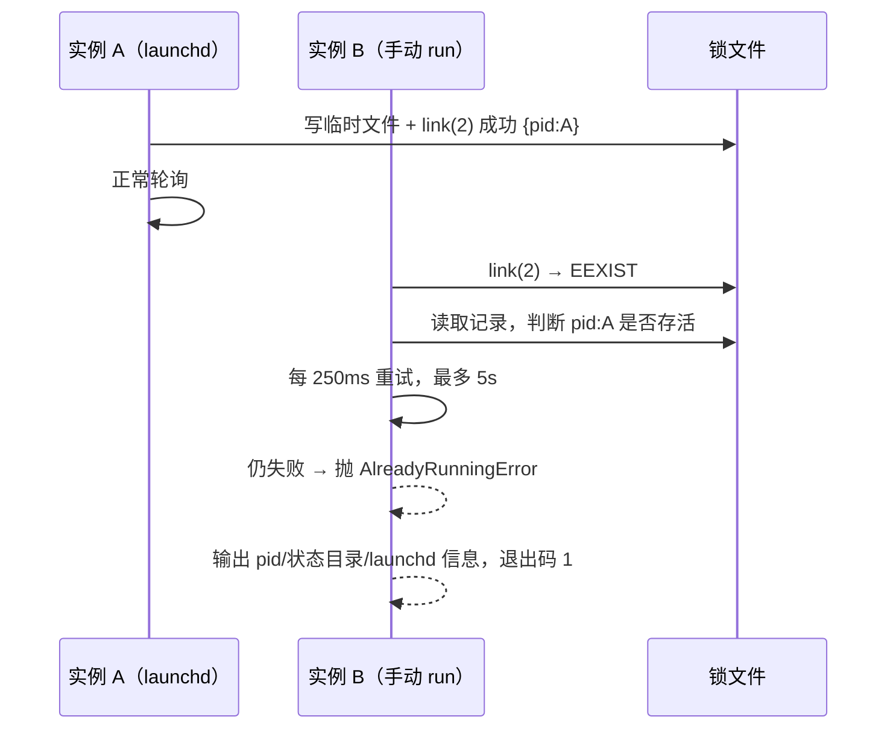

# 【后端技术文档】桥接实例互斥

> 状态：设计已确认，第一轮审查问题已修复 ｜ 更新：2026-11-10
> 需求基线：[requirements.md](./requirements.md)（2026-11-10 已确认）
> 验收记录：[verification.md](./verification.md) ｜ 审查：[review.md](./review.md)
> 规范目录：`.specs/20261110_桥接运维加固/`
> 开发分支：`feat/20261110-bridge-hardening`
> 原计划中的工具进度气泡已在真实探针中判定不可行（HTTP 200 + 空 body、客户端不渲染），已从本设计移除，结论见 `.specs/v2-backlog.md`

## 生成 AI 概要

- 生成模型：Qoder Desktop Agent 当前会话模型（会话未暴露底层型号，不作推测）
- 生成方式：由 `jojo-specs` 技能按"需求 → 设计 → 任务"阶段生成
- 设计输入：`requirements.md` + 现有代码（`src/cli.ts`、`src/config.ts`、`src/bridge/service.ts`、`src/bridge/lifecycle.ts`、`src/status.ts`）

---

## 1. 需求背景

### 1.1 为什么要做

`run` 入口没有任何前置检查，`writeRunInfo()` 无条件覆盖 `run.json`，`state.json` 是整文件原子替换且无锁。两个实例同时存活时，各自在内存里推进 `get_updates_buf` 并整文件回写，结果是同一批消息可能被执行两次、游标回退导致漏收、`outbox` / `sessions` / `contextTokens` 互相抹掉；`/stop` 也只能停掉自己进程里的任务。

高风险触发点：launchd 常驻 + 手动调试、KeepAlive 重启重叠、不同状态目录起同 bot 的调试实例。

### 1.2 高层方案与理由

| 主题 | 方案 | 理由 |
| --- | --- | --- |
| 互斥范围 | 双层锁：状态目录锁 + bot 级锁 | 状态目录锁覆盖 launchd / 手动 / 重启重叠；bot 级锁覆盖"不同状态目录、同一 bot" |
| 原子性 | 完整内容写入临时文件（`open(tmp,'wx',0o600)`）后 `link(2)` 挂到锁路径 | 并发读者只会看到「不存在」或「内容完整」两种状态，杜绝半写锁被误判为脏锁而抢占；不支持硬链接的文件系统回退 `open(path,'wx')`；不引入依赖 |
| 陈旧接管 | 锁内容带 pid，仅 `isAlive` 判存活；`isBridgeProcess` 只用于告警 | 进程被 SIGKILL 后锁文件残留，必须能靠 pid 判定接管；存活但命令行不匹配属判定不清，保守按占用处理，不删他人锁 |
| 冲突行为 | 等待 ≤5s 后拒绝启动，非零退出 | 5s 覆盖 launchd 重启重叠；wait 后仍失败交给 KeepAlive 既有节流（30s）重试 |
| 锁失败 | fail-closed | 用户明确选择：宁可起不来，也不在无互斥保护下轮询 |
| 获取顺序 | `runService` 分两阶段：先 state，登录后再 bot | 入口处即可挡掉同目录双实例；botId 在登录后才可靠 |

### 1.3 技术栈

- 运行时：Node.js ≥ 20（`engines`），无新增运行时依赖。
- 文件锁：Node 内置 `fs`。
- 进程识别：复用 `src/bridge/lifecycle.ts` 的 `isAlive` / `isBridgeProcess` / `launchdLabel`。
- 测试：vitest（既有），新模块纳入 95% Lines 覆盖门禁。

---

## 2. 相关文档 & 资源

| 资源 | 用途 |
| --- | --- |
| [requirements.md](./requirements.md) | 本设计的验收基线 |
| `.specs/v2-backlog.md` | 进度气泡探针结论与既有待办 |
| `src/bridge/lifecycle.ts` | 进程存活、桥接进程识别、launchd 发现、stop 冲突检测 |
| `src/config.ts` | `run.json` 读写、状态目录、原子写入 |

---

## 3. UI

不涉及前端页面，用户可见面只有两处。

### 3.1 终端（拒绝启动）

```
已在运行：pid 27180（launchd：com.jcyao.qoder-wechat-bridge）
状态目录：/Users/joke/.local/state/qoder-wechat-bridge
启动时间：2026-11-10T08:30:00.000Z
工作目录：/Users/joke
该实例由 launchd 托管，KeepAlive 会自动拉起。如需重启：
  qoder-wechat stop
（launchd 托管的实例需要按 stop 输出里的 bootout 命令操作）
如确认没有实例在运行，可删除记录文件后重试：
  rm "/Users/joke/.local/state/qoder-wechat-bridge/run.lock"
```

非 launchd 场景：

```
已在运行：pid 27180
状态目录：/Users/joke/.local/state/qoder-wechat-bridge
启动时间：2026-11-10T08:30:00.000Z
工作目录：/Users/joke
如需重启：
  qoder-wechat stop && qoder-wechat run
如确认没有实例在运行，可删除记录文件后重试：
  rm "/Users/joke/.local/state/qoder-wechat-bridge/run.lock"
```

### 3.2 `status`

新增一行：

```
运行实例：pid 27180（存活）
```

无实例时：

```
运行实例：未运行
```

---

## 4. 架构

### 4.1 组件关系

```mermaid
flowchart TD
  CLI[cli.ts run] --> SVC[service.ts runService]
  SVC --> LOCK[instance-lock.ts]
  LOCK --> STATE_LOCK[(stateDir/run.lock)]
  LOCK --> BOT_LOCK[(~/.local/state/qoder-wechat-bridge/instances/<sha1(botId)[0:16]>.lock)]
  LOCK --> LIFE[lifecycle.ts isAlive/isBridgeProcess/launchdLabel]
  SVC --> RUNINFO[(stateDir/run.json)]
  CLI --> STATUS[status.ts 运行实例行]
  CLI --> LIFE2[lifecycle.ts describeOwner]
```

### 4.2 数据流：重复启动拦截



### 4.3 启动与释放顺序

```
ensureDirs → loadState → prune
  → 取 state 锁（mode=state，预算 5s）
  → run.json 兜底：指向存活桥接进程 → 拒绝；陈旧 → 清理
  → 需要时登录并 reload config（登录耗时不计入任何取锁预算）
  → 取 bot 锁（mode=bot，botId 非空时；预算另起 5s，避免被登录吃掉）
  → createBridgeRuntime → 预检
  → writeRunInfo()
  → 主循环
释放顺序不变量：停止入站 → 取消已启动任务（仅用户停止路径）→ 等待队列排空（等待上限 3s）
  → 排空成功才清 run.json 并释放锁
  → 排空超时保留锁，并在在途任务落定后补释放（同进程内在此之前重启会被防重入拒绝）
  → 释放之后不得再写 state.json（canPersist 以 lockReleased 为闸）
释放点：handle.stop()（异步，等主循环收敛后释放）/ 第一次信号（停止入站 + 取消，交给 runLoop 收尾）/ 第二次信号 exit(130) 前 / runLoop finally / 启动异常 catch / 排空超时后的补释放
会话过期与主循环异常不取消已启动任务：让任务正常结束并把回复写入 outbox，再排空释放。
停止期入站策略：`stopping` 后不再下载附件、不再入队、`processTask` 入口直接丢弃排队任务；
  由于 `get_updates_buf` 已推进且 iLink 不再投递，这批消息永久不再被处理（属预期，见需求 2.7）。
```

### 4.4 部署与平台差异

- 锁路径：状态锁在 `stateDir()` 内；bot 锁固定在 `~/.local/state/qoder-wechat-bridge/instances/`，**与状态目录解析规则无关**（既不随 `QWB_STATE_DIR`，也不随 `XDG_STATE_HOME`），否则跨目录检测失效。
- macOS / launchd：拒绝启动时通过 `launchdLabel(pid)` 判断是否托管。
- Windows：`open('wx')` 语义一致；`isBridgeProcess` 不可用，按 pid 存活保守处理（见 7）。
- 其他平台：`isBridgeProcess` 基于 `ps`。

---

## 5. 方案设计

### 5.0 关键默认值与决策

| 配置 / 常量 | 默认值 | 来源与理由 |
| --- | --- | --- |
| `LOCK_WAIT_MS` | `5000`（常量） | 需求 4.2；覆盖 launchd 重启重叠 |
| `DEFAULT_POLL_MS` | `250`（常量） | 等待重试间隔 |
| 脏锁清理重试 | `≤3` 次（常量） | 防止两个进程同时清理脏锁时无限循环 |
| 锁文件权限 | `0600` | 需求 N3 |

### 5.1 组件与接口

#### 5.1.1 `src/bridge/instance-lock.ts`（新增）

职责：获取 / 释放实例锁，判定陈旧锁，抛可读的冲突错误。不读写 `state.json`，不发消息。

```ts
export interface LockRecord {
  pid: number;
  ppid: number;
  startedAt: string;
  cwd: string;
  botId: string;
  stateDir: string;
  role: 'state' | 'bot';
}

export interface LockHandle {
  /** 幂等释放：只删除内容 pid 等于自身 pid 的锁文件 */
  release: () => void;
  /** 当前持有的锁文件路径 */
  paths: string[];
}

export class AlreadyRunningError extends Error {
  readonly owner: LockRecord;
  readonly launchdLabelValue: string | null;
  /** 实际等待时长（毫秒），非预算常量 */
  readonly waitedMs: number;
  /** 冲突的锁文件或 run.json 路径，供 CLI 给出人工处置命令 */
  readonly lockFile: string;
}

export class LockIoError extends Error {
  readonly path: string;
  readonly code: string;
}

export function stateLockPath(stateDir: string): string;
export function globalInstancesDir(): string;
export function botLockPath(botId: string): string;
export function acquireInstanceLock(input: {
  stateDir: string;
  botId: string;
  /** 默认 both；runService 分两阶段分别取 state / bot */
  mode?: 'both' | 'state' | 'bot';
  waitMs?: number;
  /** 绝对截止时间；每把锁各自 5s 预算（runService 在登录后为 bot 锁重新起算），缺省用 now()+waitMs */
  deadline?: number;
  pollMs?: number;
  sleep?: (ms: number) => Promise<void>;
  isAlive?: (pid: number) => boolean;
  isBridgeProcess?: (pid: number) => boolean;
  now?: () => number;
}): Promise<LockHandle>;
```

**获取算法**

```
acquireOne(path, record):
  mkdir 父目录（失败 → LockIoError，fail-closed）
  loop:
    写同目录临时文件（open 'wx' + writeSync + 短写校验）→ link(tmp, path) → unlink(tmp)
      EEXIST → 已存在；ENOTSUP/EPERM/EACCES/EXDEV → 退回 O_EXCL 直接创建
      （先写临时文件再 link，保证并发读者不会读到半写内容而误判脏锁）
    EEXIST:
      读取记录
        文件不存在（如悬空符号链接）→ 到达 deadline 则 LockIoError(EBUSY)，否则 sleep(pollMs) 重试
        内容损坏 → 视为脏锁
        pid === 自身 → 记 error（自身 pid/对方 pid/锁路径）→ AlreadyRunningError（防同进程重入）
        pid 不存活 → 视为脏锁
        pid 存活但命令行不匹配 → 记 error 后按"存活"等待（保守，仅 !alive 才可接管）
      脏锁 → unlink（ENOENT 忽略）→ dirtyRetries+1 → 超过 3 次抛 EDIRTY → 立即重试
      存活 → 到达 deadline 则记 error 并 AlreadyRunningError(实际 waitedMs)；否则 sleep(250ms)
    其他错误 → LockIoError（message 含路径与错误码）
```

**关键不变量**

- `link(2)` 是唯一的"判断 + 占用"动作（`O_EXCL` 只用在临时文件创建上）。
- **接管只在 `!alive(pid)` 时发生**；"存活但命令行不匹配"按冲突处理并记 error，交由人工确认，避免 `node --inspect`、`env node`、`npm exec` 等漏判形态把存活实例的锁抢走。
- 两个进程同时发现脏锁时，都会 `unlink`（第二个得到 ENOENT 并忽略），随后都进入 `open('wx')`；只有一个成功，另一个重新读取新锁并按"存活"路径等待 / 失败。
- `release()` 先读锁内容，`record.pid !== process.pid` 时直接跳过，避免误删新实例的锁。
- 锁文件内容含明文 `botId`（权限 0600、目录 0700，不含 token），**文件名**为 `sha1(botId).slice(0, 16)`。
- `mode='bot'` 且 `botId` 为空 → `LockIoError(EINVAL)`。
- 获取顺序固定 state → bot；两把锁各自 5s 预算，扫码登录不占用预算，故整次启动的取锁等待上界约 10s（见 §9）。

#### 5.1.2 `src/bridge/lifecycle.ts`（修改）

- 新增 `InstanceOwner` 接口与 `describeOwner(owner, launchdLabel)`，生成 3.1 的中文文案。
- 不改 `planStop` / `stopService`；`stop` 的多实例冲突提示保持不变（需求 3.3）。

#### 5.1.3 `src/bridge/service.ts`（修改）

- 启动前取 state 锁；随后做 `run.json` 兜底（指向存活桥接进程则拒绝，陈旧则清理）；登录并 reload 配置后取 bot 锁。state 锁与 bot 锁各自计算 5s 窗口，扫码登录耗时不计入 bot 锁窗口；都拿到后才 `writeRunInfo()`。
- `lockHandles: LockHandle[]` + 幂等 `releaseLocks()`；排空（`waitForIdle()`，等待上限 3 秒）成功后才释放锁，失败则**保留锁**并记 error。
- runtime 注入两个状态查询：`isStopping()`（仅用户停止流程为 true，入站门禁用）与 `canPersist()`（`releaseLocks()` 后为 false，落盘门禁用）；会话过期不设 `isStopping`，让在途任务把回复写入 outbox。
- `handle.stop()` 改为异步：置停止态 → 取消任务 → abort 轮询 → 等 `runLoop` 收敛（其 `finally` 统一排空与释放），对外 API 由 `() => void` 变为 `() => Promise<void>`。
- 释放点：`handle.stop()`、第一次信号（`onSignal` 停止入站并取消，交给 `runLoop` 收尾）、第二次信号 `exit(130)` 前、`runLoop().finally`、启动异常 `catch`。
- `createBridgeRuntime` / 预检 / `writeRunInfo` 一并包在启动 `try` 内，任何异常都要摘早期信号监听并释放锁，避免库调用方同进程自锁。
- `config.botId` 为空时记一条 warn：跨状态目录互斥不可用。

#### 5.1.4 `src/cli.ts`（修改）

- `run` 分支捕获 `AlreadyRunningError`（`describeOwner` 输出 + exit 1）与 `LockIoError`（输出原因 + exit 1）；其他异常照旧抛给 `main().catch`。
- `status` 分支读取 `readRunInfo()` + `isAlive()` 传给 `buildStatusLines`。

#### 5.1.5 `src/status.ts`（修改）

- `StatusContext` 增加可选 `runInfo` / `runAlive`。
- 输出新增 `运行实例：pid N（存活）` 或 `运行实例：未运行`，位置在附件目录与会话数之间。

### 5.2 数据模型

| 实体 | 位置 | 字段 |
| --- | --- | --- |
| 状态锁 | `stateDir()/run.lock` | `LockRecord{role:'state'}` |
| bot 锁 | `~/.local/state/qoder-wechat-bridge/instances/<sha1(botId)[0:16]>.lock` | `LockRecord{role:'bot'}` |
| 运行记录 | `stateDir()/run.json` | 既有 `RunInfo`（不变） |

- 一个状态目录最多一把状态锁；一个 botId 在本机最多一把 bot 锁。
- 一个实例按固定顺序持有 1~2 把锁；锁不写 `state.json`，不参与 outbox。
- `run.json` 只在没有任何锁文件时作为兜底判定源（旧版本实例不写锁）；有锁时不参与判定。
- 锁状态迁移：`不存在 → 持有 → 释放`；`不存在 → 持有 → 进程被杀 → 脏锁 → 被下一个实例接管`。
- bot 锁不做定期回收：强杀后该 botId 不再启动时，`instances/*.lock` 会长期保留（内容含 pid / 路径 / 明文 botId，不含 token；文件名是 sha1 摘要），列入非目标。取锁用的临时文件 `.run.lock.<pid>.<ts>.<rand>.tmp` 正常路径由 `createLock` 的 finally 清理，若在写入与 `link` 之间被 SIGKILL 打断可能残留，内容敏感面与锁等同（0600），不做主动扫描清理，同列入非目标。
- 锁内容必须是合法 JSON 且 `pid` 为正整数，否则视为脏锁。

---

## 6. 正确性属性

### 正确性属性 1：并发启动至多一个实例

_For any_ 两个在同一状态目录、几乎同时启动的实例，桥接服务 SHALL 只允许一个进入 `getupdates` 轮询。

**验证需求：需求 1.1、2.1、2.2**

### 正确性属性 2：拒绝启动无副作用

_For any_ 因已有实例被拒绝的启动，桥接服务 SHALL NOT 覆盖 `run.json`、SHALL NOT 写入 `state.json`、SHALL NOT 处理入站消息。

**验证需求：需求 1.3**

### 正确性属性 3：陈旧锁必可接管

_For any_ 记录了不存活 pid 的锁文件，下一次启动 SHALL 清理该锁并成功获取。

**验证需求：需求 1.4、2.4**

### 正确性属性 4：崩溃不产生永久锁

_For any_ 被 SIGKILL 终止的实例，其锁 SHALL NOT 阻止后续实例启动。

**验证需求：需求 2.4**

### 正确性属性 5：锁失败即拒绝

_For any_ 锁文件因权限或 IO 无法创建 / 读取的场景，桥接服务 SHALL 以非零退出码拒绝启动，SHALL NOT 进入轮询。

**验证需求：需求 2.5**

### 正确性属性 6：运行记录归属明确

_For any_ 退出路径，桥接服务 SHALL 只在 `run.json` 的 pid 等于自身时删除该文件。

**验证需求：需求 3.2**

### 正确性属性 7：跨状态目录同 bot 互斥

_For any_ 同一 botId、不同状态目录的两个实例，桥接服务 SHALL 只允许一个存活。

**验证需求：需求 5.1、5.3**

### 正确性属性 8：释放锁之后不再写状态

_For any_ 退出路径（`handle.stop()`、SIGINT / SIGTERM、会话过期、主循环异常），桥接服务 SHALL 在释放锁之前停止入站（用户停止路径同时取消已启动任务）并等待队列排空；若 3 秒内未排空 SHALL 保留锁不释放，并在在途任务落定后补释放。锁释放后 SHALL NOT 再写入 `state.json`。

**验证需求：需求 2.3**

### 正确性属性 9：无锁旧实例必被识别

_For any_ 不存在锁文件、但 `run.json` 指向存活桥接进程的启动，桥接服务 SHALL 拒绝启动；`run.json` 指向陈旧 pid 时 SHALL 清理后继续启动。

**验证需求：需求 1.4、1.6**

说明：`run.json` 兜底与锁路径判定方向刻意不同——`run.json` 是提示源，其 pid 存活但不是桥接进程时按陈旧清理并继续启动；锁是权威源，存活但特征不符时拒绝启动并等待人工确认。

---

## 7. 错误处理

| 场景 | 行为 |
| --- | --- |
| 锁被存活实例持有 | 等待 ≤5s；仍失败记 error（自身 pid / 对方 pid / 判定依据 / 锁路径）并抛 `AlreadyRunningError`，CLI 输出 pid / 启动时间 / 工作目录 / 状态目录 / launchd 提示，退出码 1 |
| 锁存活但命令行不匹配（如 pid 复用） | 按冲突等待并记 error，**不接管**；5s 后拒绝启动，提示人工确认锁文件 |
| 锁内容损坏或 pid 不存活 | 视为脏锁，`unlink` 后重试；连续 3 次仍失败抛 `LockIoError(EDIRTY)` |
| 锁文件 EACCES / EIO / ENOTDIR | 抛 `LockIoError`（message 含路径与错误码），fail-closed，退出码 1 |
| 锁内容短写（`writeSync` 字节数不符） | 抛 `LockIoError(ENOSPC)`，删除临时文件，不创建锁 |
| 文件系统不支持硬链接 | 退回 `open('wx')` 直接创建，行为与旧实现一致 |
| 排空超时 | **保留锁**并记 error；进程退出后由下一次启动按陈旧锁接管 |
| 拒绝启动（锁或 run.json） | CLI 输出中文说明、launchd 提示与 `rm "<lockFile>"` 人工处置命令 |
| 锁路径是悬空符号链接（open EEXIST 而读取 ENOENT） | 到达 deadline 抛 `LockIoError(EBUSY)`，不忙等 |
| 无锁但 `run.json` 指向存活桥接进程 | 记 error 后按 `AlreadyRunningError` 拒绝启动 |
| `unlink` 脏锁失败（非 ENOENT） | 抛 `LockIoError`，避免无限循环 |
| botId 为空且 mode=bot | 抛 `LockIoError(EINVAL)` |
| botId 为空且 mode=both | 跳过 bot 锁，记 info；只做同状态目录互斥 |
| runService 中 botId 为空 | 记 warn：跨状态目录互斥不可用 |
| 同进程重复获取 | 直接抛 `AlreadyRunningError`，避免单测 / 库调用把自身锁判成陈旧 |
| 释放时锁已属于别的 pid | 直接跳过，不删除 |
| 释放时读取 / 删除失败（非 ENOENT） | 只记 warn，不抛错 |
| Windows 无法校验命令行 | 按 pid 存活保守视为存活实例；pid 被复用时会拒绝启动直到人工清理锁文件 |
| 启动期在取锁 / 登录 / 预检中收到信号 | 早期信号处理器释放已持有的锁后退出（130） |

---

## 8. 测试策略

### 8.1 单元测试矩阵

| 模块 | 用例 |
| --- | --- |
| `instance-lock` | 首次获取与释放；同时持有 state / bot 双锁；并发只有一个成功；脏 pid 接管；损坏 JSON 接管；存活冲突等待后失败；锁目录不可用 fail-closed；`open` / `write` / `unlink` 失败路径；释放不删他人锁；bot 锁冲突释放 state 锁；`mode` 三种取值与缺 botId 报错 |
| `lifecycle.describeOwner` | launchd / 非 launchd 文案；状态目录缺失 |
| `status` | 运行实例存活 / 未运行；既有状态行不回归 |
| `service-startup` | 同目录第二实例被拒绝且不写 `run.json`；陈旧锁接管；登录失败释放锁；取锁后 runtime/预检抛错仍释放锁；拒绝路径写 error 日志；无锁但 run.json 存活时拒绝、陈旧时清理；botId 为空告警；**任务时长超过排空上限时保留锁**；两次信号与单次信号的收尾差异 |

### 8.2 集成测试

- **双实例**：同目录启动两个 `runService`，第二个抛 `AlreadyRunningError`，第一个仍能处理消息并回复。
- **跨进程竞争**：spawn 两个独立 Node 子进程（`test/fixtures/instance-lock-contender.mjs`）抢同一 `stateDir`，成功方持锁 5s（远大于被拒方 300ms 等待窗口），断言恰好一个 exit 0、另一个 exit 1 且输出含「已在运行」——这是需求 2.1 的核心证据；用例超时会 kill 子进程。
- **脏锁接管**：预写 `pid: 999999` 的 `run.lock`，`runService` 成功启动并在 stop 后删除锁。
- **跨状态目录**：不同 `QWB_STATE_DIR`、同一 botId 的第二个实例被拒绝，且其状态锁被释放。
- **不同 bot**：不同 botId 可在不同状态目录并行。
- **隔离**：集成用例设置 `HOME` 指向临时目录，用例结束后真实注册表目录与临时目录都无锁残留。

### 8.3 覆盖率

`vitest.config.ts` 的 `coverage.include` 增加 `src/bridge/instance-lock.ts`，保持 Lines ≥ 95%。`instance-lock.ts` 实测 Lines 100%，并新增「空目录取锁 + 释放 < 100ms」计时用例对应需求 2.6。Branch 覆盖率低于 95% 的原因是大量 IO 失败分支依赖 `vi.spyOn` 注入（EACCES/EIO/EDIRTY），分支组合无法穷举；由错误处理用例逐条覆盖，不再额外堆叠组合。`service.ts` 的 `onSignal` 分支由 service-startup 的信号用例覆盖。

---

## 9. 风险与开放问题

| 风险 | 影响 | 应对 |
| --- | --- | --- |
| 取锁等待叠加 launchd 30s 节流 | 重启窗口变长 | 每把锁各 5s、登录不占预算，整次启动取锁等待上界约 10s；仅在冲突时发生，日志记录实际 `waitedMs` |
| 排空超时保留锁 → 新实例暂时起不来 | 停机窗口 = 在途任务剩余时长（上界 `qoderTimeoutMs` 600s）+ launchd 节流 | 属安全侧设计：宁可慢起，也不双写。任务落定后本进程补释放；进程若先退出则由下次启动按 `!alive` 接管（真机脚本第 5 项已验证接管） |
| 多进程同时清理脏锁 | 偶发 ENOENT | 忽略 ENOENT；`open('wx')` 仍保证唯一赢家 |
| 非 launchd 的 pid 复用 | 误判为存活 | 命令行特征校验；解析不到特征时按存活处理（fail-closed），拒绝启动并提示人工确认 |
| 进程特征漏判（`node --inspect`、`env node`、`npm exec`） | 曾会抢走存活实例的锁 | 只在 `!alive` 时接管，同时扩展特征识别（跳过运行器选项、支持 env/npm 前缀） |
| 旧版本实例不写锁 | 升级瞬间双开 | 启动时以 `run.json` 兜底：指向存活桥接进程则拒绝 |
| 退出时在途任务仍在写 `state.json` | 新实例游标被旧副本覆盖 | 释放前排空队列（上限 3s），释放后不再落盘 |
| 状态目录在不可写磁盘 | 服务无法启动 | fail-closed，错误信息带路径与错误码 |
| 锁文件被手工替换或做成悬空符号链接 | 读取失败或忙等 | 内容损坏视为脏锁；悬空链到达 deadline 抛 `LockIoError(EBUSY)` |
| bot 锁长期残留（强杀后该 bot 不再启动） | `instances/` 累积小文件 | 明确列为非目标，本期不做定期清理；临时文件在成功 link 后立即删除 |
| pid 被无关进程复用 / 僵尸进程 | 保守接管会一直拒绝启动 | **不做按时间自动接管**（可能误抢长任务）；拒绝文案给出 `rm "<lockFile>"` 人工处置命令，要求确认无实例后执行 |
| `run.json` 与锁判定方向不同 | 可能被误读为不一致 | 刻意设计：`run.json` 是提示源（不符即清理），锁是权威源（存活即等待）；已写入属性 9 说明 |
| `handle.stop()` 由同步变异步 | 库调用方未 await 时无法感知完成 | 已在本表登记；集成用例 5 处（`test/integration/instance-lock.test.ts:128/150/165/177/178`）与第三轮新增用例均已 `await`；**旧「runService 启动流程」用例仍有 12 处未 await**（`test/unit/service-startup.test.ts:104/123/139/150/171/189/210/227/241/272/325/349`，floating promise 不影响断言结果，但收尾时序不可控），列为待办 |

## 10. 权限变更

- 不申请任何系统权限，不新增能力（无 TCC / 无端口 / 无自启项变更），launchd plist 本期不改。
- 新增文件的权限位：`run.lock`、bot 锁与其临时文件均为 `0600`，`instances/` 目录 `0700`（`mkdir` mode 受 umask 影响，实测 `umask=022` 下仍为 0700）。
- 配置项无新增必填项；新增常量 `DRAIN_TIMEOUT_MS`（3s）与既有 `LOCK_WAIT_MS`（5s）均为内部常量，不对外暴露。

## 11. 影响范围

| 面 | 变化 |
| --- | --- |
| 新增模块 | `src/bridge/instance-lock.ts` → `dist/bridge/instance-lock.js`（本轮实测 `npm pack --dry-run`：90.6 kB / 57 files） |
| CLI `run` | 新增拒绝启动路径（exit 1 + 中文文案 + `rm` 提示）；其余命令不变 |
| CLI `status` | 新增一行「运行实例：pid N（存活）」/「未运行」 |
| CLI `stop` | 不发新信号、不删锁文件，行为与 0.3.0 一致；锁的清理由被停实例自身完成 |
| 库入口 | `runService` 返回的 `BridgeHandle.stop()` 由同步变异步（见 §9）；新增导出 `buildStatusLines` 的 `runInfo` 可选字段 |
| 数据文件 | `state.json` / `run.json` 结构不变，无迁移；新增 `run.lock`、`instances/<hash>.lock`、`.run.lock.*.tmp` |
| 文档 | `RUNBOOK.md` §2/§3/§5、`README.md` 常见问题新增实例互斥与停止期丢弃说明 |
| 升级兼容 | 旧版本（≤0.3.0）实例不写锁，由 `run.json` 兜底拦截；全局安装需重装新版才具备互斥能力 |

## 12. 项目发布说明

面向使用者：重复启动微信桥接会被明确拒绝并告诉你该停谁；两个实例同时消费同一个微信号导致重复回复、漏消息的问题从源头堵住。附带影响：停服瞬间正在处理或还在排队的消息会被丢弃（不再重投），排空超时时新实例要等在途任务结束才能启动。

发布动作仍归主人：本期版本号 bump 为 `0.4.0`（`package.json` / lock 已更新）；`npm publish` 需本人登录执行。

**开放问题**：无。
