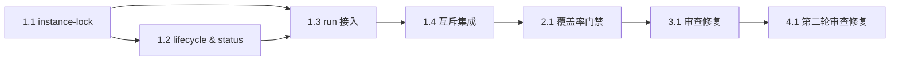

# 实现计划

> 执行约束（来自 jojo-specs workflow）：
>
> - 一次只实现一个任务；子任务存在时优先做子任务
> - 完成后立即更新本文档对应任务状态再停止，等待评审
> - 仅在用户明确要求时运行测试
> - 任务编号即为推荐执行顺序，按依赖关系自上而下递进
>
> **测试覆盖率约束：**
>
> - 本 feature 新增或被任务触达的 `src/` 中的 **.js**、**.ts** 源文件，单元测试 **Lines 覆盖率必须 ≥ 95%**
> - Statements / Functions / Branches 作为辅助指标，以项目既有测试约定为准；未达辅助指标时需在风险点中说明原因与影响
> - **单测编写遵循项目既有约定**：沿用 vitest + `test/unit` / `test/integration` 目录与中文 `describe` / `it` 句式；本 workflow 不重复定义用例规范
> - 新增模块 `src/bridge/instance-lock.ts` 必须加入 `vitest.config.ts` 的 `coverage.include`（1.1 已完成）
> - 验证口径：在 PR 说明里附上覆盖率验证命令与输出；Lines 未达 95% 须在对应单测任务里补齐用例后再关闭
>
> **提交约束：**
>
> - 每完成一个子任务（对应一个 [x] 的子任务条目）后，不自动执行 git commit；如需提交，必须由用户后续明确触发，并按 `/Users/joke/.agents/skills/jojo-specs/references/phase-5-commit.md` 执行
> - Commit 流程严格遵守 workflow 的所有步骤：收集改动 → 识别 type / scope → 生成 `type(scope): summary refs #issue-id` → 执行 `git commit`
> - `scope` 优先取本任务主要改动目录的模块名；如跨多个模块，取变动最大者
> - `issue-id` 取规范目录前缀 `20261110`；当前分支 `feat/20261110-bridge-hardening`，提交 message 使用 `refs #20261110`
> - 本规则**从第一个待执行任务起生效**
>
> **任务详情拆分约定：**
>
> - 本文档只保留任务状态、进度与索引；每个子任务的完整内容（目标 / 实现要点 / 引用 / 验证命令 / 验收 / 将写入）下钻到 `task-list/` 目录对应文件
> - 勾选 `[x]` / `[ ]` 状态仅在本文档维护；`task-list/` 文件内不再重复状态字段

---

## 概览

共 **5 个任务组 / 8 个子任务**。

本期范围已收敛为**实例互斥**：工具进度气泡在 2026-11-10 的真实探针中被判定不可行（类型 11/12 返回 HTTP 200 + 空 body、手机端不渲染），已从本迭代移除，结论回写 `.specs/v2-backlog.md`。

执行顺序：

1. **T1 实例互斥（1.1–1.4）**：纯文件锁模块 → 冲突文案与状态展示 → `runService` 接入 → 集成验证。四步严格串行，`service.ts` 与 `cli.ts` 存在复用，不能并行编辑。
2. **T2 覆盖率与回归（2.1）**：全量 typecheck / build / test:coverage 与打包自检，确认互斥改动没有回归既有收发链路。
3. **T3 审查修复（3.1）**：按 `review.md` 第一轮结论修 Block 5 条、验收欠账 7 条与文档口径，补跨进程与隔离证据。
4. **T4 第二轮审查修复（4.1）**：收口 drain 超时释放锁，清 Important/Minor 与文档口径冲突。

关键拆分原则：

- 锁模块不依赖运行态，先做能用单测锁定原子性与接管规则。
- `service.ts` 只由 1.3 改动；`cli.ts` 由 1.2、1.3 依次改动。
- 文档更新（README / RUNBOOK / 配置说明）不在本任务清单内，实现完成后由用户决定。

## 执行顺序总览

任务采用**严格线性顺序**，编号即执行顺序。下表列出全部 8 个子任务与关键依赖、预期产出（点击"任务"列链接查看完整任务内容）：

| 顺序 | 任务 | 摘要 | 硬前置 | 产出类型 |
| ---: | --- | --- | --- | --- |
| 1 | [**1.1**](./task-list/1.1-instance-lock.md) | 原子文件锁、脏锁接管、fail-closed 错误类型 | — | 纯模块 / 单测 |
| 2 | [**1.2**](./task-list/1.2-lifecycle-and-status.md) | 冲突文案、`status` 运行实例行 | 1.1 | 模块 / CLI 输出 / 单测 |
| 3 | [**1.3**](./task-list/1.3-run-entry-lock.md) | `runService` 双锁接入、`run.json` 时机、释放路径 | 1.1、1.2 | 服务编排 / 单测 |
| 4 | [**1.4**](./task-list/1.4-lock-integration.md) | 双实例 / 脏锁 / 跨状态目录集成验证 | 1.3 | 集成测试 |
| 5 | [**2.1**](./task-list/2.1-coverage-gate.md) | 全量 typecheck / build / coverage 门禁 | 1.4 | 验证门禁 |
| 6 | [**3.1**](./task-list/3.1-review-fixes.md) | 审查 Block 5 条、欠账 7 条、文档口径与跨进程证据 | 2.1 | 修复 / 测试 / 文档 |
| 7 | [**4.1**](./task-list/4.1-review-round2.md) | drain 不变量、Important/Minor 与文档口径 | 3.1 | 修复 / 测试 / 文档 |
| 8 | [**5.1**](./task-list/5.1-review-round3.md) | 停止后队列任务门禁、排空超时补释放、脚本隔离、丢弃策略入文档 | 4.1 | 修复 / 测试 / 文档 |

### 关键依赖链

- `T11 → T12/T13`：文案与服务接入都依赖锁模块的错误类型和句柄。
- `T12 → T13`：CLI 冲突输出复用 1.2 的 `describeOwner`。
- `T14 → T21`：互斥链路完整后才做全量门禁。
- `T21 → T31`：审查结论针对完整链路，修复后再跑一次门禁。
- `T31 → T41`：第二轮复审针对增量改动，需在 3.1 收口后执行。

### 并行化提示（仅供加速参考，默认仍单任务串行）

- **1.2 与 1.3** 都改 `cli.ts`，必须串行。
- **1.1 与 1.2** 写入文件不重叠，可合并为一次编辑批次。

---

## 任务清单（状态 · 进度）

> 勾选 `[x]` 表示已完成，`[ ]` 表示未完成。点击任务编号进入 `task-list/` 中的完整任务说明。

## T1. 实例互斥

- [x] **1.1** [原子文件锁模块](./task-list/1.1-instance-lock.md)
- [x] **1.2** [冲突文案与运行实例展示](./task-list/1.2-lifecycle-and-status.md)
- [x] **1.3** [`runService` 双锁接入与释放](./task-list/1.3-run-entry-lock.md)
- [x] **1.4** [互斥集成验证](./task-list/1.4-lock-integration.md)

## T2. 覆盖率与回归

- [x] **2.1** [覆盖率门禁与全量回归](./task-list/2.1-coverage-gate.md)

## T3. 审查修复

- [x] **3.1** [第一轮审查问题修复](./task-list/3.1-review-fixes.md)

## T4. 第二轮审查修复

- [x] **4.1** [第二轮审查问题修复](./task-list/4.1-review-round2.md)

## T5. 第三轮审查修复

- [x] **5.1** [第三轮审查问题修复](./task-list/5.1-review-round3.md)
