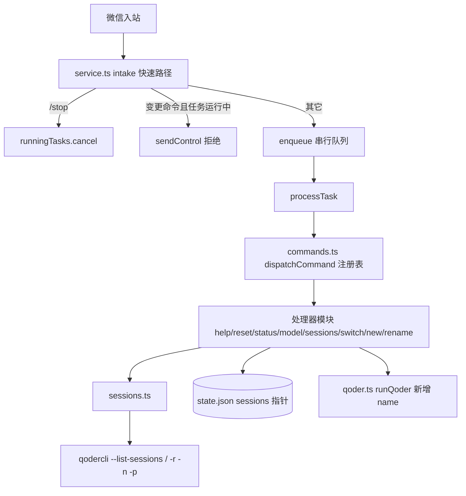
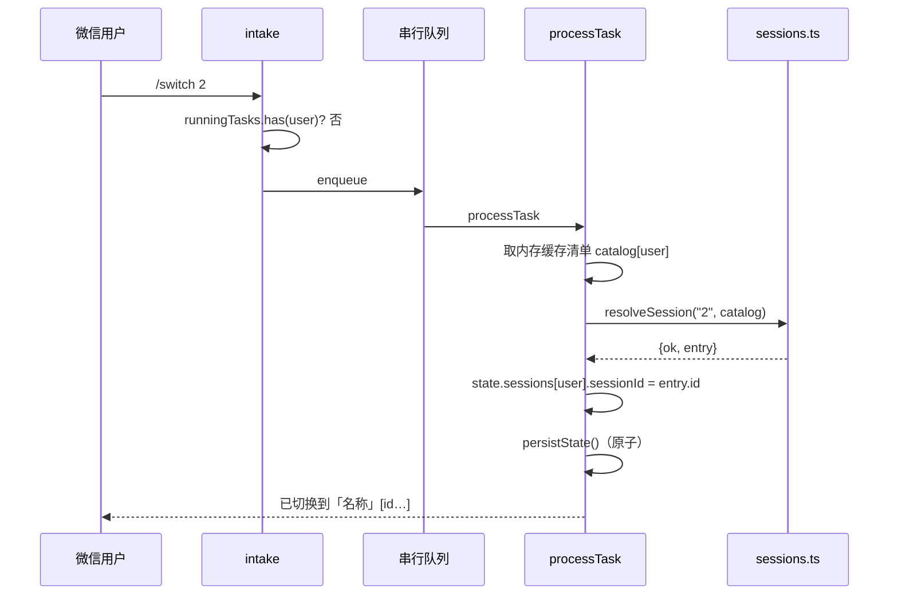

# 【后端技术文档】微信会话管理（A 期·核心切换组）

> 状态：设计待评审 ｜ 更新：2026-11-14
> 需求基线：[requirements.md](./requirements.md)（2026-11-14 已确认）
> 规范目录：`.specs/20261114_微信会话管理/`
> 开发分支：`feat/20261114-wechat-sessions`（执行阶段顺手开，不写 main）
> 上游待办：`.specs/v2-backlog.md`「会话与路由 → 多会话切换」，本包落地后回填指向本目录
> 模板说明：沿用本仓 `.specs/20261110_桥接运维加固/design.md` 的【后端技术文档】结构（Node CLI 服务，无前端页面）；phase-2 后端模板为 Java 栈专用，此处按项目实际裁剪

## 生成 AI 概要

- 生成模型：Qoder Desktop Agent 当前会话模型（会话未暴露底层型号，不作推测）
- 生成方式：由 `jojo-specs` 技能按"需求 → 设计 → 任务"阶段生成
- 设计输入：`requirements.md` + 现有代码（`src/bridge/service.ts`、`src/bridge/qoder.ts`、`src/models.ts`、`src/commands.ts`、`src/config.ts`）+ 2026-11-14 本机探针（CLI 1.1.89）

---

## 1. 需求背景

### 1.1 为什么要做

桥接每个微信用户只维护一个活动会话（`state.json` 的 `sessions[userId]`），管理命令只有 `/reset` 与 `/status`。多个话题串在同一条会话里上下文互相污染，想回到旧话题没有任何入口。会话生在 Qoder CLI 侧（`~/.qoder/projects/<cwd-slug>/<session>.jsonl`），桌面 GUI 不索引 CLI 会话（2026-11-14 复验：官方 Data import 来源不含 CLI）。本期把 CLI 1.1.89 已具备的会话能力（`--list-sessions` / `-r` / `--session-id` / `-n`）包装成微信内置命令，让用户在手机上列出、切换、新建、重命名会话。

### 1.2 高层方案与理由

| 主题 | 方案 | 理由 |
| --- | --- | --- |
| 命令范围 | 核心切换组 `/sessions` `/switch` `/new` `/rename` + 追加 `/delete` | 用户本期选定核心组；`/history` `/fork` 与 B 管理台待定（非目标）；`/delete` 2026-11-14 试用时追加（需求 8） |
| 命令结构 | 处理器注册表（插件化）：每命令一个独立处理器模块，统一分发入口 | 主人设计反馈：新命令接入更方便、可读性更好；既有命令一并迁入，行为不变（需求 5.3） |
| 会话清单来源 | 新模块 `src/bridge/sessions.ts` 调 `qodercli --list-sessions`，解析文本 | CLI 无 JSON 输出（R2 实测）；照 `models.ts` 的 `listModels` 范式 |
| 切换语义 | `/switch` 只改 `state.sessions[userId]` 指针，不触碰任何 jsonl | 需求 2.7；会话内容归 CLI 管，桥接只持有指针 |
| 新建语义 | `/new` 清指针 + 可选记待用名，下条真实消息经 `-n` 创建 | 需求 3.3：不立即调 CLI、不耗额度 |
| 重命名路径 | 受支持的 `-r <id> -n <新名> -p` headless 续接改名（R1 实测成立） | CLI 无独立 rename 旗标；不逆向内部 jsonl（与仓"明确不做"一致） |
| 并发守卫 | 变更类命令在 intake 快速路径检查 `runningTasks`，运行中即拒绝 | 串行队列会让命令排在任务后执行，无法"立即拒绝"；故守卫前置（见 §5.1.3） |
| 序号稳定性 | 每用户内存缓存最近一次 `/sessions` 清单，`/switch <序号>` 据此解析 | R3：CLI 序号按活跃排序会变；id/名称写法不受影响 |
| 依赖 | 零新增运行时依赖，复用 `cross-spawn` + `cleanEnv` | N2 |

### 1.3 技术栈

- 运行时：Node.js ≥ 20（`engines`），无新增运行时依赖。
- CLI 调用：`node:child_process` 的 `execFileSync`（清单，短任务）+ `cross-spawn`（重命名，模型轮次异步）。
- 环境清理：复用 `src/bridge/qoder.ts:95` 的 `cleanEnv`。
- 测试：vitest（既有），新模块 `sessions.ts` 纳入 95% Lines 覆盖门禁。

---

## 2. 相关文档 & 资源

| 资源 | 用途 |
| --- | --- |
| [requirements.md](./requirements.md) | 本设计的验收基线（7 需求 + 4 非功能 + 3 开放风险） |
| `.specs/v2-backlog.md` | 上游"多会话切换"待办，完成后回填 |
| `src/models.ts` | `listModels` / `resolveModel` / `formatModelList` 范式，`sessions.ts` 照此对齐 |
| `src/bridge/qoder.ts` | `runQoder`（新增 `name` 入参）、`cleanEnv`、`QoderRunInput` |
| `src/bridge/service.ts` | 命令分发（`processTask`）、intake 快速路径、串行队列、`runningTasks` |
| `src/commands.ts` | `COMMANDS` 登记表与 `isUnknownCommand` |

---

## 3. UI

不涉及前端页面，用户可见面只有微信命令回复（中文文本，计入下行额度）。

### 3.1 `/sessions`（有会话）

```
当前工作目录：/Users/joke/webcode/demo
会话清单（最近 10 条）：
1. 探针新名 (2 分钟前) [9a113144] ← 当前
2. 登录页重构 (昨天) [3f2c8be1]
3. 接口治理 (3 天前) [77aa09d2]
发 /switch <序号|id|名称> 切换，/new [名称] 开新会话。
```

- 活动会话行尾标 `← 当前`；id 截断显示前 8 位（完整 id 用于 `/switch`）。
- 超过上限只列最近 N 条并提示"仅显示最近 N 条"。

### 3.2 `/sessions`（空清单）

```
当前工作目录下还没有会话，发条消息即可创建。
```

### 3.3 `/switch` 成功 / 失败

```
已切换到「探针新名」[9a113144…]，下一条消息续接该会话。
```
```
没找到会话：xyz。发 /sessions 查看清单（支持序号、id、名称）。
```
```
任务执行中，请先 /stop 再管理会话。
```

### 3.4 `/new` / `/rename`

```
已开启新会话，下一条消息生效。
```
```
已开启新会话「登录页重构」，下一条消息创建时命名。
```
```
已把当前会话重命名为「登录页重构」。
```
```
当前没有会话，先发消息创建后再 /rename。
```

---

## 4. 架构

### 4.1 组件关系



### 4.2 数据流：`/switch <序号>`



### 4.3 命令与队列/守卫的关系

```
intake（service.ts:879 起）：
  /stop|/cancel → 快速路径取消（既有，不动；不入注册表，因需绕过队列）
  注册表查命令 → requiresIdle 且 runningTasks.has(from) → sendControl 拒绝，return（新增守卫）
  其它（含 /sessions、普通消息）→ 下载附件 → enqueue → processTask

processTask（service.ts:500 起）：
  const handled = await dispatchCommand(ctx, command)  // 注册表单一分发
  if (handled) return
  if (isUnknownCommand(command)) → 未知命令提示
  否则 → runQoder（创建时消费待用名 name）

处理器（src/bridge/commands/*.ts，每命令一个模块）：
  /sessions → listSessions（只读，不改指针）→ formatSessionList → 刷新内存缓存
  /switch   → resolveSession → 改指针 → persistState
  /new      → 清指针 + 记待用名 → persistState（不调 CLI）
  /rename   → renameSession（-r -n -p）→ 成功回显
  下条普通消息创建会话时：runQoder 传 name=待用名（仅无 sessionId 时），成功后清待用名
```

### 4.4 部署与平台差异

- 清单与重命名都在 `workdir()`（`config.cwd.trim() || os.homedir()`，service.ts:802）下执行，会话按 cwd 隔离（需求 1.7）。
- `execFileSync` / `cross-spawn` 跨平台一致；`cleanEnv` 剥离 `QODER_*` 等变量，避免污染子进程。
- 不新增端口、权限、自启项；launchd plist 不改。

---

## 5. 方案设计

### 5.0 关键默认值与决策

| 配置 / 常量 | 默认值 | 来源与理由 |
| --- | --- | --- |
| `sessionListLimit` | `10`（config 可配，env `QWB_SESSION_LIST_LIMIT`） | 需求 1.4；控制下行额度 |
| `SESSION_LIST_TIMEOUT_MS` | `30000`（常量） | 冷启实测可达 11s、负载下更久，留余量（Minor-11）；需求 7.3 |
| `SESSION_DELETE_TIMEOUT_MS` | `30000`（常量） | 删除是快速元数据操作，不用任务 600s（审查 Minor） |
| `SESSION_NAME_MAX` | `60`（常量） | 需求 4.4；超长拒绝并提示 |
| 重命名超时 | 复用 `qoderTimeoutMs`（默认 600s） | 需求 7.3；rename 跑模型轮次 |
| 重命名最小 prompt | `'重命名'`（常量） | `-p` 必填；触发一次轮次以写入 custom-title（R1） |
| 清单缓存 | 每用户内存 `Map<userId, SessionEntry[]>` | R3；不持久化，重启/跨进程失效则提示重发 /sessions |
| 待用名 | 每用户内存 `Map<userId, string>` | 需求 3.2；不持久化（重启丢失退化为默认命名，见 §9） |

### 5.1 组件与接口

#### 5.1.1 `src/bridge/sessions.ts`（新增）

职责：列会话、解析清单文本、解析切换目标、渲染清单、headless 重命名。不读写 `state.json`，不发消息。照 `models.ts` 范式。

```ts
/** 一条会话清单条目 */
export interface SessionEntry {
  /** CLI 输出序号（从 1 开始，按最近活跃排序） */
  index: number;
  /** 显示名（可能含空格/括号/中文） */
  name: string;
  /** 最近活跃时间（CLI 原文，如 "2 分钟前"） */
  lastActive: string;
  /** 完整会话 id（36 位 UUID） */
  sessionId: string;
}

/** 清单/重命名失败的可读错误 */
export class SessionError extends Error {
  readonly kind: 'not_installed' | 'not_logged_in' | 'timeout' | 'parse' | 'spawn' | 'rename';
}

/** 调 qodercli --list-sessions 并解析；失败抛 SessionError */
export function listSessions(bin: string, cwd: string): SessionEntry[];

/** 纯函数：解析 --list-sessions 文本（R2 契约，单测覆盖边界） */
export function parseSessionList(stdout: string): SessionEntry[];

/** 解析切换目标：序号 / id（完整或唯一短 id）/ 显示名 */
export function resolveSession(
  input: string,
  catalog: SessionEntry[],
): { ok: true; entry: SessionEntry } | { ok: false; reason: string };

/** 渲染 /sessions 文本：标活动会话、截断到 limit、空清单友好提示 */
export function formatSessionList(
  catalog: SessionEntry[],
  activeId: string | undefined,
  limit: number,
): string;

/** headless 重命名：-r <id> -n <name> -p（R1 受支持路径），异步 spawn */
export function renameSession(input: {
  bin: string;
  cwd: string;
  sessionId: string;
  name: string;
  timeoutMs: number;
  permissionMode: string;
}): Promise<{ ok: true } | { ok: false; error: string }>;

/** 删除会话：--delete-session <index>，异步 spawn；成功认 stdout "Deleted session"，
 *  是否删对由调用方重新 listSessions 按 sessionId 复核（F-1 更稳做法） */
export function deleteSession(input: {
  bin: string;
  cwd: string;
  index: number;
  timeoutMs: number;
}): Promise<{ ok: true } | { ok: false; error: string }>;
```

**清单解析契约（R2 实测）**

`--list-sessions` 无 `-o json`，输出形如：

```
Available sessions for this project (3):
  1. 探针新名 (2 分钟前) [9a113144-7a3b-432f-b5fb-c6b560ccb43a]
  2. 登录页重构 (昨天) [3f2c8be1-....]
```

- 解析锚定**行尾 36 位 UUID**，正则：`/^\s*(\d+)\.\s*(.*?)\s*\(([^)]*)\)\s*\[([0-9a-fA-F-]{36})\]\s*$/`。
- 名称用非贪婪 `.*?`，允许含空格、括号、中文；时间取括号内原文；id 取方括号内 UUID。
- 跳过表头行（`Available sessions...`）与空行；无法匹配的行忽略（不抛错），全部无法匹配 → `SessionError('parse')`。
- 名称含右括号 `)` 的极端情形：非贪婪 + 行尾 UUID 锚定仍可正确切分（时间在最后一对括号）。边界用例覆盖。

**`resolveSession` 优先级**（照 `resolveModel`）

1. 纯数字 → 序号（`catalog[index-1]`），越界 → `{ok:false, reason:'序号越界'}`。
2. 完整 UUID 或唯一短 id（前缀匹配恰好一条）→ 命中；多条匹配 → `{ok:false, reason:'id 不唯一'}`。
3. 显示名精确匹配（大小写不敏感）→ 命中；否则 `{ok:false, reason:'未找到'}`。

**`renameSession` 实现（R1）**

- `cross-spawn` 异步起 `qodercli -p -o json --permission-mode <mode> -w <cwd> -r <id> -n <name> '重命名'`，`cleanEnv()`，超时 `qoderTimeoutMs`，输出上限复用 `MAX_OUTPUT_BYTES` 口径。
- 解析 result：`is_error=false` 即成功（custom-title 已在 init 阶段写入，R1 探针坐实）。
- **代价**：`-r -n -p` 会跑一个完整模型轮次（约 0.05 积分 + 会话历史多一条 junk 轮次）。这是受支持路径的固有代价，§9 登记，需求 4.5 允许 P1 滑出。
- 失败（未登录/超时/spawn）→ `{ok:false, error}`，service 转中文，不直达 stderr。

#### 5.1.2 `src/bridge/qoder.ts`（修改）

- `QoderRunInput`（qoder.ts:13）新增 `name?: string`（创建会话时的显示名）。
- `runQoder`（qoder.ts:184）args 构建：在 `sessionId` 之后加 `if (input.name?.trim()) args.push('-n', input.name.trim())`。
- 仅 `/new <名称>` 后的首次创建传 `name`（无 `sessionId` 时）；普通续接不传，避免误改名。

#### 5.1.3 `src/bridge/service.ts`（修改）

- 导入 `sessions.ts`  helpers；deps 注入 `listSessions?` / `renameSession?`（照 `listModels` deps，service.ts:73/212），便于单测 mock。
- 新增内存态：`sessionCatalogs = new Map<string, SessionEntry[]>()`、`pendingNames = new Map<string, string>()`。
- **intake 守卫**（service.ts:896 `/stop` 块之后、附件下载之前）：用注册表 `findHandler(commandText)` 取处理器，若 `handler.requiresIdle && runningTasks.has(from)` → `sendControl(from, contextToken, '任务执行中，请先 /stop 再管理会话。')` 并 `return`。守卫由处理器元数据驱动，不在 intake 硬编码命令名。`/sessions`（requiresIdle=false）与普通消息不守卫，照常入队。
- **命令分发**（`processTask`，service.ts:500 起）：把现有 if 链替换为单一注册表分发 `const handled = await dispatchCommand(ctx, command); if (handled) return;`，其后保留 `isUnknownCommand` 提示与 runQoder。`ctx`（`CommandContext`）封装 state/config/userId/contextToken/reply/workdir/persistState/catalogs/pendingNames/deps/log（见 §5.3）。各命令逻辑迁入独立处理器模块，回复统一经 `ctx.reply`（内部 `session.sendSingle(text, { kind:'notice', queueOnFailure:true })`）。
- **创建时消费待用名**：`runQoder` 调用处（service.ts:575 起），当 `!state.sessions[userId]?.sessionId` 且 `pendingNames.has(userId)` 时传 `name`；任务成功写指针后（service.ts:654）`pendingNames.delete(userId)`。
- 命令分支内 CLI 调用各自 try/catch，异常 `log.warn` + 中文 `sendSingle`，不中断主循环（需求 6.3）。

#### 5.1.4 `src/commands.ts`（重构为注册表枢纽）

- 由"仅元数据登记表"升级为**命令处理器注册表枢纽**：`COMMAND_HANDLERS: CommandHandler[]`（聚合 `src/bridge/commands/*.ts` 的处理器），`COMMANDS` 改为 `COMMAND_HANDLERS.map(h => h.def)` 派生（仍是 `/help` 单一事实来源）。
- 保留 `formatHelp` / `isUnknownCommand` 行为不变；新增 `findHandler(text)`（按命令名前缀匹配）与 `dispatchCommand(ctx, text): Promise<boolean>`（命中处理器并执行，返回是否已处理）。
- 新增命令 = 新增一个处理器模块 + 在 `COMMAND_HANDLERS` 登记一行，**不改分发主干**（需求 5.3）。
- 处理器接口与目录布局见 §5.3。

#### 5.1.5 `src/config.ts`（修改）

- 新增 `sessionListLimit`（默认 10），env `QWB_SESSION_LIST_LIMIT`，照既有字段范式（config.ts:53/203）。
- 不新增必填项；其余配置不变。

### 5.2 数据模型

| 实体 | 位置 | 字段 |
| --- | --- | --- |
| 活动会话指针 | `state.json` `sessions[userId]` | 既有 `{sessionId, updatedAt, turns}`（不变） |
| 清单缓存 | 内存 `sessionCatalogs` | `SessionEntry[]`，每用户最近一次 /sessions |
| 待用名 | 内存 `pendingNames` | `string`，/new 记录、创建时消费 |
| 会话内容 | `~/.qoder/projects/<slug>/<id>.jsonl` | CLI 管，桥接只读清单、不写正文 |

- 切换/新建只改桥接指针，不触碰 CLI jsonl（需求 2.7、6.4）。
- 清单缓存与待用名均内存态，不写 `state.json`（避免 schema 膨胀）；重启丢失见 §9。
- `state.json` 改写复用既有 `persistState()` 原子路径（需求 6.2）。

### 5.3 命令处理器注册表（插件化）

主人设计反馈：把命令部分插件化，新命令接入更方便、可读性更好。采用**静态处理器注册表**（编译期登记，非运行时动态加载），每命令一个自包含模块。

#### 5.3.1 目录布局

```
src/commands.ts                 # 注册表枢纽：COMMAND_HANDLERS / COMMANDS / formatHelp / isUnknownCommand / findHandler / dispatchCommand
src/bridge/commands/
  types.ts                      # CommandContext / CommandHandler 接口
  help.ts                       # /help
  reset.ts                      # /reset
  status.ts                     # /status
  model.ts                      # /model
  sessions.ts                   # /sessions（只读）
  switch.ts                     # /switch（requiresIdle）
  new.ts                        # /new（requiresIdle）
  rename.ts                     # /rename（requiresIdle）
  delete.ts                     # /delete 两步确认（requiresIdle，需求 8 追加）
```

#### 5.3.2 接口

```ts
/** 处理器运行所需上下文，由 processTask 组装 */
export interface CommandContext {
  userId: string;
  contextToken: string;
  state: BridgeState;
  config: Config;
  /** 统一回复（内部 session.sendSingle，kind=notice，queueOnFailure） */
  reply: (text: string) => Promise<void>;
  workdir: () => string;
  persistState: () => void;
  catalogs: Map<string, SessionEntry[]>;
  pendingNames: Map<string, string>;
  isTaskRunning: (userId: string) => boolean;
  deps: { listSessions: typeof listSessions; renameSession: typeof renameSession; listModels: typeof listModels };
  log: Logger;
}

/** 一条命令处理器 */
export interface CommandHandler {
  /** 元数据：name/usage/description，供 /help 与 isUnknownCommand */
  def: CommandDef;
  /** 变更类命令标 true：任务运行中由 intake 拒绝（/switch /new /rename） */
  requiresIdle?: boolean;
  /** 匹配并处理；返回 true=已处理（含错误回复），false=不匹配 */
  handle: (ctx: CommandContext, text: string) => Promise<boolean>;
}
```

#### 5.3.3 分发与守卫

- `findHandler(text)`：trim 后按 `def.name` 前缀匹配（`text === name || text.startsWith(name + ' ')`），返回首个命中处理器。
- `dispatchCommand(ctx, text)`：`findHandler` 命中 → `await handler.handle(ctx, text)` → 返回 true；未命中 → 返回 false（processTask 继续走 isUnknownCommand / runQoder）。
- intake 守卫：`findHandler(commandText)?.requiresIdle && runningTasks.has(from)` → 拒绝。守卫由元数据驱动，新增变更命令只需标 `requiresIdle`，intake 零改动。
- `/stop` **不入注册表**：它必须绕过串行队列在 intake 直接取消任务，语义与排队命令不同，保留既有快速路径（N1 不动）。

#### 5.3.4 各处理器职责

| 处理器 | requiresIdle | 职责 |
| --- | --- | --- |
| help | — | `ctx.reply(formatHelp())` |
| reset | — | `delete state.sessions[userId]` → persistState → 回显（既有行为不变） |
| status | — | 组装工作目录/模型/会话/轮次/待补发/隔离区/额度行 → reply |
| model | — | 无参列模型；default 恢复；否则 resolveModel 切换（deps.listModels） |
| sessions | false | `deps.listSessions(bin, workdir())` → formatSessionList → 刷新 catalogs；只读；失败 catch 中文 |
| switch | true | 序号用 catalogs 缓存（无缓存提示先 /sessions）；id/名称用新鲜 listSessions 校验；resolveSession → 改指针 → persistState；同条提示"已在该会话" |
| new | true | 清指针；带名称（≤60）记 pendingNames 否则清除；persistState；回显；不调 CLI |
| rename | true | 无活动会话提示；名称空/超长拒绝；deps.renameSession → 成功回显/失败中文 |
| delete | true | 两步确认：`/delete <目标>` 记待确认（60s 过期）→ `/delete yes <序号>` 按 sessionId 重取当前序号 → deps.deleteSession（认 stdout `Deleted session`）；删活动会话清指针（需求 8，2026-11-14 追加） |

#### 5.3.5 迁移与兼容

- 既有 `/help` `/reset` `/status` `/model` 逻辑**原样迁入**对应处理器，行为不变（N1）；由 §8.2 黄金路径回归用例守护。
- 这是单一注册表分发，不是并行第二套系统（需求 5.3）；processTask 的 if 链被 `dispatchCommand` 取代。
- 不做运行时动态插件加载、不做依赖注入容器——静态登记已满足"新命令接入方便 + 可读性"，避免过度设计。

---

## 6. 正确性属性

### 正确性属性 1：`/sessions` 只读

_For any_ `/sessions` 调用，桥接服务 SHALL NOT 改变 `state.sessions[userId]` 指针，SHALL NOT 修改任何会话 jsonl。

**验证需求：需求 1.5、2.7**

### 正确性属性 2：`/switch` 仅改指针

_For any_ 成功的 `/switch`，桥接服务 SHALL 只更新 `state.sessions[userId]` 的 `sessionId/updatedAt`，SHALL NOT 删除、截断或修改目标与源会话内容。

**验证需求：需求 2.1、2.7**

### 正确性属性 3：`/new` 不即时耗额度

_For any_ `/new [名称]`，桥接服务 SHALL NOT 立即调用 qodercli，SHALL NOT 消耗模型额度；命名 SHALL 在下一条真实消息创建会话时经 `-n` 生效。

**验证需求：需求 3.3、3.2**

### 正确性属性 4：任务运行中拒绝变更命令

_For any_ 用户存在 `runningTasks` 条目时发来的 `/switch`、`/new`、`/rename`，桥接服务 SHALL 在 intake 拒绝并提示先 `/stop`，SHALL NOT 入队或改写指针；`/sessions` SHALL 仍可执行。

**验证需求：需求 6.1、2.8、3.6、4.6**

### 正确性属性 5：命令异常不中断主循环

_For any_ 会话命令处理中的异常（CLI 失败/解析失败/超时），桥接服务 SHALL 捕获并返回中文可读错误，SHALL NOT 中断 `getupdates` 主循环或影响其它用户。

**验证需求：需求 6.3、1.6、7.1**

### 正确性属性 6：清单按工作目录隔离

_For any_ `config.cwd` 非空的 `/sessions`，清单 SHALL 只含该工作目录下的会话，SHALL NOT 混入主目录全局会话。

**验证需求：需求 1.7**

### 正确性属性 7：状态原子写入

_For any_ 会话命令改写 `state.json`，桥接服务 SHALL 复用既有原子保存路径，SHALL NOT 产生半截写入。

**验证需求：需求 6.2**

### 正确性属性 8：重命名走受支持路径或明确降级

_For any_ `/rename`，桥接服务 SHALL 经 `-r -n -p` headless 路径改名；IF 该路径失败 THEN SHALL 返回中文错误，SHALL NOT 静默失败或假装成功，SHALL NOT 逆向写 CLI 内部 jsonl。

**验证需求：需求 4.1、4.5（R1）**

### 正确性属性 9：序号以最近清单为准

_For any_ `/switch <序号>`，桥接服务 SHALL 以该用户最近一次 `/sessions` 的内存缓存解析；IF 无缓存 THEN SHALL 提示先发 `/sessions`，SHALL NOT 用过期序号误切。

**验证需求：需求 2.2（R3）**

### 正确性属性 10：增量兼容与隐私

_For any_ 新命令，桥接服务 SHALL NOT 改变普通消息收发、排队、`/reset`、`/status`、`/model`、`/stop`、`/help` 的既有行为；回复与日志 SHALL NOT 含 bot token / context_token。

**验证需求：N1、N3、需求 5.4、7.1**

### 正确性属性 11：命令注册表单一分发且可扩展

_For any_ 新增微信命令，桥接服务 SHALL 以独立处理器模块接入注册表，SHALL NOT 改动 `dispatchCommand` 分发主干或 intake 守卫逻辑；变更类命令 SHALL 仅通过 `requiresIdle` 元数据获得任务运行中拒绝能力。

**验证需求：需求 5.3、6.1**

---

## 7. 错误处理

| 场景 | 行为 |
| --- | --- |
| `--list-sessions` 未安装/未登录 | `SessionError('not_installed'/'not_logged_in')` → 中文"无法列出会话：…"，不直达 stderr |
| 清单超时（>30s） | `SessionError('timeout')` → 中文"列出会话超时，请稍后重试" |
| 清单输出无法解析 | `SessionError('parse')` → 中文"会话清单格式异常，请升级 qodercli" |
| `/switch` 无参数 | 用法提示 + 当前活动会话，不改指针 |
| `/switch` 序号越界/无缓存 | "序号越界，发 /sessions 刷新" / "请先发 /sessions 获取序号清单" |
| `/switch` id 不唯一/名称未找到 | 中文错误 + 提示用 /sessions，不改指针 |
| `/switch` 目标即当前 | "已在该会话"，不写入 |
| `/new` 名称超长 | 拒绝并提示 ≤60 字符 |
| `/rename` 无活动会话 | "当前没有会话，先发消息创建" |
| `/rename` 名称空/超长 | 用法提示 / 拒绝 |
| `/rename` CLI 失败/超时 | 中文错误（含"暂不支持/请稍后重试"），不假装成功 |
| 变更命令遇任务运行中 | intake `sendControl` 拒绝"任务执行中，请先 /stop" |
| 命令处理任意异常 | catch → `log.warn`（userId/命令/目标 id/原因）+ 中文 `sendSingle`，主循环不中断 |

---

## 8. 测试策略

### 8.1 单元测试矩阵

| 模块 | 用例 |
| --- | --- |
| `sessions.parseSessionList` | 正常多行；名称含空格/括号/中文；空清单；表头跳过；坏行忽略；全坏 → parse 错误；行尾 UUID 锚定 |
| `sessions.resolveSession` | 序号命中/越界；完整 id；唯一短 id；不唯一短 id；名称精确/大小写；未找到 |
| `sessions.formatSessionList` | 标活动会话；截断到 limit；空清单友好提示；id 截断 8 位 |
| `sessions.listSessions` | mock execFileSync 成功/未安装/超时；cwd 透传 |
| `sessions.renameSession` | mock spawn 成功/is_error/超时；args 含 -r -n -p；cleanEnv |
| `qoder.runQoder` | name 入参 → args 含 -n；无 name 不含 -n；与 -r 共存 |
| 处理器模块（help/reset/status/model/sessions/switch/new/rename） | 各自逻辑：/sessions 只读+刷缓存；/switch 改指针/同条/无参/越界；/new 清指针+待用名+不调 CLI；/rename 成功/无会话/超长；既有四命令行为不回归 |
| `commands` 注册表 | findHandler 前缀匹配；dispatchCommand 命中/未命中；COMMANDS 由处理器派生；isUnknownCommand 识别新命令；/help 含新命令；requiresIdle 标记正确 |
| `service` intake 守卫 | 任务运行中 requiresIdle 命令被拒不入队；/sessions 仍入队；无任务时正常入队；守卫由元数据驱动 |
| `service` 创建消费待用名 | 无 sessionId+pendingNames → runQoder 传 name；成功后清除 |

### 8.2 集成测试

- **黄金路径不回归**：普通消息、/reset、/status、/model、/stop、/help 行为与 0.4.0 一致。
- **切换续接**：/sessions → /switch <序号> → 下条消息 runQoder args 含目标 `-r`。
- **新建命名**：/new 名称 → 下条消息 args 含 `-n` 且无 `-r`；成功后待用名清除。
- **并发守卫**：模拟 runningTasks 有条目，变更命令被拒、/sessions 放行。
- **隔离**：不同 config.cwd 的清单互不混列。

### 8.3 覆盖率

`vitest.config.ts` 的 `coverage.include` 增加 `src/bridge/sessions.ts`、`src/commands.ts`（重构后含分发逻辑）与 `src/bridge/commands/*.ts`（处理器，`types.ts` 纯接口除外），保持 Lines ≥ 95%。`sessions.ts` 纯函数（parse/resolve/format）易达 100%；IO 失败分支用 mock 注入逐条覆盖。处理器模块逻辑短小、易覆盖；注册表 dispatch/findHandler 由单测覆盖。

---

## 9. 风险与开放问题

| 风险 | 影响 | 应对 |
| --- | --- | --- |
| R1 `/rename` 耗额度 + junk 轮次 | `-r -n -p` 跑完整轮次（约 0.05 积分 + 历史多一条） | 受支持路径固有代价，已登记；需求 4.5 允许 P1 滑出；评审时由主人决定是否保留 |
| R1 备选：直接追加 custom-title jsonl | 零额度但触碰 CLI 内部格式 | **拒绝**：脆弱、与仓"明确不做逆向"一致；不采用 |
| R2 清单文本解析 | 名称含括号/中文/空格 | 行尾 UUID 锚定 + 非贪婪名称；边界用例覆盖 |
| R3 序号漂移 | 两次 /sessions 间序号变 | 内存缓存最近清单；id/名称写法不受影响；无缓存提示重发 |
| 待用名/清单缓存内存态 | 重启丢失待用名 → 退化默认命名 | 简洁优先不持久化；登记为已知限制，非目标 |
| `execFileSync` 列清单阻塞事件循环 | 短暂 stall 其它用户轮询 | 照 models.ts 既有范式（短超时 30s）；清单为低频命令，可接受 |
| 变更命令守卫位置 | 串行队列会排在任务后而非立即拒绝 | 守卫前置到 intake（§5.1.3），忠实需求 6.1 |
| CLI 版本差异 | 旧版无 --list-sessions/-n | 失败转中文"请升级 qodercli"；不静默 |

**开放问题**：`/rename` 是否保留（P1，耗额度）由主人在设计评审时拍板；其余无。

---

## 10. 权限变更

- 不申请任何系统权限，不新增能力（无 TCC / 无端口 / 无自启项变更）。
- 不读取/打印 bot token、context_token；会话 id/显示名可展示（N3）。
- 新增配置 `sessionListLimit` 为可选，默认 10，不破坏既有 config。

## 11. 影响范围

| 面 | 变化 |
| --- | --- |
| 新增模块 | `src/bridge/sessions.ts`（含 `deleteSession`）+ `src/bridge/commands/*.ts`（含 `delete.ts`）→ `dist/`，纳入 coverage.include |
| `qoder.ts` | `QoderRunInput` 新增 `name?`；runQoder args 条件加 `-n` |
| `service.ts` | intake 守卫 + 四命令分支 + 内存缓存/待用名 + 创建消费待用名 |
| `commands.ts` | 重构为注册表枢纽（COMMAND_HANDLERS/dispatchCommand/findHandler）；新增 `src/bridge/commands/*.ts` 处理器模块 |
| `config.ts` | 新增 `sessionListLimit` + env 映射 |
| 微信用户侧 | 新增 /sessions /switch /new /rename；/help 自动包含 |
| 数据文件 | `state.json` 结构不变；新增内存态（不落盘） |
| 文档 | README 命令表、RUNBOOK 会话管理节；v2-backlog 回填 |
| **插件壳（独立仓）** | `qoder-wechat-plugin`：`skills/qoder-wechat/SKILL.md:39` 与 `agents/qoder-wechat-setup.md:115` 命令清单补四命令；核对 README；独立分支/提交，版本号 bump 与重装归主人（需求 5.5，列入 tasks） |
| 升级兼容 | 纯增量，旧命令与普通消息行为不变（N1） |

## 12. 项目发布说明

面向使用者：微信里发 `/sessions` 列出当前工作目录的会话并标出活动会话，`/switch` 切到旧话题继续聊，`/new [名称]` 开干净新会话，`/rename` 给会话起名。切换/新建只改桥接指针，不动任何会话内容，旧会话随时找回。任务执行中变更类命令会被拒绝并提示先 `/stop`。

发布动作仍归主人：版本号 bump 与 `npm publish` 需本人登录执行；本期建议随下一个 minor（如 0.5.0）发布。

**交付任务承诺（主人反馈第 2 点）**：本需求完成后，tasks.md 须单列一条"同步 qoder-wechat 插件壳命令清单"任务，覆盖独立仓 `qoder-wechat-plugin` 的 SKILL.md / setup agent / README，与桥接本体合并验收；插件壳为独立 git 仓，单独开分支、单独提交，不写 main。