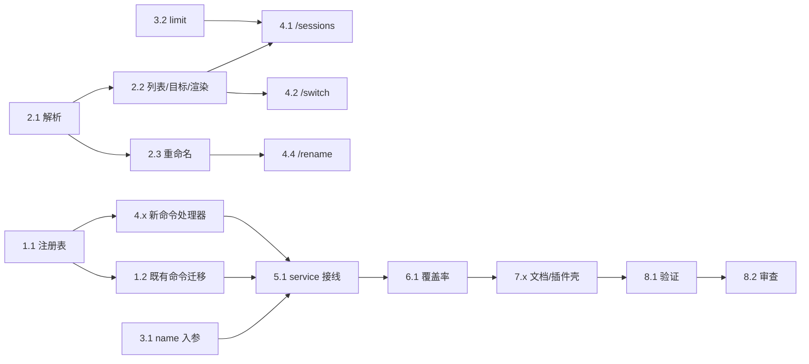

# 实现计划

> 执行约束（来自 jojo-specs workflow）：
>
> - 一次只实现一个任务；子任务存在时优先做子任务
> - 完成后立即更新本文档对应任务状态再停止，等待评审
> - 仅在用户明确要求时运行测试
> - 任务编号即为推荐执行顺序，按依赖关系自上而下递进
> - 测试驱动：每个含 `.ts` 产出的子任务先写失败用例，再实现至通过（红-绿-重构）
>
> **测试覆盖率约束：**
>
> - 本项目为 Node CLI 服务（非前端 / 非 NestJS / 非 Java 栈）。本 feature 新增或被触达且纳入 `vitest.config.ts` `coverage.include` 白名单的 `.ts` 源文件，单元测试 **Lines 覆盖率必须 ≥ 95%**
> - 本期纳入门禁的新增/触达文件：`src/bridge/sessions.ts`、`src/commands.ts`、`src/bridge/commands/*.ts`（`types.ts` 纯接口除外）；既有 `qoder.ts` / `config.ts` / `service.ts` 已在白名单，触达后不得拉低覆盖率
> - Statements / Functions / Branches 作为辅助指标，以项目既有 vitest 约定为准；未达辅助指标时在风险点说明原因与影响
> - **单测编写遵循项目既有测试约定**：测试位于 `test/unit`、`test/integration`，命名与 Mock 复用照既有风格；本 workflow 不重复定义用例规范
> - 验证口径：在 PR 说明里附覆盖率验证命令与输出；Lines 未达 95% 须在对应单测任务补齐用例后再关闭
>
> **提交约束：**
>
> - 每完成一个子任务（对应一个 [x] 的子任务条目）后，不自动执行 git commit；如需提交，必须由用户后续明确触发，并按 jojo-specs skill 的 references/phase-5-commit.md 执行
> - 主人已确认采用**合并提交**：文档 + 代码 + 单测合并，多批次特性审查后再由主人触发提交；无关清理可按主人点名先单独提交（精确 add）
> - Commit 流程严格遵守 workflow 的所有步骤：收集改动 → 识别 type / scope → 生成 `type(scope): summary refs #issue-id` → 执行 `git commit`
> - `scope` 优先取本任务主要改动目录的模块名；如跨多个模块，取变动最大者
> - `issue-id` 从当前分支名末段提取：开发分支 `feat/20261114-wechat-sessions`，个人仓用 `20261114` 作 issue-id（`refs #20261114`）
> - 本规则**从第一个待执行任务起生效**
>
> **任务详情拆分约定：**
>
> - 本文档只保留任务状态、进度与索引；每个子任务的完整内容（目标 / 实现要点 / 引用 / 验证命令 / 验收 / 将写入）下钻到 `task-list/` 目录对应文件
> - 勾选 `[x]` / `[ ]` 状态仅在本文档维护；`task-list/` 文件内不再重复状态字段

---

## 概览

共 **8 个任务组 / 17 个子任务**。把已批准设计（命令处理器注册表 + 会话清单模块 + 四命令 + service 接线）拆成测试驱动的增量步骤。

- **T1 注册表骨架与既有命令迁移**（1.1–1.2）：先立统一分发入口与处理器接口，再把既有四命令原样迁入，守住 N1 兼容。这是所有命令处理器的地基，必须最先。
- **T2 会话清单模块**（2.1–2.3）：`sessions.ts` 读路径（解析/列表/目标解析/渲染）与写路径（headless 重命名）分离，R2 解析契约与 R1 重命名各自独立可测。
- **T3 创建命名与配置**（3.1–3.2）：`runQoder` 新增 `name` 入参（`-n`）与 `sessionListLimit` 配置，是 `/new` 命名与 `/sessions` 截断的前置。
- **T4 会话命令处理器**（4.1–4.4）：四个新命令各成处理器模块，依赖 T1 注册表与 T2/T3 能力。
- **T5 service 接线**（5.1）：intake 守卫（元数据驱动）+ `dispatchCommand` 替换 if 链 + `CommandContext` 组装 + 内存缓存/待用名 + 创建消费待用名。依赖全部处理器就绪。
- **T6 覆盖率门禁**（6.1）：扩容 `coverage.include`，全量 Lines ≥ 95% 验证。
- **T7 文档与插件壳同步**（7.1–7.2）：桥接仓文档回填 + 独立仓 `qoder-wechat-plugin` 命令清单同步（主人反馈第 2 点，需求 5.5）。
- **T8 验证与审查**（8.1–8.2）：全量验证产物 + 覆盖式 review.md。

**关键拆分原则**：注册表与既有命令迁移前置（地基 + 兼容守护）；`sessions.ts` 纯函数先行（易测、R2 风险早暴露）；service 接线放最后（依赖全部处理器）；文档/插件壳与主线解耦放后段；审查独立成组。`/rename` 主人已确认**保留交付**（P1，R1 受支持路径成立，代价约 0.05 积分 + 一条 junk 轮次，已在设计 §9 登记）。

## 执行顺序总览

任务采用**严格线性顺序**，编号即执行顺序。下表列出全部 17 个子任务与关键依赖、预期产出（点击"任务"列链接查看完整任务内容）：

| 顺序 | 任务 | 摘要 | 硬前置 | 产出类型 |
| ---: | --- | --- | --- | --- |
| 1 | [**1.1**](./task-list/1.1-registry-types-dispatch.md) | 注册表枢纽 + 处理器接口 + dispatch/findHandler | — | TS 模块 + 单测 |
| 2 | [**1.2**](./task-list/1.2-migrate-existing-commands.md) | 既有 /help /reset /status /model 迁入处理器 | 1.1 | TS 处理器 + 回归单测 |
| 3 | [**2.1**](./task-list/2.1-session-parse.md) | SessionEntry/SessionError + parseSessionList | — | TS 模块 + 单测 |
| 4 | [**2.2**](./task-list/2.2-session-list-resolve-format.md) | listSessions + resolveSession + formatSessionList | 2.1 | TS 模块 + 单测 |
| 5 | [**2.3**](./task-list/2.3-session-rename.md) | renameSession（-r -n -p headless） | 2.1 | TS 模块 + 单测 |
| 6 | [**3.1**](./task-list/3.1-qoder-name-arg.md) | QoderRunInput.name + runQoder -n | — | TS 修改 + 单测 |
| 7 | [**3.2**](./task-list/3.2-config-session-list-limit.md) | config.sessionListLimit + env 映射 | — | TS 修改 + 单测 |
| 8 | [**4.1**](./task-list/4.1-sessions-command.md) | /sessions 处理器（只读 + 刷缓存） | 1.1, 2.2, 3.2 | TS 处理器 + 单测 |
| 9 | [**4.2**](./task-list/4.2-switch-command.md) | /switch 处理器（改指针） | 1.1, 2.2 | TS 处理器 + 单测 |
| 10 | [**4.3**](./task-list/4.3-new-command.md) | /new 处理器（清指针 + 待用名） | 1.1 | TS 处理器 + 单测 |
| 11 | [**4.4**](./task-list/4.4-rename-command.md) | /rename 处理器 | 1.1, 2.3 | TS 处理器 + 单测 |
| 12 | [**5.1**](./task-list/5.1-service-wiring.md) | intake 守卫 + dispatchCommand + ctx + 内存态 + 消费待用名 | 1.2, 4.1, 4.2, 4.3, 4.4, 3.1 | TS 修改 + 集成单测 |
| 13 | [**6.1**](./task-list/6.1-coverage-gate.md) | coverage.include 扩容 + Lines ≥ 95% | 5.1 | 配置 + 验证 |
| 14 | [**7.1**](./task-list/7.1-bridge-docs.md) | README/RUNBOOK/v2-backlog 回填 | 6.1 | 文档 |
| 15 | [**7.2**](./task-list/7.2-plugin-shell-sync.md) | 插件壳命令清单同步（独立仓） | 6.1 | 文档（独立仓） |
| 16 | [**8.1**](./task-list/8.1-full-verification.md) | typecheck/build/test/coverage/pack 全量验证 | 7.1, 7.2 | 验证产物 |
| 17 | [**8.2**](./task-list/8.2-review.md) | 覆盖式 review.md 审查 | 8.1 | 审查文档 |

### 关键依赖链

- `1.1 → 1.2 / 4.x`：处理器依赖注册表与接口
- `2.1 → 2.2 / 2.3`：列表/重命名复用解析类型与错误类
- `2.2 + 3.2 → 4.1`、`2.2 → 4.2`、`2.3 → 4.4`：命令处理器依赖清单能力与配置
- `1.2 + 4.x + 3.1 → 5.1`：接线依赖全部处理器与 name 入参
- `5.1 → 6.1 → 7.x → 8.1 → 8.2`：门禁 → 文档 → 验证 → 审查

### 并行化提示（仅供加速参考，默认仍单任务串行）

- **2.1 与 3.1 / 3.2** 相互独立，可合并为一次编辑（不同文件）
- **4.1 / 4.2 / 4.3 / 4.4** 写入不同处理器文件，逻辑独立，可并行；但都依赖 1.1
- **同一文件内的多个子任务**（如 2.1/2.2/2.3 同写 `sessions.ts`）必须严格串行，不得并行
- **7.1 与 7.2** 分属不同仓，可并行

---

## 任务清单（状态 · 进度）

> 勾选 `[x]` 表示已完成，`[ ]` 表示未完成。点击任务编号进入 `task-list/` 中的完整任务说明。

## T1. 命令注册表骨架与既有命令迁移

- [x] **1.1** [注册表枢纽 + 处理器接口 + 分发](./task-list/1.1-registry-types-dispatch.md)
- [x] **1.2** [既有四命令迁入处理器](./task-list/1.2-migrate-existing-commands.md)

## T2. 会话清单模块 sessions.ts

- [x] **2.1** [会话类型与清单解析](./task-list/2.1-session-parse.md)
- [x] **2.2** [列表 / 目标解析 / 渲染](./task-list/2.2-session-list-resolve-format.md)
- [x] **2.3** [headless 重命名](./task-list/2.3-session-rename.md)

## T3. 创建命名与配置

- [x] **3.1** [runQoder name 入参](./task-list/3.1-qoder-name-arg.md)
- [x] **3.2** [sessionListLimit 配置](./task-list/3.2-config-session-list-limit.md)

## T4. 会话命令处理器

- [x] **4.1** [/sessions 处理器](./task-list/4.1-sessions-command.md)
- [x] **4.2** [/switch 处理器](./task-list/4.2-switch-command.md)
- [x] **4.3** [/new 处理器](./task-list/4.3-new-command.md)
- [x] **4.4** [/rename 处理器](./task-list/4.4-rename-command.md)

## T5. service 接线

- [x] **5.1** [intake 守卫 + 注册表分发 + 上下文 + 内存态](./task-list/5.1-service-wiring.md)

## T6. 单元测试与覆盖率

- [x] **6.1** [覆盖率门禁扩容与验证](./task-list/6.1-coverage-gate.md)

## T7. 文档与插件壳同步

- [x] **7.1** [桥接仓文档回填](./task-list/7.1-bridge-docs.md)
- [x] **7.2** [插件壳命令清单同步](./task-list/7.2-plugin-shell-sync.md)

## T8. 验证与审查

- [x] **8.1** [全量验证](./task-list/8.1-full-verification.md)
- [x] **8.2** [覆盖式审查](./task-list/8.2-review.md)
- [x] **8.3** 审查修复批次（P0-1 + P1-1~6 + Minor-1/4/5/7/8/9/11，TDD 先红后绿；全量 471 用例绿、Lines 98.58%；已重建并重新部署试用服务）

## T9. 追加 /delete（2026-11-14 主人试用时追加，需求 8）

- [x] **9.1** /delete 两步确认删除（sessions.ts deleteSession + commands/delete.ts + 注册 + service pendingDeletes 接线；TDD；插件壳/README/RUNBOOK 同步；已重建部署试用服务）
- [x] **9.2** /delete 增量审查修复（I-1 删后清缓存 + I-2 名称后验 + I-3 探针落盘 + 文案/超时/pendingDeletes 残留/集成用例/文档漂移；全量 492 用例绿、delete.ts Lines 100%；已重建部署）
- [x] **9.3** /delete 终审 F 批次（F-1 改 re-list 按 id 复核根治名称截断 + F-2 实断言 + F-3 任何失败失效缓存 + 文档漂移；全量 492 用例绿、Lines 98.7%；已重建部署 pid 39768）

---

这些任务内容是否已经合适？