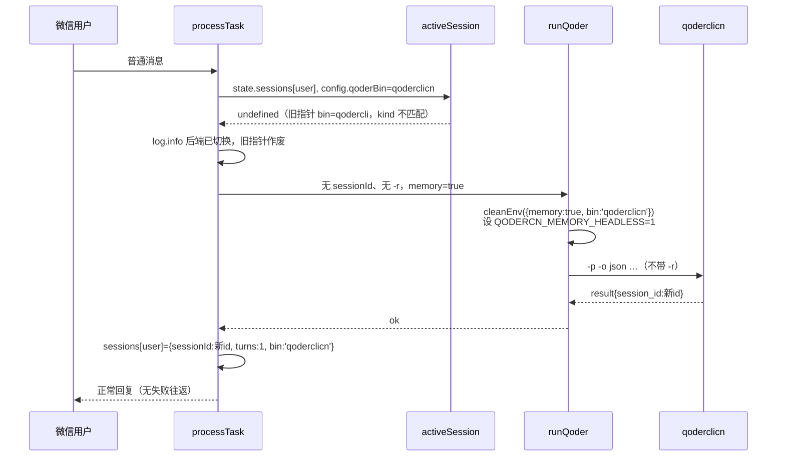

# 【后端技术文档】CLI 后端兼容（qodercli / qoderclicn 可配置切换）

> 状态：设计已批准（2026-11-19 主人确认，含 D1 kind 比较）｜ 更新：2026-11-19（审查后修正 P1-1 覆盖链路、P1-2 预检文案、P2 若干）
> 需求基线：[requirements.md](./requirements.md)（2026-11-19 已批准）
> 规范目录：`.specs/20261119_CLI后端兼容/`
> 开发分支：`feat/20261119-cli-backend-compat`（已开，不写 main）
> 模板说明：沿用本仓 `.specs/20261114_微信会话管理/design.md` 的【后端技术文档】结构（Node CLI 服务，无前端页面）；phase-2 后端模板为 Java 栈专用，此处按项目实际裁剪

## 生成 AI 概要

- 生成模型：Qoder Desktop Agent 当前会话模型（会话未暴露底层型号，不作推测）
- 生成方式：由 `jojo-specs` 技能按"需求 → 设计 → 任务"阶段生成
- 设计输入：`requirements.md` + 现有代码（`src/bridge/qoder.ts`、`src/models.ts`、`src/config.ts`、`src/bridge/service.ts`、`src/bridge/commands/*.ts`）+ 2026-11-19 CN 包 1.1.92 本机取证（品牌常量、`yo()` env 前缀函数、契约字符串、`--version` 与空清单哨兵实测）

---

## 1. 需求背景

### 1.1 为什么要做

桥接底层适配国际版 `qodercli`，主人已迁移到 Qoder CN。`qoderBin` 配置项早已存在（config.json / `QWB_QODER_BIN` / `--qoder-bin`），换二进制本身可行，但切到 `qoderclicn` 后三处隐性耦合静默失效：记忆开关 env 名不同（CN 读 `QODERCN_MEMORY_HEADLESS`）、自定义模型配置目录不同（CN 在 `~/.qoder-cn`）、`cleanEnv` 漏剥 `QODERCN_*`。另外跨后端会话指针不可续接，现有降级重试虽能自愈但白付一次失败往返。本期补齐后端画像推导与会话 bin 标签，使切换只改 `qoderBin` 一个配置项。

### 1.2 高层方案与理由

| 主题 | 方案 | 理由 |
| --- | --- | --- |
| 切换开关 | 复用既有 `qoderBin`，不加新配置项 | 需求非目标明确；预检/任务/会话/模型命令已全部 bin 驱动 |
| 后端差异 | 新模块 `src/bridge/backend.ts` 纯函数 `backendProfile(bin)`，由命令名推导画像 | 需求 1.5 禁止运行时探测；纯函数易单测、零依赖 |
| CN 判定 | basename 去脚本扩展名后精确匹配 `qoderclicn` / `qodercn`（官方包两个 bin 名），其余回落国际版 | 实测包 bin 字段只有这两个名；精确匹配可预测，wrapper 局限登记 README（R2） |
| 记忆开关 | `cleanEnv` 按画像设 `memoryEnv`，`QODER_*` 与 `QODERCN_*` 双前缀都剥 | CN 包 `yo()` 前缀实测；worker 判定变量两版都叫 `QODER_*`，双剥是保险 |
| 模型目录 | `models.ts` 经 `resolveConfigDir(bin)` 取目录：按后端认各自覆盖变量（CN `QODERCN_CONFIG_DIR` / intl `QODER_CONFIG_DIR`），否则默认 `.qoder` / `.qoder-cn`；`cleanEnv` 把解析目录补回子进程 | 真机对照实测两版覆盖名不同（P1-1 修正）；缓存已按 bin 隔离 |
| 会话衔接 | `SessionRecord` 加 `bin?` 标签 + `activeSession()` 读取过滤；**按后端 kind 比较**而非原始字符串 | 跨后端直接新建，省失败往返（需求 4）；kind 比较是对 4.2 的落实细化，见 §5.0 决策 D1 |
| 存量兼容 | 无 `bin` 字段的旧指针视为 `qodercli`（国际版） | 需求 4.3；旧 state.json 零迁移 |
| 文案 | failure.ts / sessions.ts 用户可见"qodercli"改"Qoder CLI" | 需求 5；只改文案不改归类/截断/去重 |
| 可观测 | `/status` 加"后端"行；启动日志记 bin 与画像 | 需求 6；手机上可验证切换生效 |
| 依赖 | 零新增运行时依赖 | N2 |

### 1.3 技术栈

- 运行时：Node.js ≥ 20（`engines`），无新增运行时依赖。
- 新模块 `backend.ts` 仅用 `node:path`（basename）。
- 环境清理复用 `cleanEnv`；CLI 调用复用既有 `cross-spawn` / `execFileSync` 路径，调用层零改动。
- 测试：vitest（既有）；`backend.ts` 纳入 `coverage.include` 95% Lines 门禁。

---

## 2. 相关文档 & 资源

| 资源 | 用途 |
| --- | --- |
| [requirements.md](./requirements.md) | 验收基线（6 需求 + 4 非功能 + 3 开放风险） |
| `src/bridge/qoder.ts` | `cleanEnv`（改）、`runQoder`（传 bin 给 cleanEnv，调用层不动） |
| `src/models.ts` | `qoderConfigDir` / `listCustomModels`（按后端取目录） |
| `src/config.ts` | `SessionRecord`（加 bin）、`activeSession`（新增helper）、`normalizeState`（不动） |
| `src/bridge/service.ts` | 指针读写（551/633）、启动日志（1205） |
| `src/bridge/commands/{status,sessions,switch,rename}.ts` | 指针读取过滤与 bin 写入 |
| `src/bridge/failure.ts` / `src/bridge/sessions.ts` | 用户文案中性化 |
| `.specs/20261114_微信会话管理/design.md` | 会话指针与命令注册表范式 |
| CN 包取证 | `/tmp/qoderclicn-probe/package/bundle/qoderclicn.js`（临时目录，验收后清理）：品牌常量、`yo()`/`Gu="QODERCN_"`、契约字符串 |

---

## 3. UI

不涉及前端页面，用户可见面只有微信命令回复（中文文本，计入下行额度）。

### 3.1 `/status`（新增"后端"行，置于"工作目录"行后）

```
工作目录：/Users/joke/webcode/demo
后端：qoderclicn
模型：Auto（默认）
Qoder 会话：（尚未创建）
累计轮次：0
待补发：0 条
隔离区：0 条
下行额度：正常
```

- 跨后端切换后、首条消息前：旧指针被过滤，"Qoder 会话"显示"（尚未创建）"、"累计轮次"显示 0（与"视为无活动会话"语义一致）。
- 新增一行约 15 字符，下行额度影响可忽略（需求 6.3）。

### 3.2 用户文案中性化示例（需求 5）

| 原文案 | 新文案 |
| --- | --- |
| 执行失败：无法启动 qodercli。请检查 QWB_QODER_BIN… | 执行失败：无法启动 Qoder CLI。请检查 QWB_QODER_BIN… |
| 执行失败：qodercli 没有任何输出（退出码 N）… | 执行失败：Qoder CLI 没有任何输出（退出码 N）… |
| 无法列出会话：qodercli 未安装或工作目录不存在 | 无法列出会话：Qoder CLI 未安装或工作目录不存在 |
| 会话清单格式异常，请升级 qodercli | 会话清单格式异常，请升级 Qoder CLI |
| 无法启动 qodercli（rename/delete spawn 失败） | 无法启动 Qoder CLI |
| Qoder 凭据已失效：需在本机重新登录 qodercli 后重试 | Qoder 凭据已失效：需在本机重新登录 Qoder CLI 后重试 |

错误归类（`errorClass`/`errorCode`）、截断（`userErrorMaxChars`）、去重窗口口径全部不变；日志与诊断保留命令原文。

---

## 4. 架构

### 4.1 组件关系

```mermaid
flowchart TD
  CFG[config.qoderBin<br/>config.json / QWB_QODER_BIN / --qoder-bin] --> BP[backend.ts backendProfile 纯函数]
  BP -->|memoryEnv| CE[qoder.ts cleanEnv<br/>剥 QODER_* + QODERCN_*]
  BP -->|configDirEnv/configDirName| MD[models.ts resolveConfigDir<br/>按后端认覆盖变量]
  BP -->|kind| AS[config.ts activeSession<br/>指针 bin 标签过滤]
  CE --> RUN[runQoder / sessions.ts / models.ts<br/>全部 CLI 调用路径]
  AS --> SVC[service.ts processTask<br/>续接判定 + 写指针带 bin]
  AS --> CMD[commands status/sessions/switch/rename]
  SVC --> STATE[(state.json sessions 指针<br/>{sessionId, updatedAt, turns, bin?})]
```

### 4.2 数据流：切到 CN 后的第一条普通消息



### 4.3 指针消费点全清单（bin 过滤覆盖面）

| 位置 | 现状 | 本期改动 |
| --- | --- | --- |
| `service.ts:551` | `state.sessions[userId]` 直接读 | 改 `activeSession`；原始记录存在但被过滤时 log.info |
| `service.ts:633` | 写 `{sessionId, updatedAt, turns}` | 加 `bin: config.qoderBin` |
| `commands/status.ts:11` | 直接读 | 改 `activeSession`；新增"后端"行 |
| `commands/sessions.ts:16` | 直接读 activeId | 改 `activeSession`（跨后端旧 id 不标"← 当前"） |
| `commands/switch.ts:15` | 直接读 current | 改 `activeSession`（turns 不串后端） |
| `commands/switch.ts:44` | 写指针 | 加 `bin: ctx.config.qoderBin` |
| `commands/rename.ts:15` | 直接读 current | 改 `activeSession`（跨后端 → "当前没有会话"提示，不对错误后端改名） |
| `commands/delete.ts:66` | sessionId 相等判定后删指针 | **不动**：跨后端 id 不可能相等，判定天然安全 |
| `commands/new.ts:22` / `reset.ts:11` | delete 指针 | **不动** |
| `src/status.ts:89` | `Object.keys(state.sessions).length` 计数 | **不动**：聚合计数无续接语义 |
| `service.ts:605` 降级重试 | 匹配 errorDetail 续接失败 | **不动**：bin 过滤后跨后端不再进入此路径；同后端内语义保持 |

### 4.4 部署与平台差异

- 不新增端口、权限、自启项；launchd plist 不改（`QWB_QODER_BIN` 可写进 plist EnvironmentVariables，README 给示例）。
- basename 用平台原生 `path.basename`；Windows npm shim 扩展名 `.cmd/.exe/.bat/.ps1` 去除后匹配（大小写不敏感）。
- CN CLI 登录凭据由 CLI 自管（keychain 前缀 `qoder-cli-cn`），桥接不触碰；登录是主人真人步骤。

---

## 5. 方案设计

### 5.0 关键默认值与决策

| 决策 | 内容 | 理由 |
| --- | --- | --- |
| **D1（需求 4.2 落实细化，评审重点）** | bin 标签比较按 `backendProfile(bin).kind` 而非原始字符串；记录仍存原始 `config.qoderBin` 值 | 同后端不同写法（`qodercli` ↔ `/usr/local/bin/qodercli`、`qoderclicn` ↔ `qodercn` dispatcher）共享会话存储，不应误判为跨后端而丢续接。需求 4.2 的"不一致"落实为"后端 kind 不一致"，4.3 存量视为 `qodercli` 即 intl kind，语义不变 |
| D2 | 无法识别的 bin 名回落 intl 画像，不报错 | 需求 1.3；保持现状兼容，局限写明 README（R2） |
| D3 | `cleanEnv` 的 `bin` 参数可选，缺省 `'qodercli'`；全部 CLI 调用方（runQoder / sessions.ts ×3 / models.ts）均传 bin | 双前缀剥离无条件生效；P1-1 方案 A 后配置目录补回也按 bin，故调用方须传 bin 保证目录一致 |
| D4 | `activeSession` 放 `config.ts`，`backendProfile` 放 `src/bridge/backend.ts` | config.ts 已有 import bridge/error-class 先例；backend.ts 纯函数零依赖，无循环导入 |
| D5 | 存量指针不迁移、不补写 bin | 需求 4.3 读时兜底即可；下次成功任务自然写入 bin（自愈） |
| D6 | 跨后端旧指针被新指针覆盖，不双向保留 | 需求 4.5、非目标（主人已确认）；CLI 侧旧会话内容未动，切回国际版可经 `/sessions` 找回 |
| D7 | 文案统一改"Qoder CLI"，不内插 bin 名 | 需求 5.1 中性称呼；内插 bin 名会让错误提示变长且暴露路径，收益低 |
| **D8（P1-1 方案 A，审查后新增，主人已确认）** | 配置目录覆盖按后端认变量（CN `QODERCN_CONFIG_DIR` / intl `QODER_CONFIG_DIR`，空串/空白视为未设置，不跨后端读）；`resolveConfigDir(bin)` 统一解析，`cleanEnv` 把解析目录补回子进程对应变量 | 真机对照实测两版覆盖名不同，原"两版通用"前提有误；补回保证桥接 `/model` 列表与 CLI 实际可用模型一致，且只补当前后端变量避免桌面 shell 旧目录泄漏 |
| D9（P1-2，主人已确认） | 预检告警 `formatPreflightAlert` 用实际 `config.qoderBin`（D7 中性化的例外），失败日志补 bin + detail | 需求 5.3 要求含实际 bin 名；预检失败时用户需知道查哪个 CLI，中性称呼反而误导 |

### 5.1 组件与接口

#### 5.1.1 `src/bridge/backend.ts`（新增，纯函数）

```ts
/**
 * CLI 后端画像：由 bin 名推导国际版 / CN 版差异
 * @module bridge/backend
 */
import os from 'node:os';
import path from 'node:path';

/** 后端画像 */
export interface BackendProfile {
  /** 后端类别 */
  kind: 'intl' | 'cn';
  /** headless 长期记忆开关 env 名 */
  memoryEnv: string;
  /** 用户配置目录覆盖 env 名（两版不同，真机对照实测） */
  configDirEnv: string;
  /** 用户配置目录名（主目录下） */
  configDirName: string;
}

/** CN 官方包的两个 bin 名（@qodercn-ai/qoderclicn 实测） */
const CN_BINS = new Set(['qoderclicn', 'qodercn']);

/**
 * 推导后端画像；无法识别回落国际版
 * @param bin - 配置的 qoderBin（命令名或路径）
 * @returns 画像
 */
export function backendProfile(bin: string): BackendProfile {
  const base = path.basename(bin).replace(/\.(cmd|exe|bat|ps1)$/i, '').toLowerCase();
  return CN_BINS.has(base)
    ? { kind: 'cn', memoryEnv: 'QODERCN_MEMORY_HEADLESS', configDirEnv: 'QODERCN_CONFIG_DIR', configDirName: '.qoder-cn' }
    : { kind: 'intl', memoryEnv: 'QODER_MEMORY_HEADLESS', configDirEnv: 'QODER_CONFIG_DIR', configDirName: '.qoder' };
}

/**
 * 解析当前后端配置目录：只认本后端覆盖变量（空串/空白视为未设置），否则默认目录
 * 不跨后端读覆盖变量，避免桌面 shell 继承的旧后端目录混入
 */
export function resolveConfigDir(bin: string): string {
  const profile = backendProfile(bin);
  const override = process.env[profile.configDirEnv]?.trim();
  return override || path.join(os.homedir(), profile.configDirName);
}
```

#### 5.1.2 `src/bridge/qoder.ts`（修改 `cleanEnv`，调用层不动）

```ts
export function cleanEnv(opts: { memory?: boolean; bin?: string } = {}): NodeJS.ProcessEnv {
  const env: NodeJS.ProcessEnv = { ...process.env };
  for (const key of Object.keys(env)) {
    if (
      key.startsWith('QODER_') ||
      key.startsWith('QODERCN_') ||
      key === 'CLAUDECODE' ||
      key.startsWith('CLAUDE_CODE_')
    ) {
      delete env[key];
    }
  }
  const bin = opts.bin ?? 'qodercli';
  const profile = backendProfile(bin);
  if (opts.memory) env[profile.memoryEnv] = '1';
  // 只补回当前后端的配置目录变量，保证 CLI 与 models.ts 同目录，且不泄漏另一后端覆盖
  env[profile.configDirEnv] = resolveConfigDir(bin);
  return env;
}
```

- `runQoder` 内唯一改动：`env: cleanEnv({ memory: input.memory, bin: input.bin })`（qoder.ts:206）。
- `sessions.ts` ×3 与 `models.ts` `listBuiltinModels` 的 `cleanEnv()` 均改为传 bin（P1-1 方案 A 要求全路径目录一致）。
- args 构建、result 解析、超时/宽限期、诊断全部不动（CN 契约实测一致）。
- 注释更新：说明双前缀剥离原因、CN 记忆开关来源（`yo()` 实测）与配置目录补回。

#### 5.1.3 `src/config.ts`（修改）

```ts
/** 某个微信用户对应的 Qoder 会话 */
export interface SessionRecord {
  sessionId: string;
  updatedAt: number;
  turns: number;
  /** 创建/续接该会话时的后端 bin；存量记录无此字段，视为 DEFAULT_CONFIG.qoderBin */
  bin?: string;
}

/**
 * 取当前后端下的活动会话指针；跨后端（kind 不匹配）返回 undefined
 * @param state - 运行状态
 * @param userId - 微信用户 id
 * @param bin - 当前配置的后端 bin
 * @returns 可续接的指针；无记录或跨后端时 undefined
 */
export function activeSession(state: State, userId: string, bin: string): SessionRecord | undefined {
  const record = state.sessions[userId];
  if (!record) return undefined;
  // 手改/损坏 state 的 bin 可能非字符串，收窄后再推导（P2-5）
  const recordBin =
    typeof record.bin === 'string' && record.bin.trim() ? record.bin : DEFAULT_CONFIG.qoderBin;
  return backendProfile(recordBin).kind === backendProfile(bin).kind ? record : undefined;
}
```

- `normalizeState` 不动：sessions 原样透传，bin 字段自然存续；缺失由读时兜底（D5）。
- `DEFAULT_CONFIG` / `ENV_OVERRIDES` 不动：不新增配置项。

#### 5.1.4 `src/models.ts`（修改）

```ts
// 删除原本地 qoderConfigDir，统一用 backend.ts 的 resolveConfigDir(bin)
// listCustomModels(bin)：path.join(resolveConfigDir(bin), 'settings.json')
```

- `listCustomModels(bin)`、`listModels(bin)` 透传 bin；解析结构（`providers.<id>.models[]`）与降级行为不变。
- 覆盖变量按后端：CN 认 `QODERCN_CONFIG_DIR`、intl 认 `QODER_CONFIG_DIR`，空串/空白视为未设置，不跨后端读取（P1-1）。
- 缓存键已是 `cache.bin`，切换后端天然不命中旧缓存（需求 3.4）；新增测试专用 `clearModelCache()` 供单测隔离（P2-2）。
- `listBuiltinModels(bin)` 的 `cleanEnv()` 改传 bin，保证内置模型查询与自定义目录同后端。

#### 5.1.5 `src/bridge/service.ts`（修改）

- `processTask`（551 起）：

```ts
const rawRecord = state.sessions[userId];
const record = activeSession(state, userId, config.qoderBin);
if (rawRecord && !record) {
  log.info('后端已切换，旧会话指针不可续接，将新建会话', {
    userId, taskId: id, oldBin: rawRecord.bin ?? DEFAULT_CONFIG.qoderBin, newBin: config.qoderBin,
  });
}
```

- 指针写入（633 起）：`state.sessions[userId] = { sessionId: result.sessionId, updatedAt: Date.now(), turns: (record?.turns ?? 0) + 1, bin: config.qoderBin }`。record 已被过滤，跨后端时 turns 自动从 1 起（需求 4.4）。
- 降级重试（605）、pendingNames 消费、其余逻辑不动。
- 启动日志（1205）加字段：`qoderBin: config.qoderBin, backend: profile.kind, memoryEnv: profile.memoryEnv, configDir: resolveConfigDir(config.qoderBin)`（P2-1 补配置目录）。
- 预检失败（P1-2）：`formatPreflightAlert(preflight, config.qoderBin)` 告警含实际 bin；`log.error('启动预检失败')` 增 `qoderBin` 与 `details`（failures[].detail 拼接截断 300）。

#### 5.1.6 命令处理器（修改 4 个，其余不动）

| 处理器 | 改动 |
| --- | --- |
| `status.ts` | `const record = activeSession(ctx.state, ctx.userId, ctx.config.qoderBin)`；lines 数组在"工作目录"行后插 `后端：${ctx.config.qoderBin}` |
| `sessions.ts` | `const activeId = activeSession(ctx.state, ctx.userId, ctx.config.qoderBin)?.sessionId` |
| `switch.ts` | current 改 `activeSession`；写指针加 `bin: ctx.config.qoderBin` |
| `rename.ts` | current 改 `activeSession`（跨后端 → 既有"当前没有会话"提示路径） |
| `new.ts` / `reset.ts` / `delete.ts` / `model.ts` / `help.ts` | 不动（见 §4.3） |

#### 5.1.7 文案中性化（修改 2 个）

- `failure.ts`：89/99/100/104/107/110/116 行用户模板中 `qodercli` → `Qoder CLI`（§3.2 表）。
- `sessions.ts`：96/127/250/314 行用户可见文案同样替换；注释里的 `qodercli` 技术描述可保留或同步，不影响行为。
- `error-class.ts` 归类逻辑、`buildUserErrorReply` 截断/去重口径不动。

### 5.2 数据模型

| 实体 | 位置 | 字段 |
| --- | --- | --- |
| 会话指针 | `state.json` `sessions[userId]` | `{sessionId, updatedAt, turns, bin?}`；bin 可选，存量缺失读时兜底 |
| 后端画像 | 内存（纯函数即时求值） | `{kind, memoryEnv, configDirEnv, configDirName}`，不持久化 |
| 模型缓存 | 内存 `cache{bin, at, options}` | 既有，按 bin 隔离 |
| 会话内容 | 国际版 `~/.qoder/projects/…` / CN `~/.qoder-cn/projects/…` | CLI 管，桥接不写正文 |

- `state.json` 版本仍为 2，无需迁移脚本：bin 是可选新增字段，旧文件直接可读（D5）。
- 指针改写复用既有 `persistState()` / `saveState` 原子路径。

---

## 6. 正确性属性

### 正确性属性 1：画像纯函数与回落

_For any_ bin 字符串，`backendProfile` SHALL 仅由 basename（去 `.cmd/.exe/.bat/.ps1`、大小写不敏感）决定画像：`qoderclicn`/`qodercn` → CN，其余 → 国际版；SHALL NOT 执行 CLI、读文件或产生副作用。

**验证需求：需求 1.1、1.2、1.3、1.5**

### 正确性属性 2：配置目录覆盖优先

_For any_ 后端，IF 本后端覆盖变量已设置（CN `QODERCN_CONFIG_DIR` / intl `QODER_CONFIG_DIR`，空串/空白视为未设置） THEN 自定义模型目录 SHALL 用该值，SHALL NOT 被默认目录覆盖，SHALL NOT 读取另一后端覆盖变量；解析目录 SHALL 经 cleanEnv 补回子进程对应变量。未设置时 SHALL 按画像取 `~/.qoder-cn`（CN）或 `~/.qoder`（国际版）。

**验证需求：需求 1.4、3.1、3.2**

### 正确性属性 3：记忆开关按后端互斥

_For any_ `cleanEnv({memory:true, bin})`，SHALL 恰好设置画像对应的一个记忆开关（CN → `QODERCN_MEMORY_HEADLESS=1` 且无 `QODER_MEMORY_HEADLESS`；国际版反之）；`memory:false` 时 SHALL 两个都不设。

**验证需求：需求 2.1、2.2、2.3**

### 正确性属性 4：双前缀剥离覆盖全部调用路径

_For any_ `cleanEnv` 调用（任务/会话清单/重命名/删除/模型清单），返回 env SHALL 不含任何 `QODER_*`、`QODERCN_*`、`CLAUDECODE`、`CLAUDE_CODE_*` 键（记忆开关按属性 3 补回）。

**验证需求：需求 2.4、2.5**

### 正确性属性 5：模型目录隔离与降级

_For any_ `/model`，内置模型 SHALL 来自当前 bin `--list-models`，自定义模型 SHALL 来自当前后端配置目录；切换 bin 后 SHALL NOT 命中旧缓存；IF settings.json 缺失/损坏 THEN 自定义列表 SHALL 为空且不报错。

**验证需求：需求 3.1、3.2、3.3、3.4、3.5**

### 正确性属性 6：指针必带 bin 标签

_For any_ 成功写入会话指针的路径（任务成功、`/switch`），记录 SHALL 含 `bin = 当前 config.qoderBin`。

**验证需求：需求 4.1、4.6**

### 正确性属性 7：跨后端不续接、同后端行为不变

_For any_ 指针 bin 与当前 bin 后端 kind 不一致（含存量缺失 bin 视为国际版），`activeSession` SHALL 返回 undefined，下一条普通消息 SHALL 不带 `-r` 新建会话、turns 从 1 起、旧指针被覆盖；kind 一致时 SHALL 正常续接且行为与现状完全一致。

**验证需求：需求 4.2、4.3、4.4、4.5、4.7（D1）**

### 正确性属性 8：文案中性化不改语义

_For any_ 用户可见错误文案，SHALL 以"Qoder CLI"替代写死的"qodercli"；错误归类、errorCode、截断长度、去重窗口 SHALL 与改动前一致；日志/诊断 SHALL 保留命令原文。

**验证需求：需求 5.1、5.2、5.3**

### 正确性属性 9：切换可观测

_For any_ `/status`，回复 SHALL 含当前 `config.qoderBin` 行；桥接启动日志 SHALL 含 bin、backend kind、memoryEnv。

**验证需求：需求 6.1、6.2、6.3**

### 正确性属性 10：国际版零回归与隐私

_For any_ `qoderBin=qodercli` 的运行，普通消息收发、排队、全部命令、notify、send-file、续接语义 SHALL 与改动前一致；存量 state.json SHALL 无需迁移可用；回复与日志 SHALL NOT 含 bot token / context_token。

**验证需求：N1、N3、需求 4.3、4.7**

### 正确性属性 11：零新增依赖

_THE_ 实现 SHALL NOT 新增运行时依赖；backend.ts SHALL 仅依赖 `node:path`。

**验证需求：N2**

---

## 7. 错误处理

| 场景 | 行为 |
| --- | --- |
| CN bin 未安装 | 预检 `qoder_missing`（detail 含实际 bin 名，既有逻辑不动）→ 启动告警 |
| CN 未登录 | CLI 返回 auth 类 result → 既有 `errorClass='auth'` 中文提示（文案改"重新登录 Qoder CLI"） |
| 跨后端旧指针 | 不报错：`activeSession` 过滤 + log.info + 新建会话（属性 7） |
| wrapper 名无法识别 | 回落 intl 画像，不报错；CN 记忆开关会设错 → README 写明 bin 名约束（R2） |
| CN settings.json 缺失/损坏 | 自定义模型降级空列表（既有 catch 路径），`/model` 仍列内置模型 |
| 同后端续接失败 | 既有降级重试路径不动（605），errorDetail 匹配语义保持 |
| 后端覆盖变量指向不存在目录 | 读 settings 失败 → 降级空列表（既有行为）；CLI 子进程同目录，登录态缺失则报 auth |

不新增错误类别；`SessionError` / `QoderErrorKind` / `QoderErrorClass` 枚举均不变。

---

## 8. 测试策略

### 8.1 单元测试矩阵

| 模块 | 用例 |
| --- | --- |
| `backend.backendProfile`（新） | qodercli/qoderclicn/qodercn 三名；绝对路径（posix）；`.cmd/.exe/.bat/.ps1` 扩展名；大小写；未知名字回落 intl；空串回落 intl；纯函数无副作用 |
| `config.activeSession`（新） | 无记录 → undefined；bin 一致 → 记录；跨 kind → undefined；存量缺 bin + 当前 qodercli → 记录；存量缺 bin + 当前 CN → undefined；同 kind 不同写法（qodercli ↔ 绝对路径、qoderclicn ↔ qodercn）→ 记录（D1） |
| `config` 存量兼容 | normalizeState 透传含 bin / 缺 bin 的 sessions；旧 state.json 加载不报错 |
| `qoder.cleanEnv` | 双前缀剥离（注入 QODER_X/QODERCN_Y/CLAUDECODE/CLAUDE_CODE_Z 全被剥）；memory=true × intl/cn 各设对应开关且互斥；memory=false 两个都不设；bin 缺省按 intl |
| `qoder.runQoder` | fixture `env-probe` 模式：bin 传 CN 名时子进程收到 QODERCN_MEMORY_HEADLESS=1 且无 QODER_MEMORY_HEADLESS；国际版反之；args/解析/超时既有回归不动 |
| `models` | CN/intl 各自覆盖变量优先；CN 忽略 intl 覆盖变量；默认目录；settings 损坏降级；clearModelCache 隔离 + 同 bin 命中/不同 bin 重读 |
| `service.processTask` | 跨后端首条消息：runQoder 入参无 sessionId、成功后指针 bin=新值 turns=1、log.info 触发；同后端续接不变；存量指针在 qodercli 下正常续接 |
| 命令处理器 | status 含"后端"行 + 跨后端显示尚未创建；sessions 跨后端不标当前；switch 写 bin + turns 不串；rename 跨后端 → 当前没有会话 |
| `failure` / `sessions` 文案 | 中性化后模板快照；归类/截断/去重口径回归不变 |

### 8.2 集成测试

- **黄金路径不回归**：fake-ilink 既有集成全绿（普通消息、命令、排队、停服排空）。
- **CN 后端往返**：fake-qodercli 增 `env-probe` 模式（把收到的记忆开关与泄漏前缀键写进 result），runQoder 以 CN bin 名调用断言 env 正确。
- **跨后端切换序列**： intl 会话指针 → 改 config.qoderBin=CN 名 → 首条消息新建（无 -r）→ 指针带新 bin。

### 8.3 真机验收（执行阶段，CN 登录后）

| 项 | 命令/操作 | 状态 |
| --- | --- | --- |
| CN CLI 就位 | `qoderclicn --version` → 1.1.92 | ✅ 已实测 |
| 空清单哨兵 | 空目录 `--list-sessions` → `No previous sessions found for this project.` | ✅ 已实测，正则匹配 |
| CN 登录 | 主人本人授权 | ✅ 2026-11-19 完成 |
| 真实任务往返 | 桥接 runQoder（bin=qoderclicn）最小 prompt | ✅ ok=true、回复"收到"、exitCode 0 |
| 记忆开关生效 | 行为探针问 GitHub 用户名 → joker-yjc（来自迁移记忆） | ✅ 长期记忆已加载 |
| `--list-models` 格式 | CN 输出与解析兼容 | ✅ 内置无括号/自定义带括号跳过 |
| CN 自定义模型 | `listModels('qoderclicn')` 列 8 条 providerId/model | ✅ id 格式可传 -m |

### 8.4 覆盖率

`vitest.config.ts` `coverage.include` 增加 `src/bridge/backend.ts`；`config.ts`、`qoder.ts`、`service.ts`、四个命令处理器已在门禁内。`models.ts` 不在既有 include（沿用现状，不扩大门禁范围），但仍补单测。Lines ≥ 95%。

---

## 9. 风险与开放问题

| 风险 | 影响 | 应对 |
| --- | --- | --- |
| R1 CN 真机往返未测 | 静态证据支持契约一致，但登录前无法坐实 | §8.3 真机验收清单；登录后逐项实测，失败则按诊断归类排查 |
| R2 wrapper/改名 bin | 画像回落 intl，CN 记忆开关设错 | README 写明 bin 名须为 qodercli/qoderclicn/qodercn 之一或指向它们的绝对路径；不做运行时探测（需求 1.5） |
| R3 CN settings.json providers 结构 | 自定义模型解析失败 | 同代码base预期一致；既有降级路径兜底（空列表不报错） |
| D1 kind 比较 vs 字符串比较 | 与需求 4.2 字面"bin 不一致"有细化差异 | §5.0 显式登记，设计评审拍板；语义上更忠实"跨后端"意图 |
| 文案中性化波及既有快照测试 | failure/sessions 文案断言需同步 | 属预期变更，随代码同批更新；归类/截断断言不动 |
| CN 包临时取证目录 | /tmp/qoderclicn-probe 约 170MB | 验收完成后询问主人清理 |

**开放问题**：D1（kind 比较）请主人在设计评审时确认；其余无。

---

## 10. 权限变更

- 不申请任何系统权限，不新增能力（无 TCC / 无端口 / 无自启项变更）。
- 不读取/打印 bot token、context_token、CN 登录凭据；画像只涉及 env 名与目录名。
- 不新增配置项；`state.json` 加可选字段，无需迁移。

## 11. 影响范围

| 面 | 变化 |
| --- | --- |
| 新增模块 | `src/bridge/backend.ts`（纯函数画像）→ dist，纳入 coverage.include |
| `qoder.ts` | cleanEnv 双前缀 + 按后端记忆开关；runQoder 传 bin |
| `config.ts` | SessionRecord.bin? + activeSession helper |
| `models.ts` | 配置目录按后端 |
| `service.ts` | 指针过滤/写 bin/切换日志/启动日志画像 |
| 命令处理器 | status/sessions/switch/rename 四个小改；其余不动 |
| `failure.ts` / `sessions.ts` | 用户文案中性化 |
| 微信用户侧 | /status 多一行"后端"；无新增命令 → **插件壳（qoder-wechat-plugin）命令清单无需变更** |
| 数据文件 | state.json 可选 bin 字段，存量零迁移 |
| 文档 | README：切换方法、bin 名约束、CN 登录前置、launchd env 示例；RUNBOOK：后端切换排查节 |
| 测试 | 新增 backend.test.ts；cleanEnv/activeSession/service/命令/文案用例；fixture env-probe 模式 |
| 升级兼容 | 国际版行为零回归（N1）；纯增量 |

## 12. 项目发布说明

面向使用者：桥接现在支持 Qoder 国际版与 CN 版 CLI。把配置里的 `qoderBin` 改成 `qoderclicn`（或设 `QWB_QODER_BIN=qoderclicn`）即切到 CN，记忆开关、自定义模型目录自动跟随；`/status` 可看当前后端。切换后第一条消息自动开新会话，不浪费一次失败往返；切回 `qodercli` 一切如旧，旧会话仍在 CLI 侧可经 `/sessions` 找回。前提：CN CLI 已安装（`npm install -g @qodercn-ai/qoderclicn`）且已登录。

发布动作仍归主人：版本号 bump 与 `npm publish` 需本人登录执行；本期建议随下一个 minor（如 0.6.0）发布。