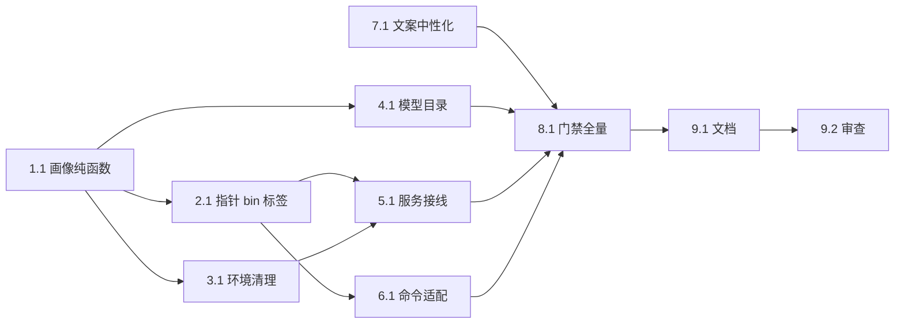

# 实现计划

> 执行约束（来自 jojo-specs workflow）：
>
> - 一次只实现一个任务；子任务存在时优先做子任务
> - 完成后立即更新本文档对应任务状态再停止，等待评审
> - 仅在用户明确要求时运行测试
> - 任务编号即为推荐执行顺序，按依赖关系自上而下递进
> - 测试驱动：每个含 `.ts` 产出的子任务先写失败用例，再实现至通过（红-绿-重构）
>
> **测试覆盖率约束：**
>
> - 本项目为 Node CLI 服务（非前端 / 非 NestJS / 非 Java 栈）。本 feature 新增或被触达且纳入 `vitest.config.ts` `coverage.include` 白名单的 `.ts` 源文件，单元测试 **Lines 覆盖率必须 ≥ 95%**
> - 本期纳入门禁的新增/触达文件：`src/bridge/backend.ts`（新增，8.1 扩容白名单）；既有 `config.ts` / `qoder.ts` / `service.ts` / `bridge/commands/{status,sessions,switch,rename}.ts` / `failure.ts` / `sessions.ts` 已在白名单，触达后不得拉低覆盖率；`models.ts` 不在既有白名单（沿用现状，不扩大门禁），但仍补单测
> - Statements / Functions / Branches 作为辅助指标，以项目既有 vitest 约定为准；未达辅助指标时在风险点说明原因与影响
> - **单测编写遵循项目既有测试约定**：测试位于 `test/unit`、`test/integration`，命名与 Mock 复用照既有风格（命令处理器走 `dispatchCommand` + makeCtx 范式）；本 workflow 不重复定义用例规范
> - 验证口径：在 PR 说明里附覆盖率验证命令与输出；Lines 未达 95% 须在对应单测任务补齐用例后再关闭
>
> **提交约束：**
>
> - 每完成一个子任务（对应一个 [x] 的子任务条目）后，不自动执行 git commit；如需提交，必须由用户后续明确触发，并按 jojo-specs skill 的 references/phase-5-commit.md 执行
> - 主人已确认采用**合并提交**：文档 + 代码 + 单测合并，全部子任务完成并审查后再由主人触发提交；无关清理可按主人点名先单独提交（精确 add）
> - Commit 流程严格遵守 workflow 的所有步骤：收集改动 → 识别 type / scope → 生成 `type(scope): summary refs #issue-id` → 执行 `git commit`
> - `scope` 优先取本任务主要改动目录的模块名；如跨多个模块，取变动最大者
> - `issue-id` 从当前分支名末段提取：开发分支 `feat/20261119-cli-backend-compat`，个人仓用 `20261119` 作 issue-id（`refs #20261119`）
> - 本规则**从第一个待执行任务起生效**
>
> **任务详情拆分约定：**
>
> - 本文档只保留任务状态、进度与索引；每个子任务的完整内容（目标 / 实现要点 / 引用 / 验证命令 / 验收 / 将写入）下钻到 `task-list/` 目录对应文件
> - 勾选 `[x]` / `[ ]` 状态仅在本文档维护；`task-list/` 文件内不再重复状态字段

---

## 概览

共 **9 个任务组 / 10 个子任务**。把已批准设计（后端画像纯函数 + 会话 bin 标签 + 环境清理 + 模型目录 + 服务/命令接线 + 文案中性化）拆成测试驱动的增量步骤。

- **T1 画像基座**（1.1）：`backend.ts` 纯函数先行，零依赖、易测，是后续全部改动的地基。
- **T2 指针标签**（2.1）：`SessionRecord.bin?` + `activeSession` 过滤 helper（D1 kind 比较），依赖 T1。
- **T3 环境清理**（3.1）：`cleanEnv` 双前缀剥离 + 按后端记忆开关 + fixture `env-probe`，依赖 T1；与 T2/T4 不同文件，可并行。
- **T4 模型目录**（4.1）：`models.ts` 按后端取配置目录，依赖 T1；独立文件。
- **T5 服务接线**（5.1）：`service.ts` 指针过滤/写 bin/切换日志/启动日志画像，依赖 T2+T3。
- **T6 命令适配**（6.1）：status/sessions/switch/rename 四处理器小改，依赖 T2。
- **T7 文案中性化**（7.1）：failure.ts/sessions.ts 用户文案，与主线解耦，无硬前置。
- **T8 门禁与全量验证**（8.1）：coverage.include 扩容 + typecheck/build/test/coverage/pack 全量。
- **T9 文档与审查**（9.1–9.2）：README/RUNBOOK 回填 + 覆盖式 review.md。

**关键拆分原则**：纯函数地基最先（风险早暴露）；指针/环境/模型三条线互不写同一文件，T1 后可并行；服务接线依赖指针与环境就绪；文案独立解耦；门禁、文档、审查放后段。

**执行模式（主人既有偏好）**：本计划批准后连续执行全部子任务，不在每个子任务后停顿等催；测试随 TDD 红-绿循环即时运行（属主人既定工作流要求）；验收由 agent 跑本地命令，主人只做 CN 登录/微信真人步骤；全部完成后统一审查再触发合并提交。

**范围说明**：CN 登录后的真机验收（设计 §8.3）属用户验收，不在本任务清单；review.md 登记其待办状态。插件壳无新增命令，无需变更（设计 §11）。

## 执行顺序总览

任务采用**严格线性顺序**，编号即执行顺序。下表列出全部 10 个子任务与关键依赖、预期产出（点击"任务"列链接查看完整任务内容）：

| 顺序 | 任务 | 摘要 | 硬前置 | 产出类型 |
| ---: | --- | --- | --- | --- |
| 1 | [**1.1**](./task-list/1.1-backend-profile.md) | backend.ts 画像纯函数 + 单测 | — | TS 模块 + 单测 |
| 2 | [**2.1**](./task-list/2.1-session-bin-tag.md) | SessionRecord.bin + activeSession + 单测 | 1.1 | TS 修改 + 单测 |
| 3 | [**3.1**](./task-list/3.1-clean-env-backend.md) | cleanEnv 双前缀/按后端开关 + env-probe fixture | 1.1 | TS 修改 + 夹具 + 单测 |
| 4 | [**4.1**](./task-list/4.1-models-config-dir.md) | models.ts 配置目录按后端 + 单测 | 1.1 | TS 修改 + 单测 |
| 5 | [**5.1**](./task-list/5.1-service-pointer-wiring.md) | service 指针过滤/写 bin/日志 + 单测 | 2.1, 3.1 | TS 修改 + 单测 |
| 6 | [**6.1**](./task-list/6.1-commands-backend.md) | 四命令处理器适配 + 单测 | 2.1 | TS 处理器 + 单测 |
| 7 | [**7.1**](./task-list/7.1-wording-neutral.md) | failure/sessions 文案中性化 + 断言同步 | — | TS 修改 + 单测 |
| 8 | [**8.1**](./task-list/8.1-coverage-full-verify.md) | coverage 扩容 + 全量验证 | 4.1, 5.1, 6.1, 7.1 | 配置 + 验证产物 |
| 9 | [**9.1**](./task-list/9.1-docs-backfill.md) | README/RUNBOOK 回填 | 8.1 | 文档 |
| 10 | [**9.2**](./task-list/9.2-review.md) | 覆盖式 review.md | 9.1 | 审查文档 |

### 关键依赖链

- `1.1 → 2.1/3.1/4.1`：三条消费线都依赖画像纯函数
- `2.1 + 3.1 → 5.1`：服务接线需要指针过滤与按后端 env 就绪
- `2.1 → 6.1`：命令处理器用 activeSession 与 bin 写入
- `4.1 + 5.1 + 6.1 + 7.1 → 8.1`：全量门禁在全部代码改动后
- `8.1 → 9.1 → 9.2`：文档与审查收尾

### 并行化提示（仅供加速参考，默认仍单任务串行）

- **2.1 / 3.1 / 4.1 / 7.1** 写不同源文件，1.1 完成后相互独立，可合并为一次编辑批次
- **6.1** 只依赖 2.1，可与 3.1/4.1 并行
- **同一文件内的多个子任务** 必须严格串行：本计划无同文件跨子任务冲突（config.ts 仅 2.1、qoder.ts 仅 3.1、service.ts 仅 5.1）

---

## 任务清单（状态 · 进度）

> 勾选 `[x]` 表示已完成，`[ ]` 表示未完成。点击任务编号进入 `task-list/` 中的完整任务说明。

## T1. 画像基座

- [x] **1.1** [backend.ts 画像纯函数 + 单测](./task-list/1.1-backend-profile.md)

## T2. 会话指针 bin 标签

- [x] **2.1** [SessionRecord.bin + activeSession + 单测](./task-list/2.1-session-bin-tag.md)

## T3. 环境清理与记忆开关

- [x] **3.1** [cleanEnv 双前缀/按后端开关 + env-probe fixture](./task-list/3.1-clean-env-backend.md)

## T4. 模型目录按后端

- [x] **4.1** [models.ts 配置目录按后端 + 单测](./task-list/4.1-models-config-dir.md)

## T5. 服务层接线

- [x] **5.1** [service 指针过滤/写 bin/日志 + 单测](./task-list/5.1-service-pointer-wiring.md)

## T6. 命令处理器适配

- [x] **6.1** [四命令处理器适配 + 单测](./task-list/6.1-commands-backend.md)

## T7. 文案中性化

- [x] **7.1** [failure/sessions 文案中性化 + 断言同步](./task-list/7.1-wording-neutral.md)

## T8. 门禁与全量验证

- [x] **8.1** [coverage 扩容 + 全量验证](./task-list/8.1-coverage-full-verify.md)

## T9. 文档与审查

- [x] **9.1** [README/RUNBOOK 回填](./task-list/9.1-docs-backfill.md)
- [x] **9.2** [覆盖式 review.md](./task-list/9.2-review.md)

---

这些任务内容是否已经合适？